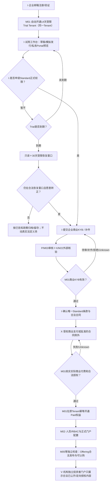

# RWA SaaS｜Step05-01 可视化业务与字段PRD草案：企业注册、14天Trial、商业KYB及Standard转正

> **Draft v0.1｜等待产品负责人按场景审核**（2026-10-25）。本稿是**Step05第一场景的审阅底稿**，不是已批准的字段级PRD，也不批准任何UI代码或生产KYB/支付接入。不得重审/变更DEC-019已Approved的14天受限试用、正式商业付款前KYB、唯一Standard套餐、30天恢复窗口及原Tenant升级原则。依据[DEC-028条件认可范围](../../decisions/DEC-028-step04-cross-audit-conditional-acceptance-and-step05-visual-review.md)与[Step02 v0.4勘误版](../04-business-workflows/RWA-SaaS-Step-02-Four-Lane-Core-Flow-DEC019-Onboarding-Corrected-v0.4-Draft.md)。

## 1. 一张图看懂：从第一次注册到正式付费

**重要**：图是用户场景的逻辑表达，不意味着可以无限次重试支付、审核拒绝即可马上反复提交，也不等于试用到期自动删除；所有重试必须遵守M01/M17/M20已经批准的受控规则及Step05后续字段审定。

## 2. 从使用者角度审核七个连续页面/环节

| 顺序 | 企业用户（I）看到/操作 | 平台后台（P）职责 | 外部服务（X） | 投资者端（V） |
|---|---|---|---|---|
| ① 注册 | 邮箱验证、账户安全；无需KYB或银行卡 | M01幂等建立试用Tenant，M02初始化管理员 | 必要身份/邮件验证 | 无正式真实账户或Offering可购买入口 |
| ② 试用 | 14天剩余、受限资产/发行草稿、模拟资金和私有Portal预览 | M01/M19强制Trial Guard、M20 Tenant隔离 | Sandbox/模拟服务 | 仅获授权的内部测试预览，不是真实投资者注册购买 |
| ③ 企业KYB | 提交商业买方企业/代表/必要证明、查看补件和审核 | M03-F001受权审查和复核；M01保存商业KYB权威结果 | M22-F001适格Provider验证、结果引用 | 不与投资者个人KYC混同 |
| ④ Standard与合同 | 查看唯一Standard套餐、使用权益、合同及可选合法企业合同例外 | M01合同/权益条件与受权例外核对 | 必要合法电子签/商业付款提供者 | 无变化 |
| ⑤ 实际商业付费 | 受权付款、失败/Unknown查询、收据及授权更新 | 只在证据满足时由M01转Paid；M03受权处理异常 | 商业PSP/实际付款证据，不是投资者USDT/USDC认购款 | 无变化 |
| ⑥ 转正 | 仍用原组织/Tenant进入正式工作台；可以配置成员及标准门户 | M01-F004/F005/F006幂等升权，M03服务状态及开通故障处理 | 生产外部服务仍独立启用 | Issuer正式门户实例准备中，Offering未合法发布不得认购 |
| ⑦ Offering正式发布 | M04/M05/M06/M07等独立审查合法发行、资金和Signer | 只提供商业/技术受权支持 | X适格发行/法律/实际资金及签名方 | 依法允许的Offering正式展示及按资格购买 |

## 3. 四类最重要的业务对象及跨端真值

| 核心对象（建议命名，未冻结schema） | 唯一业务主责 | I端查看 | P端查看/操作 | 严禁误判 |
|---|---|---|---|---|
| **SaaSCustomer / CommercialApplicant** | M01；商业审核M03 | 企业名称、合法联系人、KYB进度 | 商业客户和KYB审核队列 | SaaS买方＝实际Instrument法律发行人 |
| **Tenant / TenantEntitlement** | M01；M19能力Guard | Trial剩余天数、受限额度、Paid权限 | 租户开通、暂停、恢复、审计 | TrialActive＝金融生产可用 |
| **KYBCase / VerificationEvidence** | M01商业KYB结论；M22外部核验，M03操作 | 补件、Verified或Rejected | 合法访问摘要/受权文档、复核 | Provider200/身份通过＝具体金融Offering合规 |
| **CommercialSubscription / CommercialPayment** | M01及真实商业付款方 | Standard条款、账单及付费结果 | 商业授权、证据核对、异常升级 | PaymentSubmitted/Unknown＝Paid/Token可发行 |

投资者门户V的独立URL是**M01-F009门户实例**；只有Issuer正式商业授权和M05 Offering合法发布同时允许时，M08才可向相应投资者展示真实受权Offering。该数据不复制成M03运营数据主账。

## 4. 业务状态表：各对象独立，不使用一个万能Status

| 对象 | 建议状态类别（字段未冻结） | 允许进入下一步的条件 | 异常处理 |
|---|---|---|---|
| 邮箱/用户 | Registered → EmailVerified → Active | 邮箱已有效验证 | 账号重复、验证失效/未知→受控恢复 |
| Tenant | TrialProvisioning → TrialActive → TrialExpiredReadOnly／PaidActive／PaidRestricted | M01创建唯一Tenant；Paid必须基于KYB+合同+商业付费 | Provisioning Unknown先查询原Tenant；Trial到期只读+30天恢复 |
| 商业KYB | NotSubmitted → Pending/NeedsInfo/Review → Verified 或 Rejected/Expired/Unknown | 必要商业主体核验有效且有权接受 | 外部Unknown不放行；补件不是默认通过 |
| 商业合同 | Draft/Presented → Accepted/Effective 或 Expired/Disputed | 企业合法受权代表同意正确版本 | 合同争议/签署Unknown待核 |
| 商业支付 | NotStarted → Submitted → Paid/Failed/Unknown/RefundPending | 商业回执与合同/权益匹配 | Unknown不重复扣费；人工例外需正式证据 |
| 正式生产资格 | **与Paid单独**：Offering/Instrument法域、资金、登记、Signer等独立Guard | M04/M05/M06/M07/M11/M12及X各自合法条件均通过 | 订阅付费不能越权触发真实资金/Token |

## 5. 本场景必须检查的异常

| 编号 | 情况 | 预期产品结果 |
|---|---|---|
| A01 | 注册验证完成但自动Tenant开通超时 | M01查询原幂等创建意图，不能直接创建第二个Tenant |
| A02 | 企业已在Trial、尚未KYB | 正常受限试用，不强制提交KYB才能进入工作台 |
| A03 | Trial模拟项目已展示门户预览 | 不调用生产KYC、真实钱包Sign、收款/Mint；不允许真实公众购买 |
| A04 | KYB外部核验Unknown或需要补件 | P后台队列和I补件保持真实进度，不放行正式订阅付款 |
| A05 | KYB已通过，Standard支付Unknown | 不能赋Paid、不得二次重复扣费，先核商业PSP原指令 |
| A06 | 商业付款成功、Tenant升权失败 | 同一Tenant恢复权益、保留真实付款证据，不重复新建 |
| A07 | Trial到期、30天内补KYB并付费 | 在原Tenant合法恢复转正，清理模拟到生产数据的非法混入 |
| A08 | 已发生真实资产发行的Paid机构欠费或停服 | 禁止非法新业务，保留合法投资者查询、未付债务/资金及交接义务 |
| A09 | Issuer门户已发布但Offering未合法公开或开放 | 投资者不能绕过M05/M09的展示和购买资格检查 |
| A10 | 已取得Standard商业授权 | 不自动开通外部真实KYB、Signer、登记与收款生产凭证 |

本节为后续Step05验收草案，不是运行测试结论。

## 6. 字段级PRD待补清单（下一版再细化，不是本次已审核字段）

| 域 | 仍需定义的字段/精度 | 预期真实拥有者 |
|---|---|---|
| Tenant | id、commercialCustomerId、trialActivatedAt、trialExpiresAt、graceEndsAt、entitlementVersion、suspensionReason、statusEvidence | M01/M19/M20 |
| KYBCase | applicantLegalEntityId、authorizedRepresentative、providerReference、evidenceVersion、reviewerId、recheckAt、decisionReason、resultFinality | M01/M03/M22 |
| CommercialPayment | subscriptionIntentId、termsVersion、paymentProviderId、originalPaymentId、amount/currency、paymentFinality、refundReference、authorizationEvidence | M01/商业X |
| Portal | tenantId、portalInstanceId、previewOnly、visibilityScope、offeringPublishedGate、publishedVersion | M01-F009／M05 |
| TenantOps | actionIntentId、actor/approver、targetTenantId、reason、before/after、resultUnknown、auditReference | M03／M17／M20 |

**注意**：上表是待产品与技术进一步审核的字段候选，不是已冻结Schema/枚举。税务、资质、反试用滥用、防退款争议、KYB服务法域、客户撤销/公司代表变更等专门情况在Step05继续展开。

## 7. 给产品负责人的可视化审核重点（本稿仍Draft）

此场景已批准的原则无需重新选择A/B。下一轮只需判断：
- **画面与使用流程**：从官网注册、Trial仪表盘、企业KYB向导、Standard收费到Paid工作台的顺序是否直观。
- **角色及交接**：P后台对商业KYB和Tenant开停有操作权限，I客户端办理本机构资料及订阅，V只接触合法发布的数据，X提供受权真实证据。
- **疑难场景**：14天到期30天受限恢复、付款Unknown、已有真实发行的客户退租时还能合法查询/兑付。

**建议保留本Step05-01为Draft，用户核对上述三点后，再正式形成字段/状态/页面层面的Approved版及后续Step05-02发行至投资者展示场景。**

本稿不触碰四份Frozen、现有DEC/SCOPE/193项版号，不修改PR #6，也不授权UI、代码或真实生产资金/Token执行。
