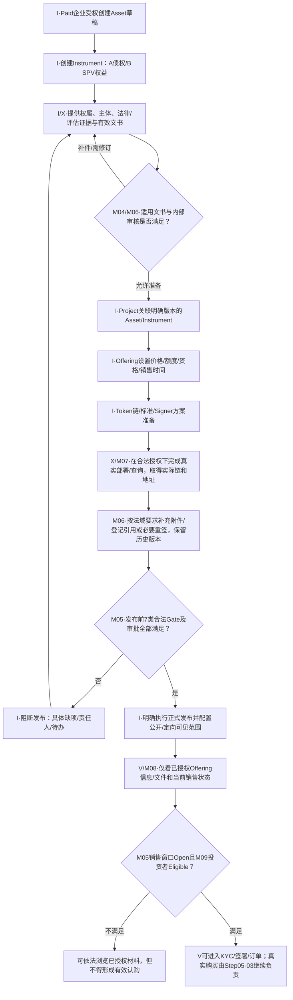

# RWA SaaS｜Step05-02 可视化产品审核：Asset → Instrument/法律文件 → Project/Offering → Token → 投资者门户（Draft v0.1）

> **状态：Draft / Pending Product Owner Review（2026-10-25）**。本文件仅启动Step05-02的场景式产品审阅，**不得自动将05-02-R01～R04记为Approved**；已有DEC-020/021/022/025的Step04原则继续Approved。字段、接口、页面路由、UI图稿、法域授权/真实Signer等均未获本轮批准。Step05-01七项产品级规则已由DEC-029/030全部Approved；技术字段仍Draft。

**现行依据**：[S04-02资产/Instrument/法律文件Approved](RWA-SaaS-Step-04-S04-02-Issuer-Asset-Instrument-Documents-Approved-v0.1.md)｜[S04-03 Project/Offering/Token Approved](RWA-SaaS-Step-04-S04-03-Issuer-Project-Offering-Token-Approved-v0.1.md)｜[S04-07投资者门户Approved](RWA-SaaS-Step-04-S04-07-Issuer-Investor-Portal-Approved-v0.1.md)｜[DEC-022法定登记/Token地址文书后绑定](../../decisions/DEC-022-step04-s0404-investor-subscription-allocation-registration-approved.md)｜[DEC-019商业Trial守卫](../../decisions/DEC-019-step04-s0401-trial-kyb-subscription-supplement-approved.md)。

## 一、先看真实发行流程（四端）

**图中顺序是示意不是强制“所有法域必须先部署后签署”**：需按具体Instrument、文件法律效力及Signer权限选择合法时序；如果先部署不合法，则在未获受权之前不得调用真实部署。正式发布条件失败时应按缺项退回相应业务环节，而非每次都退回全部资产建档。

## 二、P/I/V/X四端具体工作与数据交接

| 业务阶段 | I 企业工作台入口/操作 | P SaaS后台 | V 投资者门户 | X 实际有权主体及唯一真值 |
|---|---|---|---|---|
| ① Asset与证据 | Asset建档、资产分类、控制权证据、提交复核 | 仅商业Tenant可用性/受权支持 | 不展示未依法批准的内部Asset草稿 | M04资产及版本，M06正式文件，外部产权/适格证据X |
| ② Instrument | 选A债权/B SPV权益合法模板、主体/经济权利/转让限制、送审 | 不因SaaS商业KYB而批准金融工具 | 不展示未审法定权利；之后展示经批准的权利摘要 | M04 InstrumentVersion唯一法律权利描述，适格律师/法定责任方X |
| ③ Project/Offering | Project可关联明确版本，建立多个Offering轮次，设置价格/额度/销售资格与窗口 | 不默认审批证券发行 | 试用仅私有模拟预览；真实未发布不可凭直链查询 | M05发布/销售条件与状态，M12容量，M19准入规则 |
| ④ Token准备 | 选择受支持链/标准、Token与法定权利映射，受权提交部署 | 不能代替Issuer/外部Signer控制密钥 | 公告中Token链/地址仅引用真实可验证版本 | M07方案/执行与链上证据，M22节点，X合法Signer |
| ⑤ 法律文书绑定 | 关联经批准法律/风险文件，按法域对部署后实际合约地址进行有效补充/重签等 | 仅受权系统安全审计 | 只能查看合法有效且与当前Offering版本一致的文书 | M06正式文件与有效签署证据；M04权利；M07合约地址；有权X法务 |
| ⑥ 发布前检查 | 展示未通过Gate、负责人、补件和内部审批；具备条件后明确发布 | SaaS后台不自动给证券发行许可 | 已发布/未开售可依法展示指定信息，不自动启用购买 | M05唯一正式发布与可见事实，M01商业Guard，M09资格/通用X法律Gate |
| ⑦ 投资者查询 | Issuer查看门户预览、公开/定向访问及当前销售状态 | Tenant及安全管控 | M08显示Issuer名称、权益/风险、价格/日期、法律文书、Token说明及购买条件 | M08仅视图消费M04/M05/M06/M07的数据；不自建另一套资产/权利账 |

**重要边界**：SaaS客户、Issuer法律发行主体、Asset实际控制方、SPV、法定名册持有人及Token接收钱包不自动是同一个实体。企业购买Standard并不授予某个Instrument公开募集、募集款托管或Mint权限。

## 三、四种必须区分的状态（禁止一个Published覆盖全部）

| 事实 | 状态语义（先按产品语言） | 唯一事实来源 | V端应如何处理 |
|---|---|---|---|
| Asset/Instrument审查 | 草稿、审核中、需补件、内部可用、需重新审 | M04 + M06相应版本 | 内部审核完成不代表可以向投资者公开 |
| Token部署/法定地址绑定 | 方案草稿、待授权、链上待核、真实部署已核、文书待绑定/已有效绑定 | M07链事实＋M06法律文件 | 合约已部署不自动显示“发行完成” |
| Offering披露/可见 | Draft、ApprovedNotPublished、PublishedNotOpen、Published/Open、Paused、ClosedForSubscriptions（引用既有语义） | M05/访问授权 | 未发布不公开；已发布未开售可依法查看但不可购买；暂停/关闭不可新增认购 |
| 当前投资者认购资格 | 未KYC、已核验、当前Offering资格不满足/满足 | M09 + Offering规则 | 可以合法浏览不等于可购买；资格审查在下单前独立发生 |

上表的英文状态来自Step04功能设计，具体数据库枚举和各状态迁移条件仍为Step05后续Draft，不在此自动冻结。

## 四、投资者详情页信息从哪里来（避免两个端重复数据）

| 信息 | 来源 | 用户可见条件 |
|---|---|---|
| Issuer名称、Logo、门户条款 | M01 Issuer Portal | 正式发布或合法受权私有预览 |
| Asset概览、Instrument权利类型 | M04经审版本 | 合法Offering可披露的内容；SPV权益不等于直接持有Asset |
| 法定发行主体/风险 | M04/M06权威版本 | 法定文书有效且可向受权读者披露 |
| Offering价格、额度、窗口、销售状态 | M05唯一版本 | 不得将Project总状态取代单轮Offering |
| Token链/合约地址/真实状态 | M07经核验引用 | 不得把测试合约/待部署计划展示为真实已部署 |
| 合法文件、签署要求 | M06正式文件与M22适用电子签 | 受权版本，文件变更必须版本追溯 |
| 可购买/资格提示 | M05 + M09/M19 | KYC成功不等于特定Offering Eligible |
| 已购及后续持仓 | M10/M11/M12/M07/M13 | 本场景只定义后续链接，实际履约见Step05-03/04 |

## 五、失效与异常最小保护

| 例外 | 现行产品必须避免的错误 | 后续详细PRD应定义 |
|---|---|---|
| Asset已内部通过但缺专业法律凭证 | 自动公开Offering | 具体需要的批准版本/原因码/责任人 |
| Instrument条款被重大修改 | 无版本处理即覆盖旧披露 | 旧/新Instrument与文件、Offerings的引用及影响 |
| 有真实链合约地址但正式文书未合法绑定 | 自动允许募集/购买 | 法域条件、补充附件/重签/合法引用方式 |
| Offering已审核但尚未发布 | V端深链绕过公开披露Guard | 路由/权限与访问可见控制 |
| 已发布但未到开售时刻 | “购买”可直接下单 | 时间窗口/资格/合同Guard |
| Offering暂停或关闭，有历史已付款订单 | 页面删单/错误退款/权益消失 | M10/M11/M12在途订单及法律义务处理 |
| Token节点返回Unknown | 默认部署成功或重复部署 | M07/M22原Tx查询及版本绑定 |
| Issuer调整募集金额/条款 | 自动修改已签报价或合同 | M05/M06/M10旧版本与必须重签/通知的法域门 |
| Trial模拟Offering被Paid升级 | 自动发布正式投资者门户 | R06重新审查合法草稿和所有真实发布Gate |

## 六、仅用于本场景审阅的四个细化问题（**全部Draft，未获用户审批**）

| 提案ID | 细化建议A | 问题 |
|---|---|---|
| **Step05-02-R01** | **Offering公开信息可见与“能否下单”分两个可独立展示的标志**：已正式发布但未开售或暂停，依法可浏览获授权披露资料；按钮不允许产生有效订单，具体定向/私密项目仍按权限隐藏 | 是否同意在V端显式区分“已披露”“可认购”？ |
| **Step05-02-R02** | **发布清单在Issuer端采用缺项式Gate检查**：展示每项必要条件的责任模块、已满足/待补、跳转处理入口；通过审批后仍需有权发布动作，不能凭内部审核自动上架 | 是否按“缺项清单→修复→受权发布”展示？ |
| **Step05-02-R03** | **Investor详情页把Instrument的法定权益说明置于Token技术说明之前**，A债权显示合法本息/期限，B SPV权益显示真实持有的SPV权益与合法分配/限制，不误宣传“直接持有底层资产” | 是否按“法律权益→收益和风险→认购条款→Token信息”组织详情？ |
| **Step05-02-R04** | **发行条款/正式文书/合约地址发生必要变更时，保留已发布历史快照并标识当前版本**；对受影响投资者/在途订单明确“可继续/需重新确认/暂停”状态，不简单整体覆盖 | 是否按“历史快照＋差异影响＋必要通知/再确认”设计变更体验？ |

R01～R04属于对已Approved上游原则的**页面/跨端使用细化候选**；用户不接受时仍不得触碰此前DEC的必须守卫或合法权利记录，不因此新增正式功能ID。

## 七、进入字段级PRD前仍待决的事项

- 首发具体法域/Instrument合法发行条件、A债权与B SPV权益适用文书/精度/主体关系与资格；
- 实际收款主体、是否依法须指定登记人/集中募集、Token部署权限、Signer与合约地址合法绑定，具体供应商与密钥方案；
- Offering正式发布、可见与可认购的确切字段、权限Guard、时间窗格式、状态/API错误码；
- 条款重大变更的法律通知/重新签约条件；法定文件版本哈希/可见授权字段；真实链终局及异常对账；
- Step05-01已批准的R06草稿复用边界在本场景逐Asset/Instrument/Offering审定；**不将任何模拟业务事实变成生产结果**。

**本稿状态：Step05-02 Visual PRD Draft v0.1，R01～R04全部待审核。未创建正式批准DEC；不更新任何Frozen或旧Approved，PR #6仍Draft/Open/Unmerged，未进行UI或代码开发。**
