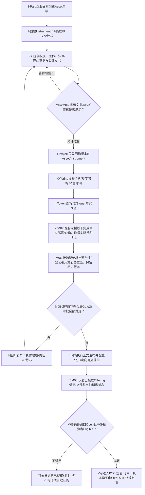

# RWA SaaS｜Step05-02 产品级详细PRD：资产、金融工具、Offering、Token及投资者展示（Approved v0.2）

> **2026-10-25｜Approved仅限用户明确批准的Step05-02-R01～R04四项产品业务规则，以及继承的Step04已批准功能原则。** 当前65项Step05-01字段候选不因此变化；本文件新增任何字段名称、数据库schema、API/事件、技术状态码、法域合法性判断、真实资金/Signer方案与测试结果均**Draft/Not Executed**。本PRD不是UI开发授权或V1.0整体Frozen。

[DEC-031正式批准](../../decisions/DEC-031-step05-02-r01-04-offering-visibility-publishing-disclosure-versioning-approved.md)｜[原Step05-02 v0.1可视化草案（历史Draft）](RWA-SaaS-Step-05-02-Issuer-Asset-Instrument-Offering-Token-Investor-Visibility-Visual-PRD-Draft-v0.1.md)｜[S04-02批准版](RWA-SaaS-Step-04-S04-02-Issuer-Asset-Instrument-Documents-Approved-v0.1.md)｜[S04-03批准版](RWA-SaaS-Step-04-S04-03-Issuer-Project-Offering-Token-Approved-v0.1.md)｜[S04-07投资者门户批准版](RWA-SaaS-Step-04-S04-07-Issuer-Investor-Portal-Approved-v0.1.md)｜[DEC-022地址文书绑定](../../decisions/DEC-022-step04-s0404-investor-subscription-allocation-registration-approved.md)

## 零、四项产品业务规则Approved的精确范围

| 决策编号 | 产品行为（Approved） | 仍保留Draft的范围 |
|---|---|---|
| **R01** 可见与可认购状态分离 | M05决定对该访问者可否合法披露，M05销售窗口和M09当前Offering资格另判断是否可认购；依法可见的未开售/暂停/停售不允许新有效订单；未发布、私密、定向和无权深链严格阻断。 | 匿名/定向法域具体规则、实现字段和访问缓存 |
| **R02** Issuer端按P-01～P-07缺项检查后受权发布 | 每项必要Gate显示是否满足、缺项、受权责任及处理入口；即使内部已审核完成，仍须有权人员明确发布，不凭Paid、Token部署或内部资产审核自动上架。 | 具体法域条件、生产执行Signer、真实资金或登记资格 |
| **R03** 投资者详情先展示法定权益与风险，后展示Token | 合法主体及Instrument权益→真实收益条件/风险→Offering条款与有效法律披露→Token技术信息；A债权与B SPV权益分述，SPV权益不虚构底层资产直接产权、固定分红或保证回购。 | UI视觉布局、实际法定披露精度和合同适用条款 |
| **R04** 历史快照、差异影响与适用再确认 | Offering条款、有效文书及必要Token地址变更，必须保留旧披露/Quote/签署关联，做旧/新版本与受影响人订单分析并按法域确认可继续、需重签/通知或暂停；不可静默覆盖旧权益。 | 通知法定送达、合约升级与变更技术策略、哪种变更依法须重新签署 |

所有状态与页面内容都应以M04/M05/M06/M07/M09等**各自唯一真实权威**为来源，M08仅负责依法授权展示；试用草稿升Paid须遵循Step05-01 R06重新核验生产Gate，不能直接发布。P平台工作人员不自动享有证券发行审批、合法资金持有人或Signer身份。

## 一、先看真实发行流程（四端）

**图中顺序是示意不是强制“所有法域必须先部署后签署”**：需按具体Instrument、文件法律效力及Signer权限选择合法时序；如果先部署不合法，则在未获受权之前不得调用真实部署。正式发布条件失败时应按缺项退回相应业务环节，而非每次都退回全部资产建档。

## 二、P/I/V/X四端具体工作与数据交接

| 业务阶段 | I 企业工作台入口/操作 | P SaaS后台 | V 投资者门户 | X 实际有权主体及唯一真值 |
|---|---|---|---|---|
| ① Asset与证据 | Asset建档、资产分类、控制权证据、提交复核 | 仅商业Tenant可用性/受权支持 | 不展示未依法批准的内部Asset草稿 | M04资产及版本，M06正式文件，外部产权/适格证据X |
| ② Instrument | 选A债权/B SPV权益合法模板、主体/经济权利/转让限制、送审 | 不因SaaS商业KYB而批准金融工具 | 不展示未审法定权利；之后展示经批准的权利摘要 | M04 InstrumentVersion唯一法律权利描述，适格律师/法定责任方X |
| ③ Project/Offering | Project可关联明确版本，建立多个Offering轮次，设置价格/额度/销售资格与窗口 | 不默认审批证券发行 | 试用仅私有模拟预览；真实未发布不可凭直链查询 | M05发布/销售条件与状态，M12容量，M19准入规则 |
| ④ Token准备 | 选择受支持链/标准、Token与法定权利映射，受权提交部署 | 不能代替Issuer/外部Signer控制密钥 | 公告中Token链/地址仅引用真实可验证版本 | M07方案/执行与链上证据，M22节点，X合法Signer |
| ⑤ 法律文书绑定 | 关联经批准法律/风险文件，按法域对部署后实际合约地址进行有效补充/重签等 | 仅受权系统安全审计 | 只能查看合法有效且与当前Offering版本一致的文书 | M06正式文件与有效签署证据；M04权利；M07合约地址；有权X法务 |
| ⑥ 发布前检查 | 展示未通过Gate、负责人、补件和内部审批；具备条件后明确发布 | SaaS后台不自动给证券发行许可 | 已发布/未开售可依法展示指定信息，不自动启用购买 | M05唯一正式发布与可见事实，M01商业Guard，M09资格/通用X法律Gate |
| ⑦ 投资者查询 | Issuer查看门户预览、公开/定向访问及当前销售状态 | Tenant及安全管控 | M08显示Issuer名称、权益/风险、价格/日期、法律文书、Token说明及购买条件 | M08仅视图消费M04/M05/M06/M07的数据；不自建另一套资产/权利账 |

**重要边界**：SaaS客户、Issuer法律发行主体、Asset实际控制方、SPV、法定名册持有人及Token接收钱包不自动是同一个实体。企业购买Standard并不授予某个Instrument公开募集、募集款托管或Mint权限。

## 三、四种必须区分的状态（禁止一个Published覆盖全部）

| 事实 | 状态语义（先按产品语言） | 唯一事实来源 | V端应如何处理 |
|---|---|---|---|
| Asset/Instrument审查 | 草稿、审核中、需补件、内部可用、需重新审 | M04 + M06相应版本 | 内部审核完成不代表可以向投资者公开 |
| Token部署/法定地址绑定 | 方案草稿、待授权、链上待核、真实部署已核、文书待绑定/已有效绑定 | M07链事实＋M06法律文件 | 合约已部署不自动显示“发行完成” |
| Offering披露/可见 | Draft、ApprovedNotPublished、PublishedNotOpen、Published/Open、Paused、ClosedForSubscriptions（引用既有语义） | M05/访问授权 | 未发布不公开；已发布未开售可依法查看但不可购买；暂停/关闭不可新增认购 |
| 当前投资者认购资格 | 未KYC、已核验、当前Offering资格不满足/满足 | M09 + Offering规则 | 可以合法浏览不等于可购买；资格审查在下单前独立发生 |

上表的英文状态来自Step04功能设计，具体数据库枚举和各状态迁移条件仍为Step05后续Draft，不在此自动冻结。

## 四、投资者详情页信息从哪里来（避免两个端重复数据）

| 信息 | 来源 | 用户可见条件 |
|---|---|---|
| Issuer名称、Logo、门户条款 | M01 Issuer Portal | 正式发布或合法受权私有预览 |
| Asset概览、Instrument权利类型 | M04经审版本 | 合法Offering可披露的内容；SPV权益不等于直接持有Asset |
| 法定发行主体/风险 | M04/M06权威版本 | 法定文书有效且可向受权读者披露 |
| Offering价格、额度、窗口、销售状态 | M05唯一版本 | 不得将Project总状态取代单轮Offering |
| Token链/合约地址/真实状态 | M07经核验引用 | 不得把测试合约/待部署计划展示为真实已部署 |
| 合法文件、签署要求 | M06正式文件与M22适用电子签 | 受权版本，文件变更必须版本追溯 |
| 可购买/资格提示 | M05 + M09/M19 | KYC成功不等于特定Offering Eligible |
| 已购及后续持仓 | M10/M11/M12/M07/M13 | 本场景只定义后续链接，实际履约见Step05-03/04 |

## 五、失效与异常最小保护

| 例外 | 现行产品必须避免的错误 | 后续详细PRD应定义 |
|---|---|---|
| Asset已内部通过但缺专业法律凭证 | 自动公开Offering | 具体需要的批准版本/原因码/责任人 |
| Instrument条款被重大修改 | 无版本处理即覆盖旧披露 | 旧/新Instrument与文件、Offerings的引用及影响 |
| 有真实链合约地址但正式文书未合法绑定 | 自动允许募集/购买 | 法域条件、补充附件/重签/合法引用方式 |
| Offering已审核但尚未发布 | V端深链绕过公开披露Guard | 路由/权限与访问可见控制 |
| 已发布但未到开售时刻 | “购买”可直接下单 | 时间窗口/资格/合同Guard |
| Offering暂停或关闭，有历史已付款订单 | 页面删单/错误退款/权益消失 | M10/M11/M12在途订单及法律义务处理 |
| Token节点返回Unknown | 默认部署成功或重复部署 | M07/M22原Tx查询及版本绑定 |
| Issuer调整募集金额/条款 | 自动修改已签报价或合同 | M05/M06/M10旧版本与必须重签/通知的法域门 |
| Trial模拟Offering被Paid升级 | 自动发布正式投资者门户 | R06重新审查合法草稿和所有真实发布Gate |

## 六、R01～R04产品级决策和实际用户操作

### R01｜可见与可认购状态分离

**Approved行为**：M05决定对该访问者可否合法披露，M05销售窗口和M09当前Offering资格另判断是否可认购；依法可见的未开售/暂停/停售不允许新有效订单；未发布、私密、定向和无权深链严格阻断。

**独立待决项**：匿名/定向法域具体规则、实现字段和访问缓存。

### R02｜Issuer端按P-01～P-07缺项检查后受权发布

**Approved行为**：每项必要Gate显示是否满足、缺项、受权责任及处理入口；即使内部已审核完成，仍须有权人员明确发布，不凭Paid、Token部署或内部资产审核自动上架。

**独立待决项**：具体法域条件、生产执行Signer、真实资金或登记资格。

### R03｜投资者详情先展示法定权益与风险，后展示Token

**Approved行为**：合法主体及Instrument权益→真实收益条件/风险→Offering条款与有效法律披露→Token技术信息；A债权与B SPV权益分述，SPV权益不虚构底层资产直接产权、固定分红或保证回购。

**独立待决项**：UI视觉布局、实际法定披露精度和合同适用条款。

### R04｜历史快照、差异影响与适用再确认

**Approved行为**：Offering条款、有效文书及必要Token地址变更，必须保留旧披露/Quote/签署关联，做旧/新版本与受影响人订单分析并按法域确认可继续、需重签/通知或暂停；不可静默覆盖旧权益。

**独立待决项**：通知法定送达、合约升级与变更技术策略、哪种变更依法须重新签署。

## 七、Issuer发布前七类缺项式Gate（R02产品行为Approved）

| 已批准Gate | 唯一业务事实来源 | Issuer端必须解释的阻断 |
|---|---|---|
| P-01 商业与组织 | M01/M02 | 商业Paid权益/受权发行角色不满足 |
| P-02 法律工具与正式文书 | M04/M06/X | Instrument版本、法定主体与文件/法律专业结果不满足 |
| P-03 发行方式和容量 | M05/M12 | 发行价格/额度/公司授权或依法必须集中募集条件未满足 |
| P-04 投资者准入 | M05/M09/M19 | 投资者范围、资格限制和必要法律条件未匹配 |
| P-05 合法收款 | M11/M22/X | 真实资金持有、收款/退款与对账合法条件未落实 |
| P-06 法定登记与Token | M12/M07/M22/X | 登记主体、链/Signer、文书合法地址绑定缺项 |
| P-07 存续义务及审计 | M13/M17～M22 | 收益、清偿、披露、异常及外部责任未获合法承接 |

以上Gate源自DEC-021的M05 P-01～P-07。Issuer查看已满足/待补/待专业核验/不适用并可定位责任人，但**适用法律和真实资金Signer权责仍需逐Instrument/法域确定**，不把该展示能力误认作已完成真正生产部署。**内部批准与有权发布是两个操作。**

## 八、从Issuer端到投资者门户的数据与页面交接

| 信息/对象 | 唯一事实来源 | I端→V端展示约束 |
|---|---|---|
| 发行机构信息及Logo | M01门户实例/M04实际发行主体 | I配置，V按获授权项目显示；SaaS客户不天然等于法定发行人 |
| Asset与Instrument权益及风险 | M04 InstrumentVersion/M06正式法律披露 | A债权真实本息/到期及风险；B SPV股权/份额与条件性分配 |
| Project/Offering及价格/时间 | M05当前受权发布的Offering版本 | 1个Project可有多个Offering；各轮开放和关闭独立 |
| Token链与真实合约地址 | M07受权链部署及实际证据 | 合约地址仅在已核验及合法披露时展示，不能混淆Token持仓与法定名册 |
| 合法文书与签署历史 | M06文件版本/合法X签署依据 | 历史签署不可改写；重要变更需分对象评估 |
| 可见与可购买 | M05发布及访问条件＋M09当前投资者资格 | 可以看≠有资格买；V端不得写入另一套发布事实 |
| 后续订单与持仓 | M10/M11/M12/M07/M13 | 下游Step05-03/04处理真实支付/权益，门户只显示 |

**投资者资产详情排序（R03）**：真实法律主体/Instrument权益 → 适用经济条件与风险 → Offering认购条款/合法文件 → Token技术信息。M08不得写另一套法律权益或Token链状态主账，所有跨端展示需引用经批准的**对象版本**。

## 九、条款与披露变更的版本追踪（R04产品行为Approved）

- **触发**：Instrument权利、Offering价格/额度/销售范围、正式法律文件、依法必须与文件关联的实际Token合约链ID/地址/版本发生需要影响评估的变更。
- **保留**：旧Offering/Instrument/Document有效版本，原QuotedPrice、合同与签署/披露历史、受权操作、适用Investor与在途订单引用，不能静默改写历史。
- **评估**：按旧/新版本差异与法域要求识别需要停止新单、通知、必要再确认/重新签署、合法退款或可继续履行等分支；通知送达≠法定已生效。
- **执行**：责任Issuer/适格X完成法律/业务批准后，才更新M05对外生效的版本和受众；M06合法文件与M07已核验真实合约引用相匹配；旧在途订单仍按其有权原版本处理，必要时阻断。
- **不得**把Token部署成功自动视作发行文件生效或允许募资、登记及Mint；该实际法律时序依DEC-022 C02及具体Instrument/法域执行。

## 十、跨端业务状态和异常承接

[Step05-02独立跨端状态与异常规范 v0.1（仅产品行为Approved）](RWA-SaaS-Step-05-02-Cross-Lane-Product-States-Exceptions-Approved-v0.1.md)记录R01～R04的状态事实分离、各端处理、错误路径和未执行的验收断言。下列异常均指产品层所需保护，具体工程事件、代码和测试状态仍Draft/Not Executed。

| 异常编号 | 业务事实 | 应遵守的产品级保护行为 |
|---|---|---|
| E02-01 | 内部Asset已通过但Offering未审/未发布 | I端显示业务缺项；V端不向无权用户展示或认购 |
| E02-02 | 已发布但销售窗口未开/暂停/关闭 | 合法受权资料可见，拒绝有效新订单；在途及历史义务保留 |
| E02-03 | Offering已Open但用户KYC/Offering资格不合 | 允许依法查看但不能有效下单，按M09提示合法补件/限制 |
| E02-04 | Instrument文书过期/欠专业证明 | P-02展示缺项、业务暂停/退补，不能以已上传=合法生效 |
| E02-05 | Token部署成功但合约地址依法尚未绑定有效文件 | 禁止自动发布；由M06和X依据适用法域补充文书或必要重签 |
| E02-06 | Token部署/事件出现Unknown或重组 | 按M07/M22原意图查证，不重复链执行、不显示为已完成 |
| E02-07 | 已发布条款/发行价格发生重大变更 | 保留旧版本/Quote及受权历史，按对象评估继续/再确认/暂停 |
| E02-08 | 已签文件涉及的地址/法律实体变化 | 不得原地改旧文件；按适用法律准备附件/签署证据和投资者通知 |
| E02-09 | 已发布定向Offering通过直链或跨Tenant访问 | 服务端按M05权限拒绝，不能泄露文件、投资者或敏感资产数据 |
| E02-10 | Paid升级了原Trial草稿 | M04/M05/M06/M07重新校验正式发布Gate；模拟投资者/钱款/Token不变真 |
| E02-11 | Issuer已停售但存在在途收款/订单或应付权益 | 不得删除订单或合法权益；交M10/M11/M12/M13依法继续处理 |
| E02-12 | 某法域依法要求集中募集而V1仍采用持续认购 | 适用产品必须冻结前单独重审M05/M10/M12功能版号，不能静默绕过 |

## 十一、未来验收断言（全部Not Executed）

| ID | 后续要证明的正确业务行为 |
|---|---|
| T02-01 | 非本Tenant或未发布Offering无法通过列表/搜索/直链泄露 |
| T02-02 | PublishedNotOpen、Paused和ClosedForSubscriptions不能产生新有效订单 |
| T02-03 | KYC Verified但当前Offering不Eligible时仍不能下单 |
| T02-04 | 7类必要发布Gate逐项显示缺项并阻断正式发布 |
| T02-05 | 全部Gate满足而仅内部审核ApprovedNotPublished时仍不对外发布 |
| T02-06 | B SPV权益信息不会误描述为底层资产直接所有权/保本 |
| T02-07 | 文书/条款重大变更可查看旧签署/Quote与受影响订单 |
| T02-08 | 地址后绑定需合法证据，不能覆盖旧签署文件 |
| T02-09 | Trial草稿升Paid不自动创建真实Token或公开Offering |
| T02-10 | 停售/暂停不删除历史订单、支付、登记或收益义务 |

以上是产品验收要求，不表示任何工程代码已经存在或测试通过。

## 十二、技术/资金/法域/Signer等未决门（全部Draft）

- 首发具体法域/Instrument合法发行条件、A债权与B SPV权益适用文书/精度/主体关系与资格；
- 实际收款主体、是否依法须指定登记人/集中募集、Token部署权限、Signer与合约地址合法绑定，具体供应商与密钥方案；
- Offering正式发布、可见与可认购的确切字段、权限Guard、时间窗格式、状态/API错误码；
- 条款重大变更的法律通知/重新签约条件；法定文件版本哈希/可见授权字段；真实链终局及异常对账；
- Step05-01已批准的R06草稿复用边界在本场景逐Asset/Instrument/Offering审定；**不将任何模拟业务事实变成生产结果**。

- **技术字段与事件**：Asset/Instrument/Offering/Document/Token的版本主键、销售窗口时区、法律文件引用/哈希、跨端可见Guard、缓存失效、下单资格返回条件及真实API错误码仍需字段级与架构评审。
- **法域**：首发Instrument A债权或B SPV权益的法律主体/真实许可、公开与定向披露、文件何时生效、电子签与地址绑定、依法需集中募集时对DEC-017 V1版本的独立重审不可跳过。
- **真实执行**：M11合法资金持有人、M12有权登记者、M07真正生产Signer与签名许可、可用链/合约/链上终局、外部律师与合规责任尚未确定。
- **业务后续**：投资者进入认购、合同签署、付款、配售与Token交割由Step05-03进一步设计；收益到期及其他存续事项由Step05-04承接，不能在Step05-02暗自宣布执行完成。
- **治理**：四份Frozen及旧DEC/SCOPE/原Step05-02 Draft原文均保留；193项原版号不变、Step04 146/146已逐ID批准，13项跨端审计门仍Open；PR #6 Draft/Open/Unmerged，不授权UI、代码或真实金融链上生产。

**最终状态：Step05-02四项产品规则Approved（DEC-031），本产品级PRD v0.2仅相应业务/用户行为批准；技术字段、工程状态enum、API、具体法域/资金/Signer与全部实测仍Draft或Not Executed，V1.0整体未Frozen。**
