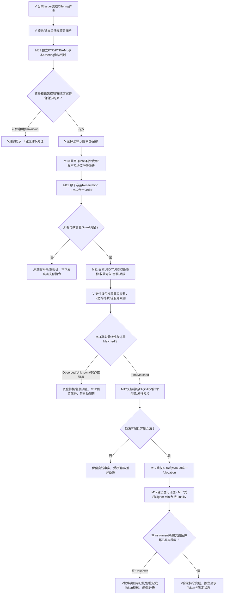

# RWA SaaS｜Step05-03 可视化产品审核：投资者KYC→签署认购→真实付款→配售/法定登记→Token交付（Draft v0.1）

> **2026-10-25｜Draft / Pending Product Owner Review。** 本文启动Step05第三个业务场景的可视化产品审阅。**Step05-03-R01～R06为建议方案，均未获产品负责人批准**；不得生成相关正式DEC或标记Approved/Frozen。前序Step04 S04-03/04/05/07/09已批准的职责与Guard继续有效，Step05-01 R01～R07、Step05-02 R01～R04的产品批准不自动扩大至本场景。技术字段、API、法域、真实资金持管/Signer、合约和真实测试全部Draft/Not Executed。

**阅读依据**：[S04-04投资者/订单/配售登记Approved](RWA-SaaS-Step-04-S04-04-Issuer-Investor-Subscription-Allocation-Approved-v0.1.md)｜[S04-05资金/收益Approved](RWA-SaaS-Step-04-S04-05-Issuer-Funds-Lifecycle-Approved-v0.1.md)｜[S04-03 Token Approved](RWA-SaaS-Step-04-S04-03-Issuer-Project-Offering-Token-Approved-v0.1.md)｜[S04-07投资者门户Approved](RWA-SaaS-Step-04-S04-07-Issuer-Investor-Portal-Approved-v0.1.md)｜[S04-09外部服务Approved](RWA-SaaS-Step-04-S04-09-External-Authority-Service-Adapters-Approved-v0.1.md)｜[DEC-022合法名册和地址后绑定](../../decisions/DEC-022-step04-s0404-investor-subscription-allocation-registration-approved.md)。

## 一、先用一张图看懂一笔真实购买

**重要**：上图用于让用户理解依赖关系，并不强制所有法域统一“先签署后创建订单”或“先登记后Mint”；必要法律签署须在不可逆付款前按适用条件满足，法定登记与Token的执行先后依Instrument合法时序决定。**真正的订单、资金、Allocation、登记与链执行必须各有独立事实来源。**

## 二、四端实际操作、页面与唯一数据主责

| 页面/阶段 | 投资者或发行机构的实际操作 | 唯一领域真值 | 不能错误视为完成 |
|---|---|---|---|
| V01 入口/账户 | 合法获授权Offering详情 | M05发布及M08页面 | 按访问授权披露；尚未KYC可依法先阅读 |
| V02 认证/资格 | 自然人/机构、代表、补件、风险筛查与本Offering资格 | M09身份/AML/Eligible、M08导引、X适格核验 | 个人/机构KYC与Tenant商业KYB分离 |
| V03 钱包 | 外部钱包连接或经审核的嵌入式创建恢复、Token接收绑定 | M08钱包体验、M07接收地址守卫、X合法钱包服务 | 登录账户/法定持有人/付款来源/接收钱包不自动相同 |
| V04 确认认购 | 法律单位/金额、QuoteSnapshot、合同/风险版本、必要签署 | M10订单Quote、M06生效签署、M12容量预留 | 确认/签署/预留各自独立，失败不得显示可付指令 |
| V05 支付页面 | 合法链币、目标、金额、期限与钱包操作、查询 | M11受权PaymentInstruction/收款实际证据、M22链观察 | 钱包签名/广播≠实收，必须显示Unknown核查 |
| V06 我的订单 | 订单、实收/配售/登记/Token与退款多段进度 | M10汇总视图，M11/M12/M07独立事实 | 保留已付款但未配售、已配售未登记等真实状态 |
| V07 我的持仓 | 合法权益、登记生效条件、已交付Token和差异 | M12合法权益/名册，M07 Token执行，M08展示 | 仅Instrument规定必要条件满足时表示完整合法交割 |
| I01 投资者合规 | 实名核验、AML、当前Offering合规/人工复核 | M09＋X法定核验 | 合规人员不因权限自动越过制裁/法定限制 |
| I02 认购订单 | Quote/签署、唯一订单、预留、合法取消 | M10，M12容量，M06文件 | 运营不能手改实收或法定权益 |
| I03 资金对账/退款 | 链观察、真实最终性与匹配、付款差异与合法退款 | M11＋受权财务及X合法持款/Signer | 退款批准≠出款，Unknown要核原指令 |
| I04 配售登记交付 | 适用Auto/Manual Allocation、登记证据、Mint与差异对账 | M12容量配售/法律登记；M07链执行 | 受权配售/名册/链事实分别保全 |
| P01 平台运营支持 | 跨Tenant隔离下受权查看最少状态、异常升级、审计 | M03/M17/M20/M22 | 不得自行批准法定配售、登记、退款、Mint或读取私钥 |

**P/I/V/X分工**：P=SaaS商业/基础设施/安全最小权限支持；I=Issuer法定发行及合规、资金/配售/存续团队；V=Issuer自己拓展的合法受众，独立门户账户；X=受权身份核验、钱包/Signer、合法资金持有人、名册登记等实际主体，X可能是依法获准的Issuer自己或适格独立机构。P不是默认实际资金托管、登记者或Mint私钥管理者。

## 三、十条“买成功”不能简单合并的事实

| 独立事实 | 唯一主责 | 必须保持独立的理解 |
|---|---|---|
| Account与代表身份 | M08账户/M09投资者KYC | 注册≠KYC Verified≠合法代理人授权 |
| Offering适格决定 | M09核验版本、M05资格条件 | Verified≠Eligible；后续资格撤销不会覆盖历史判定 |
| 钱包控制与接收绑定 | M08入口/M07接收资格/X合法钱包服务 | 钱包Connection≠法律持有人资格；转账发送地址不必是Token接收地址 |
| Quote与认购订单 | M10 | OrderCreated≠Paid；Quote旧版本不因发行方改价被覆盖 |
| Series容量与预留/配售 | M12 | 有效预留、已配售、异常冻结不得重复计数；Token供应量≠法律上限 |
| 真实链收款与订单匹配 | M11与合法实际持款X | Tx广播/Observed/Unknown≠FinalMatched；多笔真正收款需累计 |
| 法定持有人登记 | M12与依法有权Issuer或X登记者 | Allocation Approved≠合法名册已生效 |
| Mint及Token交付 | M07链事实和X受权Signer | Submitted/Minted≠合法权益全部交付 |
| 退款与资金恢复 | M11及依法有权执行资金主体 | RefundApproved≠PaidRefund；不得按提现来源猜退款地址 |
| 最终订单/持仓视图 | M08展示/M10聚合，M12/M07提供权益与链事实 | 不得用单一bool宣称完整交割，Token余额≠法律权益 |

**投资者端建议的最低业务可见状态**：\
①等待身份/资格 → ②报价/签署与预留 → ③待支付／实收待核 → ④实收已确认、待配售 → ⑤已配售、合法登记待核 → ⑥登记或Token执行待核 → ⑦满足该Instrument合法必要条件的持仓已交割；另有**退款申请→批准→实际已退款**独立轨道。上述为**给用户阅读的建议词**，不是系统已冻结enum，也不表示每个法域都遵循完全相同的法律时序。

## 四、六组需用户明确选择的细化方案（全部Draft、推荐A）

| 方案 | 推荐A：拟定的产品细化规则 | 不得越过的既有批准边界 |
|---|---|---|
| **Step05-03-R01｜投资者身份、当前Offering资格与钱包分离** | 合法公开资料按访问权限允许先看；点击购买前补齐自然人/机构KYC、AML、当次Offering-specific Eligible及本人/代理授权；外部钱包与至少一种安全合法嵌入式钱包都是入口选项，付款来源钱包、Token接收钱包与法定持有人不强制同一地址；钱包控制权另核。 | KYC通过不自动获得所有Offering资格；钱包Connected不代表实际持有人或能自动Mint。 |
| **Step05-03-R02｜一笔交易的Quote、文件签署、订单与唯一预留** | 投资者输入法律认购单位/金额后，确认价格/费用/版本/期限及风险；必要签署有真实有效证据后，才对M10唯一订单提出M12原子预留并生成M11已批准的付款指令；顺序在适用法域及发行工具约束下允许必要合法重排，但**任何不可逆付款前必须把相应Guard核实**。 | 一个订单并不自动证明钱已到账；Quote/签署/预留因超时和重试必须能引用原Intent。 |
| **Step05-03-R03｜真实稳定币付款与“已支付”展示** | 投资者看到已批准网络、Token合约、合法收款对象、应付金额和期限；付款发起/广播/到账观察/链最终性/合法订单匹配分阶段显示；只有M11确认FinalMatched时才展示“实收已确认”；少付、多付、错链、假币、迟到、Unknown独立提示和处理，不许凭截图或txHash跳过。 | M11资金事实与M10订单状态分离；不规定USDT/USDC必须由某一固定合约/托管商接收。 |
| **Step05-03-R04｜预留、配售及最后不可逆审核** | M12唯一跨Offering、跨Series/股类计算容量，受控预留、冻结和释放；M11实收最终匹配后仍复核M09当前资格、合同版本、法域发行/公司授权和剩余额度；适用预批准自动基础配售，否则需受权人工配售，产生唯一Allocation及可追踪决定。 | 付款成功并非自动配售；预留到期时链上Pending/Unknown应保护核查，已合法释放的迟到账不能抢回别人的容量。 |
| **Step05-03-R05｜合法名册、Token交付与持仓分别确认** | 配售后按实际法域由依法可自管的Issuer或合法受托/强制有权登记者记录及确认名册；M07按获批Allocation、合法钱包及Signer权限实际Mint、核链最终性；二者遵守Instrument适用顺序并单独显示，满足该Instrument的所有必要交割条件后才标“合法持仓已完成”。 | Token余额不是法律登记；已登记但Mint失败和Mint成功但登记Unknown都不是完整交割。 |
| **Step05-03-R06｜迟到账、取消、退款与四端异常同步** | V端同一订单详情分栏展示资格/签署、订单/预留、实际实收、配售/登记、Token交付及退款，不采用单个“购买成功”绿色状态。迟到账、资金匹配但资格变更、错链/多付/少付、取消后真款到账、Token或登记Unknown均由M17建立有权任务，M11合法退款需要独立审批/真实付款证据，P端只做最小权限故障支持；已产生合法权益的订单不能用普通取消或退款按钮撤销。 | 退款已批准不等于钱已退；在途业务/已持仓法律义务不能因Offering停售或Tenant退租消失。 |

这些属于对既有DEC-017/022/023/025业务事实的**跨端用户体验与业务状态细化**，而不是增加146项之外的新核心ID。**六项都未获明确用户批准**，其后的产品级PRD/状态规范不得凭“建议A”直接打Approved。

## 五、独立异常与受权修复清单（E03-01～E03-16，草案）

| 编号 | 业务异常 | 用户/平台必须达到的安全结果 |
|---|---|---|
| E03-01 | KYC Verified但当前Offering不适格 | V可按法定范围阅读，不得生成有效新订单，M09留独立资格决定 |
| E03-02 | KYC被撤销/过期发生在已支付之后 | M11保持真实收款，M12冻结非法配售，走有权差异/退款处理 |
| E03-03 | 同账户跨两个Issuer使用旧证件与钱包 | Tenant隔离且核合法跨域授权；不同Issuer订单/名册不相互引用 |
| E03-04 | 付款来源钱包与Token接收地址不相同 | 依身份/控制权/法域独立绑定，不自动从付款Tx源地址Mint |
| E03-05 | 并发最后额度抢占 | M12原子预留，不得超总法律发行额度或重复占用 |
| E03-06 | 付款广播但链上Unknown或短重组 | M11待核，M12暂保护，禁止新配售或盲退款 |
| E03-07 | 少付/多付/错链/假币 | M11记录真实资金与差异，冻结自动配售及依法调查/受权退款 |
| E03-08 | 两笔真实转账或重复Webhook | 真实不同Tx按规则分别记账；同一Tx/Log重复回调幂等不重复计收 |
| E03-09 | 预留过期/合法释放后迟到账 | 不得重新抢占已售额度，必须记录真实收款并按受权流程处置 |
| E03-10 | Quote/签署文书变更但付款准备中 | 重新校验版本并依法必要再确认/重签，不重写旧证据 |
| E03-11 | 已付款但Allocation失败/遭禁止 | M11实收不消失、M12保留失败证据，依法退回/调查而非一键抹单 |
| E03-12 | 合法登记结果Unknown但Mint链上成功 | 分别显示链事实与权利待核；查询原登记请求、不得重复签名 |
| E03-13 | 法定登记已完成但Mint失败/Unknown | 保留合法权益，M07按原Intent核链后受权修复，不能多Mint |
| E03-14 | 钱包恢复或接收地址更换 | 重新校验控制权/法定持有人及必要法律限制，不自动迁移已登记权益 |
| E03-15 | 退款已Approved但实际出款Unknown | M11与X查原RefundIntent，不显示已退款、不重复出款 |
| E03-16 | Offering关闭、SaaS欠费/退租时仍有在途业务 | 保留M10/M11/M12/M07实际状态、投资者合法查询和法定义务/交接 |

## 六、提前为产品负责人做的交叉审计

**静态对账结论（仅依据现有已Approved功能文档）**：

1. **M08操作入口完整**：注册/登录、Offering披露、KYC引导、认购确认、稳定币支付、订单/退款、持仓/登记Token、外部和嵌入式钱包都有已批准的对应V1功能。
2. **订单→真钱→合法配售→法定登记→Token全部具有唯一主责**：M10、M11、M12、M07分别持有事实，M08只消费多业务源状态；M17/M20/M22提供任务、审计、技术适配，不另建立第二套法定资金或Token结果。
3. **两个结构性关键门尚未落地**：首发法域/具体Instrument确定资金持管、合法登记时点与权限；钱包/实际Signer及合约的部署/退款/Mint控制权需技术、法律与安全专项，不可说“已经能真实支付和Mint”。
4. **细化前需要标注的体验风险**：支付Pending时预留到期保护、错链/少多付及迟到账、不合规的已收真款、登记和Mint最终性不同步、合法持仓与Token钱包余额含义不同。
5. **V1默认合法适用持续一级认购/基础配售**；若首发法域/Instrument依法必须集中募集，须在Step06冻结前对M05-F011/M10-F009/M12-F009/F010等V2版号提出独立正式重审，不能在本场景擅自并入V1。

**本次只形成视觉产品审核Draft，不批准字段类型、原子预留算法、金额精度、KYC服务商、法域、真实链确认数/持款方案、法定登记模式、受权Signer、退款合约或生产执行。** 16种异常都是未来需要覆盖的产品情形，全部Not Executed。

## 七、用户批准之后的工作边界（尚未执行）

如用户明确同意某些方案，才按**实际已批准项**创建下一份正式DEC，并制定Step05-03产品级PRD和独立状态异常规范；未批准或需调整项继续Draft，不能隐式补批。其后继续Step05-04发行后管理/收益与到期退出。**Step06 V1整体Frozen需要另行用户决定；Frozen、旧DEC/SCOPE、PR #6均不在本次修改范围。**

**当前状态：Step05-03 可视化审核 Draft v0.1；六项R01～R06全待用户审核。**
