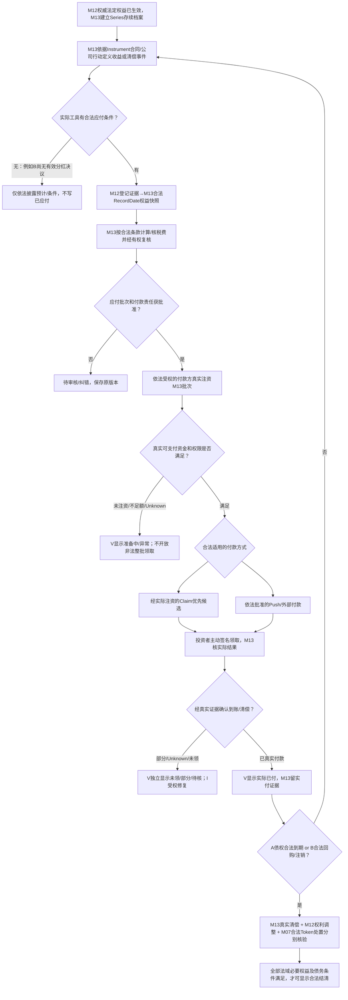

# RWA SaaS｜Step05-04 发行后存续、收益/本息、Claim/Push与到期合法退出：产品级详细PRD（Approved v0.2）

> **2026-10-25｜仅产品级业务行为Approved（[DEC-033 R01～R06六项A](../../decisions/DEC-033-step05-04-r01-06-post-issuance-yield-maturity-exit-product-approved.md)）**。本文件的业务流程、权责、对象状态语义、重要业务Guard和依批准规则形成的异常保护Approved；字段类型/schema、精确enum/API、法域、税款/计算公式、合法付款义务方、Claim/Push合约、资金Signer与生产执行仍Draft，所有测试Not Executed。Step05整体及V1.0尚未Frozen。历史[Step05-04可视化草案v0.1](RWA-SaaS-Step-05-04-Post-Issuance-Yield-Maturity-Exit-Visual-PRD-Draft-v0.1.md)保留原文。

**已批准依据**：[S04-05认购资金/收益存续Approved](RWA-SaaS-Step-04-S04-05-Issuer-Funds-Lifecycle-Approved-v0.1.md)｜[S04-07投资者持仓与收益中心Approved](RWA-SaaS-Step-04-S04-07-Issuer-Investor-Portal-Approved-v0.1.md)｜[S04-03 Token退出及授权调整Approved](RWA-SaaS-Step-04-S04-03-Issuer-Project-Offering-Token-Approved-v0.1.md)｜[DEC-032投资者合法持仓原则](../../decisions/DEC-032-step05-03-r01-06-investor-subscription-legal-holdings-product-rules-approved.md)｜[S04-04法定登记Approved](RWA-SaaS-Step-04-S04-04-Issuer-Investor-Subscription-Allocation-Approved-v0.1.md)。

## 一、发行后至合法退出业务流程（依R01～R06 Approved）

**本图只定义依赖关系，不默认A与B都有到期回购，更不表示所有SPV股权必须按债务合同付款**。M11投资者认购退款与M13收益/本金付款分属不同资金和法律义务。

## 二、I/V/P/X逻辑页面职责与唯一主责（业务Approved，UI路由Draft）

| 页面/职责 | 必要的实际使用动作 | 唯一主责及数据源 | 不应误判的结果 |
|---|---|---|---|
| I 发行后概览 | 项目/Series的合法存续义务、责任人、到期/披露计划 | M13存续档案；M04 Instrument；M05发行历史 | Offering关闭与法律义务存续分开 |
| I 权益快照 | RecordDate与权威持有人/权益名册快照、争议更正 | M13引用M12法定登记有效数据 | 不能用某时刻钱包余额替代合法名册 |
| I 收益事件 | A债券利息/本金、B依法决议股息、应计/应付与条件 | M13事件；M04合同及合法公司决议X | 合法B分红无决议不得显示已应付 |
| I 计算及复核 | 批次、合法计税/扣项、应付审核、审批轨迹 | M13应付计算/受权审核、M17审批 | 批次Approved不意味着已经实际出款 |
| I 注资与付款 | 合法付款人、实际注资核对、Claim/Push/合法外部支付 | M13资金注资与实际实付权威，X真实持款/Signer | 到账查询Unknown不重复真实出款 |
| I 到期及退出 | 到期债务/股权公司行动、名册更新、合法Token处置 | M13应付清偿；M12合法权益；M07链结果 | Burn≠实际本金兑付或权益自动消灭 |
| V 收益中心 | 应付批次、可领、未领取、Claim/Push实际付款与通知 | M08展示，M13应付与实际资金真值 | 预测≠应付；注资≠已付款 |
| V 持仓及记录 | 已持合法权利、记录日权益、Token锁定/调整与历史分配 | M08展示M12法定权益/M07 Token/M13收益 | 不基于钱包余额自动推断收益归属 |
| P 运营支持 | 只读最小化付款/分配异常、告警及审计 | M03/M17/M20/M22 | 不默认签名、托管或代Issuer批准分红 |
| X 法定执行方 | 法律/公司决议、实际注资/付款、链Signer与适格名册登记 | X真实责任人，M22有条件适配 | Provider回调不是公司分红合法生效或清偿 |

## 三、R01～R06六项正式批准的产品级业务规则

| 已批准编号 | Approved的产品行为 | 必须遵守的既有边界 |
|---|---|---|
| **Step05-04-R01｜发行后存续档案与应履行事项独立** | 每个Instrument/Series建立对应合法义务主体、合同版本、合法发行额度及持续披露/付息分红/到期安排；即使Offering已停售、SaaS客户欠费/退租，原来真实义务继续保留并能合法交接。 | 项目已下架或Token在钱包里并不意味着所有义务结束。 |
| **Step05-04-R02｜记录日快照应以合法权威权益为准** | 收益/分红/还本资格在合法RecordDate按M12真正法定持有人/权益证据形成冻结且可追溯的快照，Token余额只作为必要核对；地址更换、登记补录及争议需留变更版本/审批，不能事后无痕修改旧快照。 | 因钱包转移导致名册未同步时不能自动把法定受益人转成新的钱包持有人。 |
| **Step05-04-R03｜债权A与SPV股权B的收益逻辑分开** | A债权按真实合同生成应计/应付利息及合法到期本金事件，B SPV权益只有合法决议、可分配利润及相关条件有效时才生成法定股息/回购等事件；收益预估、已计算、已批准应付、到期、逾期是不同状态。 | B不能默认固定APR、到期必还本或平台保证回购；收益展示不得混淆预计与已承诺。 |
| **Step05-04-R04｜先批准收益，再验证真实注资，最后开放领取** | M13分配批次需先按已批准的权益快照计算/复核/确定付款主体、金额/税费及适用收款资格；只有实际合法注资、确认足额和Signer权限等条件满足时才可以启用Claim（优先考虑经注资合约），必要时可选依法适用的Push/外部付款；未足额默认不开放整批Claim，受权部分批次另经批准。 | 分配计划完成≠资金已准备，调用Claim按钮≠钱包资金实际到账。 |
| **Step05-04-R05｜投资者收益页面按事实显示多阶段记录** | V个人收益中心把预计/应付/已注资/可领取/领取中/部分领取/已付/未领取/失败/Unknown分开显示，关联M13原批次及真实支付证据；Claim只针对经核准合法权利人，Push/外部支付同样显示实付Finality。 | Unclaimed≠已付款；ClaimSubmitted≠Paid；M08不创建第二套收益资金主账。 |
| **Step05-04-R06｜到期、提前退出与Token处置必须双向核对** | A债权到期本金及可能逾期/部分偿还继续M13合法债务，B权益回购/注销仅在真实合同/公司决议与资金条件具备时适用；M13实际清偿、M12权利终止/名册调整、M07 Burn/冻结必须各自有受权证据且按Instrument合法顺序处理，不能凭Burn直接标债务已清偿或自动注销合法股权。 | 并非所有Instrument都有到期回购；停售、退租或Token销毁不能消灭真实未清偿权利。 |

**DEC-033已正式批准R01～R06六项A**。仅上述产品业务行为/状态语义Approved；技术字段、计算/税务与精度、合约、Signer、合法付款方和真实金融生产仍Draft，不可自行推导研发/生产执行许可。

## 四、五项必须独立的法律、权益、应付、真实支付和合法退出事实

| 独立事实 | 真正负责者 | 禁止的错误合并 |
|---|---|---|
| Instrument法定收益/本金/股权行动义务 | M04合同、M13存续事件、Issuer/X公司有权主体 | 宣传预估收益=实际合同应付；B未决议就显示确定收益 |
| RecordDate真实权益与合法收款权利人 | M12法定权益＋M13权益快照 | Token钱包余额=天然法定受益人；钱包恢复可直接换领取权 |
| 已计算、审批和应付批次 | M13＋受权审批人 | 批次Approved=钱已实际注资或已付 |
| 真实注资、Claim/Push付款、未领取和实际Paid | M13与依法有权付款X | Funded=Paid；ClaimSubmitted=Paid；未领=已付 |
| 到期清偿、名册合法调整与Token Burn/冻结 | M13/M12/M07分别留证 | 已Burn就等于偿付债务或股权已消灭 |

## 五、15项异常的产品保护已按DEC-033收口，技术实现与测试仍Draft/Not Executed

| ID | 场景 | 预期产品业务保护 |
|---|---|---|
| E04-01 | B SPV股权没有合法可分红决议 | 不形成已确认应付/可领，仅显示依法允许的预测 |
| E04-02 | A债权应计/到期与实际资金不足 | 应付、实际注资与已付款分开，可欠付/逾期，不能隐性保本兜底 |
| E04-03 | 合法RecordDate名册与钱包余额冲突 | 以适用法定权威为准并创建差异核查任务，不直接按链余额支付 |
| E04-04 | 投资者换钱包/法定转让在记录日前后 | 按合法生效时点复核快照及收款账户，不静默更换受益主体 |
| E04-05 | 收益计算错误或税费扣项修订 | 保留旧计算和审批版本，依法重新审批/纠错 |
| E04-06 | 收益批次已批准但未真实注资 | 不得开放Claim或将已批应付写成实际Paid |
| E04-07 | 真实只注资部分金额 | 默认阻断整批领取；合法分批方案需单独有权批准并说明 |
| E04-08 | Claim按钮提交但链回执Unknown/重组 | 保留真实付款待核，查询原ClaimIntent/Tx，不可再领一次 |
| E04-09 | Push/外部实际付款失败或部分到账 | 显示真实Partial/Unknown，不得以“已提交”冒充Paid |
| E04-10 | 未领取金额在到期或账户停用后仍存在 | 保留合法债权/应付和有权领取路径、法定处置与交接 |
| E04-11 | 提前清偿、B股权回购或注销 | 须真实合同/公司行为/法律授权及对价资金证据，禁止普通管理员点击退币即注销 |
| E04-12 | 本金已付但名册/Token尚未合法结清 | 资金/法定权益/Token按各自权威显示差异，不宣布全部合法退出 |
| E04-13 | Token已Burn但本金未真实偿还 | 不得标清偿或删除法定权益及未偿应付 |
| E04-14 | Issuer服务欠费/退租但仍有到期或未领收益 | 必要查询、追偿、数据及实际责任人移交依法继续 |
| E04-15 | Webhook重复/付款事件Unknown | 按原合法批次及真实Tx事件幂等和调查，不重复计算/出款 |

## 六、与Step05-03及Step04 Approved规则的静态一致性

- **合法持仓入口**：Step05-03由M09/M10/M11/M12/M07分别核验资格、订单、实收、配售名册、Token；**Step05-04 RecordDate收益基础只引用M12合法权威权益**，不能把M08持仓UI或钱包余额当法定名册。
- **债权A、SPV股权B双路径**：M04 Instrument定义不同合法经济权利，M13事件与到期责任按各自合同及公司决议产生；B不预设固定APR、本息偿还、自动回购。
- **钱款三分**：购买SaaS的商业费属M01，投资者认购/发行募集款及退款属M11，Issuer合法收益/本金/股息分配属M13；不能复用一个“支付成功”字段。
- **发行结束≠公司义务结束**：Offering售罄、停售、暂停或Tenant商业退租均不能删除真实应付、本金、未领金额、登记证据及有权权益人记录。
- **真金与Token生产仍待独立许可**：收益Claim优先评估实际合法注资合约，同时保留合法Push/第三方路径；退款、真实付款和Burn都须经真实授权X执行，技术设计与法域待审。

## 七、产品规则已批准，技术/法域仍待审并进入Step05-05 Draft

产品负责人已明确批准**R01～R06全部A**，[DEC-033](../../decisions/DEC-033-step05-04-r01-06-post-issuance-yield-maturity-exit-product-approved.md)已生效。本文件仅形成Step05-04产品级Approved文档，其真正资金/Token与法域履行需单独审核。详见[Step05-04跨端状态与异常规范v0.1（仅产品层Approved）](RWA-SaaS-Step-05-04-Cross-Lane-Product-States-Exceptions-Approved-v0.1.md)。

下一步仅创建[Step05-05平台运营与全局异常可视化Draft](RWA-SaaS-Step-05-05-Platform-Operations-Global-Controls-Visual-PRD-Draft-v0.1.md)，其新细化方案待产品负责人审核；之后Step06跨端13项审计风险逐项闭环及V1整体冻结另行决策。字段/schema/API、实际税款、法域/付款义务主体、Claim/Push合约、安全/Signer与验收证据仍Draft。

**当前状态：Step05-04产品级PRD Approved v0.2（DEC-033 R01～R06批准范围），详细技术字段、工程状态enum、API、法域、税费/收益算法、真实持款义务主体与Claim/Push合约Signer仍Draft；所有实际测试Not Executed。Step05-05新方案待审核，V1整体不Frozen、PR #6 Draft/Open/Unmerged；不进入UI/研发/真实金融生产。**

## 八、应形成的领域级产品关系（Approved的是关系原则，技术字段仍Draft）

| 业务对象／阶段 | 唯一事实来源 | 必须关联的业务证据/守卫 | 禁止错误结果 |
|---|---|---|---|
| A DebtCoupon / PrincipalDue | M04生效债权条款、M13存续事件 | 合同生效/本金/期限/合法偿付币种/应计基础 | 仅按实际合同产生合法到期或应付，逾期及部分清偿独立 |
| B SPV Dividend/CorporateAction | M04 SPV权益定义、Issuer/X合法公司决议、M13事件 | 有效董事会/股东决议、可分配资金、依法限制 | 没有决议时只在允许范围提示预测，不生成Guaranteed Yield |
| RecordDateSnapshot | M12法定登记权威，M13快照 | 合法生效时点/权利主体/权利数量及版本 | Token钱包只是佐证，旧快照更正另留版本 |
| EntitlementCalculation | M13收益应计与税费审核 | 生效Instrument/受益人快照/适用税费/单位精度 | 计算/复核Approved≠批次已注资/已支付 |
| DistributionBatch | M13合法分配批次 | 合法付款人、批次/权益快照、受权审核和真实应付款 | 一个受益人不能因事件重复回调获得双份应付 |
| ActualPrefunding | M13与合法付款X的真实注资证据 | 批准收款目标、实际资产/币种/金额与可用性 | 已批批次/真实注资不同状态，部分注资不能擅自整批开放 |
| PaymentClaimPush | M13合法应付与实际Paid、X链或外部Signer | 适用Claim/Push/第三方路径、合法受款人、原Intent与Finality | Claim发起/Push已提交≠实际付款成功，Unknown先查原结果 |
| UnclaimedOrOverdue | M13负债/受益人权利 | 依法受限领取窗、未领取余额、逾期通知/催告 | 保留真实义务及法域处置，而非商业到期自动退款/归零 |
| ExitSettlement | M13债务清偿、M12登记/权利变更、M07 Token Burn/冻结 | 具体合同/公司行动、实际对价出款、权利终止与合法链时序 | 完成Burn/名册修改不代表清偿；B不默认到期本息 |

**产品状态链**：RecordDateSnapshotVerified → YieldCalculationReviewed → DistributionBatchApproved → ActualFunded（实际资金和法定权限确认）→ ClaimEnabled/PushScheduled（依法适用）→ PaymentSubmitted/Unknown/Partial/FinalPaid；原权益及法定义务直到真实全部合法清偿才可以结束。以上英文是可读状态候选，**不是已冻结的后端枚举**。纠错不能覆盖旧法律/资金事实；M08只消费M13/M12/M07权威状态。

## 九、端侧展示和人机交接的精确业务要求

| 端 | 产品Approved的动作或状态展示 | 必须独立的真实责任 |
|---|---|---|
| **I Issuer存续工作台** | 管理Series法定义务、RecordDate合法快照、债务/股权事件、合法批次计算与复核、资金注资/付款调查、未领/逾期、到期退出差异 | 真实Issuer/SPV/有权债务人及财务/公司行动审批人、法定登记/付款X |
| **V Issuer投资者门户** | 查看本人法定持仓、应计/应付/可领/未领及实际领取结果、到期逾期/退出与Token调整；合法条件满足时受权Claim | V不可自行确定法定名册、批次Approved或将链广播视为Paid |
| **P SaaS平台后台** | 多租户服务稳定性、受限任务与审计的最小必要摘要、合法退款/收益异常工单衔接 | 平台不因系统管理员或SaaS商业付款拥有实际资金、密钥、董事会/股东分红批准权 |
| **X外部合法执行主体** | 提供有权公司决议/审计、实际资金注资、出款回执、法定名册、链Signer/Finality等证据 | X角色分别授权；技术回调Completed不等于合规付款/法律权益已生效 |

## 十、产品级异常与退出业务验收断言（全部Not Executed）

| ID | 真实研发/QA未来需要验证的结果 |
|---|---|
| U04-01 | Offering已Closed、Tenant受限但债权/股权、到期及未领收益继续可依法查询和履行 |
| U04-02 | RecordDate快照引用M12有效名册而非钱包Token余额，旧快照争议变更有版本审计 |
| U04-03 | A债权合同计息本金与B SPV股息/合法退出采用不同有效法律条件 |
| U04-04 | B无有效分红决议或可分配依据时不生成已应付、保本或固定APR |
| U04-05 | 收益计算、已批准应付、资金已实际注资与最终实付是四项独立状态 |
| U04-06 | 批次实际未注资或仅部分注资时默认不能开放整批Claim |
| U04-07 | Claim权限验证合法快照受益人与钱包，重复/Unknown只按原Intent核验 |
| U04-08 | Push或外部付款实际失败/部分到账时不得显示全额Paid |
| U04-09 | 未领金额保留合法应付款与法域处置，不因钱包丢失或SaaS退租自动消失 |
| U04-10 | 到期仅部分偿付时M13保留未付本息与违约/逾期状态 |
| U04-11 | Token Burn成功但合法债务未清偿，不能显示合法退出已完成 |
| U04-12 | 本金已真实付款但M12登记和M07 Burn仍待确认时分别显示真实进度 |
| U04-13 | 任何分配、记录日或退出更正都保留原审批/付款/法律版本与审计 |
| U04-14 | 相同外部事件重复Webhook不重复付款，两笔不同真实付款分别入账 |
| U04-15 | P运营管理员不得默认动用Issuer资金、Signer或代表董事会授权分红 |

以上是**未来验收条件**，未执行任何测试、真实出款、合法公司行为或合约操作，不能标记PASS。收益计算算法、利率/日期计息惯例、RecordDate时区、税费与受益钱包身份、批次可用余额、幂等签名、合同及法域仍需技术/法律审核。

## 十一、尚未关闭的研发及法律决策门（仍Draft）

- **法律权利**：A债权的合同期限、偿还、逾期、违约；B SPV的合法股息/可分配利润、法定决议、回购或公司清算，投资者权利的法律文件与适用法域。
- **计算**：本金/息票基数、按日计息惯例、RecordDate时间与时区、股份分红税/预提与外汇限制、金额单位、四舍五入、差额调整、资金精度、合法支付币种。
- **实际钱款**：债务人/付款代理/资金持有人、Chain Claim/Push/银行等法域合法出款方式；不足额、Claim双领、已批准却未注资、Unclaimed资金长期持管/送达/承继。
- **Signer/Token/退出**：真实合约、密钥与Signer授权，M12权益转让登记，M07合法冻结/Burn及何时可以消灭权利、链重组与不可逆交易调查。
- **技术交接**：领域字段/schema、状态enum、API/对账/幂等与重试、外部服务对接及端到端E2E/Security/UAT结果未获批准。
- **项目治理**：Step04已Approved 146/146与原DEC-017首次版本归属不改，13项跨端静态审计门Open；四份Frozen、历史DEC/SCOPE与原可视化Draft保留，PR #6 Draft/Open/Unmerged；V1整体未Frozen，不启动UI/开发或真实金融执行。
