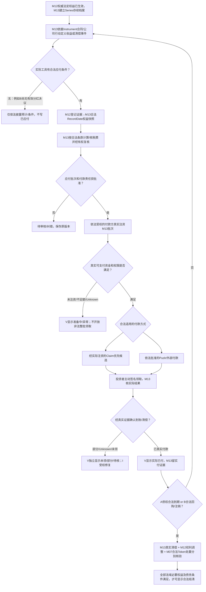

# RWA SaaS｜Step05-04 可视化产品审核：发行后管理、收益/本息、Claim/Push、到期退出（Draft v0.1）

> **2026-10-25｜Draft / Pending Product Owner Review**。本文件仅打开Step05第四个场景的图解评审；**Step05-04-R01～R06六项均为推荐A、尚未获得产品负责人批准**。不创建DEC-033，不修改Step04/Step05-01～03的已批准规则。法域、资金付款责任、税款、Claim/Push合约、钱包/Signer、具体字段/API和全部测试仍Draft/Not Executed。

**已批准依据**：[S04-05认购资金/收益存续Approved](RWA-SaaS-Step-04-S04-05-Issuer-Funds-Lifecycle-Approved-v0.1.md)｜[S04-07投资者持仓与收益中心Approved](RWA-SaaS-Step-04-S04-07-Issuer-Investor-Portal-Approved-v0.1.md)｜[S04-03 Token退出及授权调整Approved](RWA-SaaS-Step-04-S04-03-Issuer-Project-Offering-Token-Approved-v0.1.md)｜[DEC-032投资者合法持仓原则](../../decisions/DEC-032-step05-03-r01-06-investor-subscription-legal-holdings-product-rules-approved.md)｜[S04-04法定登记Approved](RWA-SaaS-Step-04-S04-04-Issuer-Investor-Subscription-Allocation-Approved-v0.1.md)。

## 一、可视化：从合法持有，到计算、付款和退出

**本图只定义依赖关系，不默认A与B都有到期回购，更不表示所有SPV股权必须按债务合同付款**。M11投资者认购退款与M13收益/本金付款分属不同资金和法律义务。

## 二、企业端、投资者端、平台和外部主体如何联动

| 页面/职责 | 必要的实际使用动作 | 唯一主责及数据源 | 不应误判的结果 |
|---|---|---|---|
| I 发行后概览 | 项目/Series的合法存续义务、责任人、到期/披露计划 | M13存续档案；M04 Instrument；M05发行历史 | Offering关闭与法律义务存续分开 |
| I 权益快照 | RecordDate与权威持有人/权益名册快照、争议更正 | M13引用M12法定登记有效数据 | 不能用某时刻钱包余额替代合法名册 |
| I 收益事件 | A债券利息/本金、B依法决议股息、应计/应付与条件 | M13事件；M04合同及合法公司决议X | 合法B分红无决议不得显示已应付 |
| I 计算及复核 | 批次、合法计税/扣项、应付审核、审批轨迹 | M13应付计算/受权审核、M17审批 | 批次Approved不意味着已经实际出款 |
| I 注资与付款 | 合法付款人、实际注资核对、Claim/Push/合法外部支付 | M13资金注资与实际实付权威，X真实持款/Signer | 到账查询Unknown不重复真实出款 |
| I 到期及退出 | 到期债务/股权公司行动、名册更新、合法Token处置 | M13应付清偿；M12合法权益；M07链结果 | Burn≠实际本金兑付或权益自动消灭 |
| V 收益中心 | 应付批次、可领、未领取、Claim/Push实际付款与通知 | M08展示，M13应付与实际资金真值 | 预测≠应付；注资≠已付款 |
| V 持仓及记录 | 已持合法权利、记录日权益、Token锁定/调整与历史分配 | M08展示M12法定权益/M07 Token/M13收益 | 不基于钱包余额自动推断收益归属 |
| P 运营支持 | 只读最小化付款/分配异常、告警及审计 | M03/M17/M20/M22 | 不默认签名、托管或代Issuer批准分红 |
| X 法定执行方 | 法律/公司决议、实际注资/付款、链Signer与适格名册登记 | X真实责任人，M22有条件适配 | Provider回调不是公司分红合法生效或清偿 |

## 三、六组请产品负责人审核的细化规则（**全部Draft，推荐A**）

| 提案 | 推荐A及拟定产品行为 | 必须遵守的既有边界 |
|---|---|---|
| **Step05-04-R01｜发行后存续档案与应履行事项独立** | 每个Instrument/Series建立对应合法义务主体、合同版本、合法发行额度及持续披露/付息分红/到期安排；即使Offering已停售、SaaS客户欠费/退租，原来真实义务继续保留并能合法交接。 | 项目已下架或Token在钱包里并不意味着所有义务结束。 |
| **Step05-04-R02｜记录日快照应以合法权威权益为准** | 收益/分红/还本资格在合法RecordDate按M12真正法定持有人/权益证据形成冻结且可追溯的快照，Token余额只作为必要核对；地址更换、登记补录及争议需留变更版本/审批，不能事后无痕修改旧快照。 | 因钱包转移导致名册未同步时不能自动把法定受益人转成新的钱包持有人。 |
| **Step05-04-R03｜债权A与SPV股权B的收益逻辑分开** | A债权按真实合同生成应计/应付利息及合法到期本金事件，B SPV权益只有合法决议、可分配利润及相关条件有效时才生成法定股息/回购等事件；收益预估、已计算、已批准应付、到期、逾期是不同状态。 | B不能默认固定APR、到期必还本或平台保证回购；收益展示不得混淆预计与已承诺。 |
| **Step05-04-R04｜先批准收益，再验证真实注资，最后开放领取** | M13分配批次需先按已批准的权益快照计算/复核/确定付款主体、金额/税费及适用收款资格；只有实际合法注资、确认足额和Signer权限等条件满足时才可以启用Claim（优先考虑经注资合约），必要时可选依法适用的Push/外部付款；未足额默认不开放整批Claim，受权部分批次另经批准。 | 分配计划完成≠资金已准备，调用Claim按钮≠钱包资金实际到账。 |
| **Step05-04-R05｜投资者收益页面按事实显示多阶段记录** | V个人收益中心把预计/应付/已注资/可领取/领取中/部分领取/已付/未领取/失败/Unknown分开显示，关联M13原批次及真实支付证据；Claim只针对经核准合法权利人，Push/外部支付同样显示实付Finality。 | Unclaimed≠已付款；ClaimSubmitted≠Paid；M08不创建第二套收益资金主账。 |
| **Step05-04-R06｜到期、提前退出与Token处置必须双向核对** | A债权到期本金及可能逾期/部分偿还继续M13合法债务，B权益回购/注销仅在真实合同/公司决议与资金条件具备时适用；M13实际清偿、M12权利终止/名册调整、M07 Burn/冻结必须各自有受权证据且按Instrument合法顺序处理，不能凭Burn直接标债务已清偿或自动注销合法股权。 | 并非所有Instrument都有到期回购；停售、退租或Token销毁不能消灭真实未清偿权利。 |

**提醒**：R01～R06尚未由用户明确批准。既有M13/M08/M12/M07的Step04 Approved原则仍生效；技术字段、合约、钱包/Signer和真实付款主体不因这6项A推荐方案自动冻结。

## 四、五条不能合并的收益与退出状态

| 独立事实 | 真正负责者 | 禁止的错误合并 |
|---|---|---|
| Instrument法定收益/本金/股权行动义务 | M04合同、M13存续事件、Issuer/X公司有权主体 | 宣传预估收益=实际合同应付；B未决议就显示确定收益 |
| RecordDate真实权益与合法收款权利人 | M12法定权益＋M13权益快照 | Token钱包余额=天然法定受益人；钱包恢复可直接换领取权 |
| 已计算、审批和应付批次 | M13＋受权审批人 | 批次Approved=钱已实际注资或已付 |
| 真实注资、Claim/Push付款、未领取和实际Paid | M13与依法有权付款X | Funded=Paid；ClaimSubmitted=Paid；未领=已付 |
| 到期清偿、名册合法调整与Token Burn/冻结 | M13/M12/M07分别留证 | 已Burn就等于偿付债务或股权已消灭 |

## 五、15类需要在详细PRD继续覆盖的异常（Draft / Not Executed）

| ID | 场景 | 预期产品业务保护 |
|---|---|---|
| E04-01 | B SPV股权没有合法可分红决议 | 不形成已确认应付/可领，仅显示依法允许的预测 |
| E04-02 | A债权应计/到期与实际资金不足 | 应付、实际注资与已付款分开，可欠付/逾期，不能隐性保本兜底 |
| E04-03 | 合法RecordDate名册与钱包余额冲突 | 以适用法定权威为准并创建差异核查任务，不直接按链余额支付 |
| E04-04 | 投资者换钱包/法定转让在记录日前后 | 按合法生效时点复核快照及收款账户，不静默更换受益主体 |
| E04-05 | 收益计算错误或税费扣项修订 | 保留旧计算和审批版本，依法重新审批/纠错 |
| E04-06 | 收益批次已批准但未真实注资 | 不得开放Claim或将已批应付写成实际Paid |
| E04-07 | 真实只注资部分金额 | 默认阻断整批领取；合法分批方案需单独有权批准并说明 |
| E04-08 | Claim按钮提交但链回执Unknown/重组 | 保留真实付款待核，查询原ClaimIntent/Tx，不可再领一次 |
| E04-09 | Push/外部实际付款失败或部分到账 | 显示真实Partial/Unknown，不得以“已提交”冒充Paid |
| E04-10 | 未领取金额在到期或账户停用后仍存在 | 保留合法债权/应付和有权领取路径、法定处置与交接 |
| E04-11 | 提前清偿、B股权回购或注销 | 须真实合同/公司行为/法律授权及对价资金证据，禁止普通管理员点击退币即注销 |
| E04-12 | 本金已付但名册/Token尚未合法结清 | 资金/法定权益/Token按各自权威显示差异，不宣布全部合法退出 |
| E04-13 | Token已Burn但本金未真实偿还 | 不得标清偿或删除法定权益及未偿应付 |
| E04-14 | Issuer服务欠费/退租但仍有到期或未领收益 | 必要查询、追偿、数据及实际责任人移交依法继续 |
| E04-15 | Webhook重复/付款事件Unknown | 按原合法批次及真实Tx事件幂等和调查，不重复计算/出款 |

## 六、与前一场景的衔接核验（静态）

- **合法持仓入口**：Step05-03由M09/M10/M11/M12/M07分别核验资格、订单、实收、配售名册、Token；**Step05-04 RecordDate收益基础只引用M12合法权威权益**，不能把M08持仓UI或钱包余额当法定名册。
- **债权A、SPV股权B双路径**：M04 Instrument定义不同合法经济权利，M13事件与到期责任按各自合同及公司决议产生；B不预设固定APR、本息偿还、自动回购。
- **钱款三分**：购买SaaS的商业费属M01，投资者认购/发行募集款及退款属M11，Issuer合法收益/本金/股息分配属M13；不能复用一个“支付成功”字段。
- **发行结束≠公司义务结束**：Offering售罄、停售、暂停或Tenant商业退租均不能删除真实应付、本金、未领金额、登记证据及有权权益人记录。
- **真金与Token生产仍待独立许可**：收益Claim优先评估实际合法注资合约，同时保留合法Push/第三方路径；退款、真实付款和Burn都须经真实授权X执行，技术设计与法域待审。

## 七、下一步与正式批准门

产品负责人可对R01～R06逐项选择A/B/暂缓；**仅明确批准项才可另建DEC-033及产品级详细PRD/跨端状态异常规范**。如需调整，应保留现有已批准S04-05等基本法律/资金权威边界。

下一步（本稿未批准）：Step05-04收益到期退出产品收口→Step05-05平台运营与全局异常→Step06跨端全量风险13项闭环审查及整体V1冻结另行决策。所有字段/schema/API、真实法域/付款义务人、合约、安全/Signer技术和验收证据仍待研发交接前专业审核。

**当前状态：Step05-04 Visual PRD Draft v0.1；R01～R06全部待审核，未创建DEC-033，Step06 V1整体未Frozen；Frozen与历史DEC/SCOPE不改，PR #6 Draft/Open/Unmerged、无UI/研发或真实资金Token生产。**
