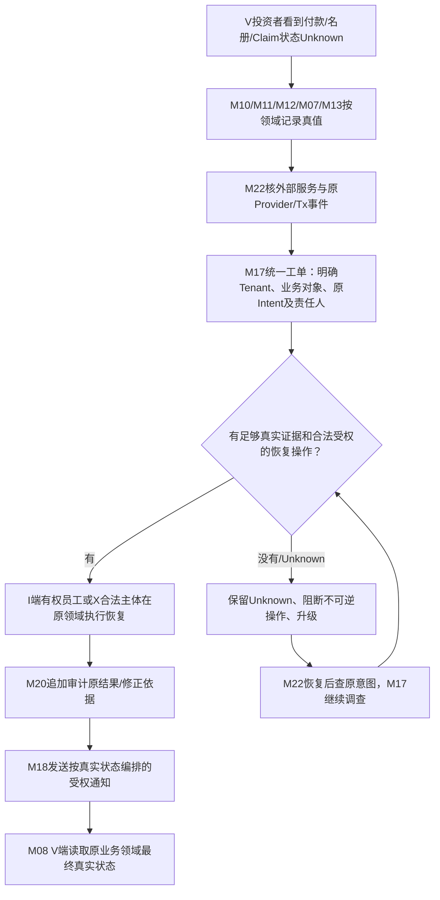

# RWA SaaS｜Step05-05 平台后台、权限、审批异常、消息、审计和外部服务：产品级详细PRD（Approved v0.2）

> **2026-10-25｜依[DEC-034](../../decisions/DEC-034-step05-05-r01-06-platform-global-controls-product-rules-approved.md)，Step05-05-R01～R06六项产品业务行为Approved。** 本文件的P/I/V/X责任、业务动作、Guard、状态语义和异常保护依上述六项已批准范围Approved；**字段/schema/API、工程状态enum、实际角色码/法域、真实资金Signer和外部服务合同、所有测试仍Draft/Not Executed**。本文件不构成任何UI/研发/实际生产或V1.0整体Frozen授权。原[Step05-05可视化Draft v0.1](RWA-SaaS-Step-05-05-Platform-Operations-Global-Controls-Visual-PRD-Draft-v0.1.md)保持历史原文。

**阅读依据**：[平台运营S04-08 Approved](RWA-SaaS-Step-04-S04-08-Platform-Operations-Approved-v0.1.md)｜[M17～M21共享规则与审计S04-06 Approved](RWA-SaaS-Step-04-S04-06-Shared-Workflows-Rules-Audit-Reports-Approved-v0.1.md)｜[M22外部服务S04-09 Approved](RWA-SaaS-Step-04-S04-09-External-Authority-Service-Adapters-Approved-v0.1.md)｜[Step05-04收益/退出DEC-033](../../decisions/DEC-033-step05-04-r01-06-post-issuance-yield-maturity-exit-product-approved.md)。

## 一、已批准的P/I/V/X平台支持与业务异常主流程

**图中“有权恢复”不是让P平台成为真实资金、Mint、合法登记或合同签署责任人。** M17只管审批/待办，业务真值始终由原领域裁决。适用的真实法域、数据保留、资金/Signer责任仍待单独审查。

## 二、四端角色与功能边界（逻辑页面/产品责任Approved，UI与权限码Draft）

| 角色/端 | 操作入口和业务职责 | 唯一事实主责 | 严格禁止 |
|---|---|---|---|
| P平台商业运营 | 审核商业买方KYB、Tenant/Standard状态、开停恢复与必要用户支持 | M03操作入口，M01商业真值，M17受权任务 | 不得因为客户KYB已通过就代Issuer批准证券发行 |
| P平台安全/审计 | 必要原文访问申请、授权撤销、跨Tenant安全事件与技术Provider调查 | M20隔离审计/M22环境凭证，M03-F005受控访问 | 不可看客户私钥、默认下载他人投资者身份证或替客户出款 |
| I发行机构团队 | 资产/Offering、KYC资格、认购配售/收益等各自受权人操作 | M04～M13业务真值、M02 RBAC、M17待办 | 部门管理员也不自动是法定签约或金融Signer |
| V投资者/代理 | 本人受权披露、KYC、认购与钱包、订单/收益/退出 | M08本人视图，M09资格、M10～M13真实结果 | 不得浏览其他Issuer和他人KYC/法定名册 |
| X合法外部服务 | 适格KYC/电签、真实资金/登记/链Signer、回执及争议证明 | M22技术交换，相关M09/M11/M12/M07/M13领域裁决 | 不同X各有自己的合同/法域责任，Webhook成功≠业务完成 |

## 三、DEC-034六项产品规则全部A Approved

| 已批准编号 | Approved的产品行为 | 不得越权的既有边界 |
|---|---|---|
| **Step05-05-R01｜平台后台只操作SaaS商业权限与受控服务** | P端可以处理企业KYB、Trial/Paid Tenant开停/恢复、敏感访问及必要安全事件；Issuer端的金融发行、投资者KYC/Offering Eligibility、资金、配售/名册、收益、Token始终由领域及依法有权主体判断，P运维不因管理员权限自动控制客户资金/Signer。 | SaaS商业KYB不同于实际发行许可，平台暂停Tenant不等于暂停真实链合约或抹除法定债务。 |
| **Step05-05-R02｜Tenant／组织RBAC与敏感信息访问统一守卫** | P/I/V端同一业务对象必须在服务端核Tenant、Issuer机构、本人/受权代表、角色与合法业务目的；P高敏访问按申请→有权审批→最小字段／时间授权→到期撤权→M20追加审计，拒绝跨Tenant原件检索/导出；跨Issuer投资者信息共享须合法依据。 | 前端隐藏不代表有效鉴权；普通运营/客服不可默认读取原始投资者KYC或客户密钥。 |
| **Step05-05-R03｜跨域审批与异常恢复使用原业务对象、原意图** | M17统一待审批/补件/差错/升级视图，但任务Done不自动修改业务最终状态；支付、登记、Mint、收益Claim、商业收费的Unknown都按原Intent查询真实权威或合法X，再受权恢复，禁止盲重付、重复配售/登记者重复入账、重复Mint和无证据改权利。 | M17只负责工作流；每个业务真值仍由M01/M04～M13持有；无法查明须保留Unknown和责任人。 |
| **Step05-05-R04｜统一消息中心区分投递、阅读与法律效力** | M18按M10/M11/M12/M07/M13等领域真实事件生成Issuer/投资者受权站内/邮件通知、补件、退款、逾期与分配提醒；发送、送达提供商回执、用户阅读、依法有效法律送达分别显示并记证；无权限链接服务端阻断。 | 不能把通知Sent当退款Paid/法律文件生效；正式法律送达渠道依首发法域专项审查。 |
| **Step05-05-R05｜规则历史、审计和跨端报表共享数据来源** | M19按强制法域限制优先、Tenant及Offering有限配置、审批生效与可追溯版本处理规则；M20保留最少必要访问/动作与外部回执；M21报表和导出只读消费原领域主账并保留币种/份额精度、数据延迟与版本标注。 | 报表金额不能成为另一本合法持款/权益账；普通SaaS管理员不能越权导出其他Tenant敏感数据。 |
| **Step05-05-R06｜外部服务健康、凭证与环境隔离及合法退出** | M22按Tenant/Provider/用途/Trial Sandbox/生产分隔API凭证，验证Webhook来源/去重/重放和服务Unknown；连接失败触发M17升级/M18适用通知、M20审计，服务恢复后按原结果补核；Tenant停用/退租时对仍存续合法资金、登记、收益、Token和投资者查询规定受权交接。 | 平台掌握RPC/API凭证不意味着拥有Issuer资金私钥；V1不包含M22-F009 V3智能切换市场或M03-F003/F004等V2高级客户工单。 |

六项已由用户明确批准并记录于**DEC-034 R01～R06全部A**；其产品行为与关键Guard Approved，但具体技术方案、法域/持款/Signer和实际测试仍Draft，不新增146项之外的任何正式V1功能ID。

## 四、业务权威不合并的五层领域事实（Approved）

| 对象 | 唯一权威 | 跨端不得混用 |
|---|---|---|
| 商业客户、Standard订阅及Tenant合法权益 | M01/P受权审核，M03仅操作入口 | Paid不等于Issuer有证券发行/资金Signer许可 |
| 真正的Asset/Instrument、Issuer Offering与法律合同 | M04/M05/M06、Issuer及X有权法律主体 | P商业KYB不替代真实发行主体和Investor资格 |
| 投资者KYC/订单/真钱/名册/Token/收益 | M09/M10/M11/M12/M07/M13 | M17工单解决不等于业务事实自动成功 |
| 工作流/消息/规则/审计与报表 | M17/M18/M19/M20/M21 | 消息、规则版本与报告不是法律资金主账 |
| Provider接入、Webhook及技术健康 | M22与X各自合法服务 | Webhook200/ACK/Provider恢复不代表资金实付、名册生效或Token Finality |

## 五、15类跨端业务异常保护（产品行为Approved；执行Not Executed）

| 编号 | 错误或异常 | 已批准的产品保护原则，技术实现仍Draft |
|---|---|---|
| E05-01 | P运营误暂停已发行Paid Tenant | 保留既有未了资金/投资者必要查询及合规付款路径，受权恢复与审计 |
| E05-02 | Trial Sandbox调用生产Token Signer或真实资金API | M19/M20/M22强阻断、隔离凭证并触发安全事件 |
| E05-03 | P客服尝试查看其他Issuer投资者原始KYC | 拒绝并审计，敏感权限必须按合法目的申请/有权审批 |
| E05-04 | 同一企业管理员无合法签名权却批准发行 | M02和领域Guard拒绝，平台商业管理员不具备真实法定签名权 |
| E05-05 | M17异常任务已关闭，外部支付仍Unknown | 原领域继续Unknown并开后续升级，不能写已退款/已领取 |
| E05-06 | 重复Webhook和链Tx不同真实转账 | 签名防重放与原TxLog对账，不能重复计收也不能吞掉第二笔真款 |
| E05-07 | M22第三方KYC/登记/支付服务不可用 | 暂停受影响不可逆动作，保留证据，恢复后查原真实结果 |
| E05-08 | 审批权限撤销但客户端仍缓存旧可用按钮 | 服务端实时Guard拒绝，记录权限版本和必要风控升级 |
| E05-09 | 法律文件或Offering规则调整影响在途订单 | 保留原Quote/签署/订单版本，必要通知/确认依法域判断 |
| E05-10 | 消息Sent/Read却未法定有效送达 | M18记录不同事实，有权Issuer补充合法送达手段 |
| E05-11 | 报表导出引用过期读模型金额 | 说明延迟与取数依据，原M11/M13真值不能被报告反向覆盖 |
| E05-12 | 跨Tenant搜索、缓存或导出泄露敏感数据 | M20服务端隔离、阻断、事件记录与依法通知/调查 |
| E05-13 | 资金或Mint结果Unknown被技术自动重试 | 必须先查原Intent/链结果再受权恢复，不能重复出款或Mint |
| E05-14 | 运营结束试用/删除租户却仍有合法权益 | 保留适用法律要求的在途资金、名册、收益和审计移交 |
| E05-15 | M22外部凭证泄漏或误用到生产 | 撤权轮换、受控停用和影响查询，普通P员工不取资金Signer密钥 |

## 六、对Step06的审计提示（仅静态覆盖，不关闭审计门）

- **功能覆盖**：P端商业客户/受限平台管理M03，I端工作中心M17、站内通知M18、规则M19、安全与审计M20、只读报表M21、外部X连接M22都有Step04批准对应功能，**当前静态未见必须新建V1核心模块才能覆盖的空档**；仍须逐端按字段/权限与可执行测试复核。
- **绝不能提前解开的13项审计门**：DEC-028有条件认可的13项风险需要Step06按原ID逐项给出证据/责任/法域必要门与实际关闭决策；本Step05-05 Draft不会把它们自动Close或标Frozen。
- **法域与生产**：M11资金、M12法定名册、M07链Signer、M13真实收益义务、商业与Investor KYC、合约地址合法文书、私有数据访问/退租存续及法律通知仍要落实真实责任人、适用规则与证据；没有法律/安全审批就只能产品演示/拟定。
- **版本保留**：DEC-017 193项V1 146/V2 22/V3 20/TBD5不改。M03-F003/F004等高级服务属于V2、M22-F009智能服务市场属于V3；不能以异常路由之名偷偷把它们并入V1。
- **真实验收**：需有未来前后端、安全、沙箱及E2E测试结果。现有产品测试场景均Not Executed，不代表系统实现完成。

## 七、批准边界、独立法域技术门与Step06冻结前审核Draft

用户已明确批准R01～R06；[DEC-034](../../decisions/DEC-034-step05-05-r01-06-platform-global-controls-product-rules-approved.md)与本Approved产品级PRD/配套[跨端状态异常规范Approved v0.1](RWA-SaaS-Step-05-05-Cross-Lane-Product-States-Exceptions-Approved-v0.1.md)现行生效。五场景的产品规则均已批准，**不等于所有字段级PRD/API/权限码和技术/法域/测试门已完成**。随后单独形成[五场景总一致性审核Draft](RWA-SaaS-Step-05-Five-Scenarios-Consistency-and-Step-06-Pre-Freeze-Audit-Draft-v0.1.md)与[DEC-028 13项风险对照Draft](../00-governance/RWA-SaaS-Step-06-X01-X13-Audit-Gate-Crosswalk-Draft-v0.1.md)，不自动关闭审计门、冻结V1或决定开发。

**当前状态：Step05-05产品级PRD Approved v0.2（依DEC-034仅R01～R06产品业务规则）；字段Schema、权限码、API、法域、真实持款/Signer、外部Provider及测试均Draft/Not Executed。五场景产品规则完成不等于Step05研发交付包Ready，更不等于Step06 V1整体Frozen。四份Frozen和历史DEC/SCOPE不改、PR #6 Draft/Open/Unmerged，不进入UI/开发或真实金融执行。**

## 八、跨端权限、页面与受控业务动作（产品级要求Approved）

| ID（本PRD局部场景ID，非新增193项功能ID） | 应有的业务操作/守卫 | 唯一真值主责 | 产品验收中需要关注的边界 | 已批准依据 |
|---|---|---|---|---|
| C05-01 | 企业客户商业KYB与Tenant开通 | P/M03、M01事实 | Trial先注册/336小时；商业KYB有效及Standard实付后原Tenant幂等Paid；有金融合法存续义务者停服不抹账 | DEC-029/030；M01/M03 |
| C05-02 | Issuer员工、平台人员与投资者授权 | M02、M20、M09 | 服务端Tenant+Issuer+真实身份/代表权+资源+目的+角色+时限，撤销后立即拒绝；前端隐藏不是授权 | R02；X-08 |
| C05-03 | 受控高敏资料临时查看 | M03-F005/M20 | 申请→合法依据→独立审批→最小范围限时访问→自动过期/撤销→不可改审计；无客户资金密钥明文读取 | R02；X-08 |
| C05-04 | 领域异常与受权复核 | M17+原M01/M07/M09～13 | 原对象/Intent/证据→责任人→Unknown查询→受权恢复或升级；工单完成不代表真实业务状态Final | R03；X-06 |
| C05-05 | Issuer/投资者业务消息与法律通知 | M18、源M05/M10～13、合法X | 可见对象+合法收件人、事件引用、发送/回执/阅读/法律送达分开存证，失效链接重新鉴权 | R04；X-11 |
| C05-06 | 合规规则版本与变更审批 | M19/M17/M20、原领域 | 法域强制规则优先，Issuer配置不得放宽强制限制；原Quote/签署/配售/收益历史引用旧有效版本 | R05；X-13 |
| C05-07 | 审计证据及最小访问 | M20、M17 | 原执行意图/审批人/证据/时间/版本/合规目的追加留痕；实际保留期限依法域决定 | R02/R03/R05 |
| C05-08 | 受限报表与业务分析 | M21只读消费M01/M05/M09～13 | 按Tenant/合法目的授权，明确报告基准与数据延迟及币种/份额单位；报告不能反写账本 | R05 |
| C05-09 | 外部连接、Webhook与Provider Unknown | M22/X、M17、M20 | 环境/凭证/租户隔离、来源签名及重放去重，失败标记原状态Unknown先核原结果；不自动多次不可逆执行 | R06；X-06/X-07/X-11 |
| C05-10 | 退租/暂停与真实金融责任保留 | M01/M03/M13/M20 | 区分Trial与Paid已发行：依法保障必要Investor查询、合法兑付/追偿、导出与受权交接，不以SaaS服务到期删除真实权益 | R01/R06；X-10 |

**端侧使用顺序**：P运营对商业买方与SaaS服务做受权操作→I发行机构员工在自身合法角色内完成真实资产、金融工具、投资者/资金/收益业务→V只能对本人或合法代理操作受权数据→X按实际法域及合同处理真实KYC、签名、合法名册、收款与Signer。M17/M18/M19/M20/M21/M22均只协助原业务权威，不增加法律发行业务审批主体。

## 九、重要字段/接口与状态关系（只批准产品含义，不批准工程定义）

| 产品对象/关联 | 唯一事实来源 | 必须能够追溯的最小业务内容（均是字段候选） |
|---|---|---|
| TenantRoleGrant / AuthorizedAccess | M02/M20 | Tenant、Issuer、真实员工/代理人、合法访问目的、审批人、资源/字段范围、有效期、撤权证据 |
| WorkflowTask / OriginalDomainIntent | M17与原领域 | 原业务对象/版本/Intent、异常事实、当前真正状态、受权责任人、审查证据和再查询记录 |
| NoticeDelivery / LegalEffect | M18与依法送达X | 领域事件、受众访问权、站内/邮件渠道、Sent/ProviderAck/Read、合法法定送达证据与差异 |
| RuleVersion / GuardDecision | M19及对应M05/M09等领域 | 适用法域强制约束、Tenant/Offering有限配置、生效版本、旧Quote引用、不合规阻断原因 |
| SecurityAudit / ExportEvidence | M20 | Tenant/目的/字段/审批/操作结果/原始证据与追加修订，保护隐私/留存期限 |
| ReadOnlyReport | M21消费原业务 | 来源模块/数据基准/更新时间/币种/最小单位、权限与导出证据，不写回资金/权益账 |
| ProviderConnection / WebhookDelivery | M22 | 服务用途、Tenant/环境/凭证权属、Webhook来源/重放标识、原Provider ID与领域关联、技术Unknown |

表中字段名仅为产品设计引用习惯，**并非已经批准的数据库列名、枚举、接口契约或编程语言类型**。

## 十、未来验收断言（Not Executed）

| ID | 未来实际系统必须证明的行为 |
|---|---|
| U05-01 | P超级管理员不得未经授权读取其他Issuer的高敏KYC原件或客户Signer密钥 |
| U05-02 | Tenant跨Issuer路由、缓存、搜索、导出均由服务端拒绝越权并留证 |
| U05-03 | 受限敏感访问到期或人工撤销后，即使前端缓存仍不能继续查看 |
| U05-04 | Trial模拟环境不能使用任何真实付款、Signer或法定登记生产凭证 |
| U05-05 | P商业KYB通过或Tenant Paid不自动通过Offering金融合规/发布Guard |
| U05-06 | M17任务Closed而M11真实退款Unknown时投资者仍显示待核，不能显示已退 |
| U05-07 | Token/退款/Claim Unknown恢复先核原意图，不产生第二份不可逆执行 |
| U05-08 | Webhook重复不重复收款，但两个不同真实Tx均记录 |
| U05-09 | M18 Sent/Read/ProviderAccepted不等于法定送达或真实资金Paid |
| U05-10 | 消息深链在当前Tenant、本人/代表权与对象权限撤销后拒绝访问 |
| U05-11 | M19规则变更保留旧Quote/签署/订单及各方受影响历史，不静默改写 |
| U05-12 | M21报表只读消费原业务真值、显示数据基准与延迟，不能反写账本 |
| U05-13 | Provider服务故障恢复后按原Intent补核，不能自动标之前Unknown已成功 |
| U05-14 | Tenant欠费、暂停或退租保留已有合法订单、未领收益、名册和必要查询/交接 |
| U05-15 | M22试用凭证与生产凭证按Tenant和合法角色隔离，泄漏后可撤权审计 |

**UAT、Sandbox、单元集成、权限渗透、安全事故和Browser测试均未运行**；不得在用户或开发交接中标记PASS/Done。

## 十一、产品级收口后的真实开放决策门（仍Draft）

- M18-F004/F005邮件服务与M22编号间的适配责任需明确接口边界；不能凭M22没有邮件独立ID推断必须新增V1功能；具体连接供应商/SDK/法定送达由专项审核；
- M02/M03/M20的最小授权RBAC/ABAC字段和敏感访问/撤权法域、数据隐私/跨Tenant KYC目的权限以及实际安全测试尚未冻结；
- 生产Token Signer/私钥、真实资金持管与退款出款、外部登记/电子签及第三方服务的法定权利/Provider合同不可由平台账户权限代替；
- 事件唯一标识、Webhook重试/去重/补偿、Unknown可测恢复、消息模板/SLA、报表口径与大数据复合币种精度仍待技术字段和实际开发后验收；
- 历史DEC/SCOPE/Frozen、193项版本归属不修改，PR #6 Draft/Open/Unmerged；**后续只生成Step06冻结前审核Draft，不自动关闭X-01～13或冻结V1.0，也不授权UI/研发/真实金融生产**。
