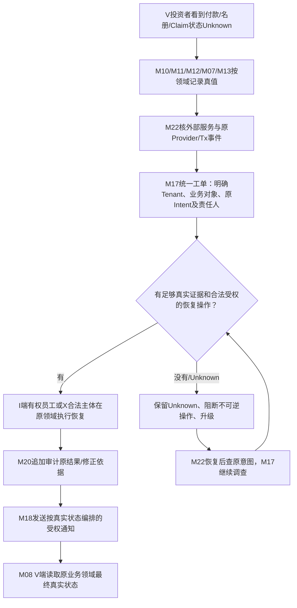

# RWA SaaS｜Step05-05 可视化产品审核：平台后台、全局权限、审批异常、通知、报表与外部服务（Draft v0.1）

> **2026-10-25｜Draft / Pending Product Owner Review。** 本稿仅启动Step05第5个产品场景审核，**Step05-05-R01～R06全部是推荐A、尚未批准**，不能创建DEC-034或直接标记产品级Approved。已批准Step04 M03/M17～M22、Step05-01～04规则维持原效；本稿不新增正式V1功能ID。技术字段/api/schema/真实安全实现、法域/生产资金Signer和测试仍Draft/Not Executed。

**阅读依据**：[平台运营S04-08 Approved](RWA-SaaS-Step-04-S04-08-Platform-Operations-Approved-v0.1.md)｜[M17～M21共享规则与审计S04-06 Approved](RWA-SaaS-Step-04-S04-06-Shared-Workflows-Rules-Audit-Reports-Approved-v0.1.md)｜[M22外部服务S04-09 Approved](RWA-SaaS-Step-04-S04-09-External-Authority-Service-Adapters-Approved-v0.1.md)｜[Step05-04收益/退出DEC-033](../../decisions/DEC-033-step05-04-r01-06-post-issuance-yield-maturity-exit-product-approved.md)。

## 一、先看P/I/V/X如何在一个异常上协作

**图中“有权恢复”不是让P平台成为真实资金、Mint、合法登记或合同签署责任人。** M17只管审批/待办，业务真值始终由原领域裁决。适用的真实法域、数据保留、资金/Signer责任仍待单独审查。

## 二、四端日常角色和功能关系（逻辑页面，不是UI设计）

| 角色/端 | 操作入口和业务职责 | 唯一事实主责 | 严格禁止 |
|---|---|---|---|
| P平台商业运营 | 审核商业买方KYB、Tenant/Standard状态、开停恢复与必要用户支持 | M03操作入口，M01商业真值，M17受权任务 | 不得因为客户KYB已通过就代Issuer批准证券发行 |
| P平台安全/审计 | 必要原文访问申请、授权撤销、跨Tenant安全事件与技术Provider调查 | M20隔离审计/M22环境凭证，M03-F005受控访问 | 不可看客户私钥、默认下载他人投资者身份证或替客户出款 |
| I发行机构团队 | 资产/Offering、KYC资格、认购配售/收益等各自受权人操作 | M04～M13业务真值、M02 RBAC、M17待办 | 部门管理员也不自动是法定签约或金融Signer |
| V投资者/代理 | 本人受权披露、KYC、认购与钱包、订单/收益/退出 | M08本人视图，M09资格、M10～M13真实结果 | 不得浏览其他Issuer和他人KYC/法定名册 |
| X合法外部服务 | 适格KYC/电签、真实资金/登记/链Signer、回执及争议证明 | M22技术交换，相关M09/M11/M12/M07/M13领域裁决 | 不同X各有自己的合同/法域责任，Webhook成功≠业务完成 |

## 三、六项产品负责人待审核问题（推荐A，全部Draft）

| 方案 | 推荐A：产品实际行为 | 已批准边界与不得越界 |
|---|---|---|
| **Step05-05-R01｜平台后台只操作SaaS商业权限与受控服务** | P端可以处理企业KYB、Trial/Paid Tenant开停/恢复、敏感访问及必要安全事件；Issuer端的金融发行、投资者KYC/Offering Eligibility、资金、配售/名册、收益、Token始终由领域及依法有权主体判断，P运维不因管理员权限自动控制客户资金/Signer。 | SaaS商业KYB不同于实际发行许可，平台暂停Tenant不等于暂停真实链合约或抹除法定债务。 |
| **Step05-05-R02｜Tenant／组织RBAC与敏感信息访问统一守卫** | P/I/V端同一业务对象必须在服务端核Tenant、Issuer机构、本人/受权代表、角色与合法业务目的；P高敏访问按申请→有权审批→最小字段／时间授权→到期撤权→M20追加审计，拒绝跨Tenant原件检索/导出；跨Issuer投资者信息共享须合法依据。 | 前端隐藏不代表有效鉴权；普通运营/客服不可默认读取原始投资者KYC或客户密钥。 |
| **Step05-05-R03｜跨域审批与异常恢复使用原业务对象、原意图** | M17统一待审批/补件/差错/升级视图，但任务Done不自动修改业务最终状态；支付、登记、Mint、收益Claim、商业收费的Unknown都按原Intent查询真实权威或合法X，再受权恢复，禁止盲重付、重复配售/登记者重复入账、重复Mint和无证据改权利。 | M17只负责工作流；每个业务真值仍由M01/M04～M13持有；无法查明须保留Unknown和责任人。 |
| **Step05-05-R04｜统一消息中心区分投递、阅读与法律效力** | M18按M10/M11/M12/M07/M13等领域真实事件生成Issuer/投资者受权站内/邮件通知、补件、退款、逾期与分配提醒；发送、送达提供商回执、用户阅读、依法有效法律送达分别显示并记证；无权限链接服务端阻断。 | 不能把通知Sent当退款Paid/法律文件生效；正式法律送达渠道依首发法域专项审查。 |
| **Step05-05-R05｜规则历史、审计和跨端报表共享数据来源** | M19按强制法域限制优先、Tenant及Offering有限配置、审批生效与可追溯版本处理规则；M20保留最少必要访问/动作与外部回执；M21报表和导出只读消费原领域主账并保留币种/份额精度、数据延迟与版本标注。 | 报表金额不能成为另一本合法持款/权益账；普通SaaS管理员不能越权导出其他Tenant敏感数据。 |
| **Step05-05-R06｜外部服务健康、凭证与环境隔离及合法退出** | M22按Tenant/Provider/用途/Trial Sandbox/生产分隔API凭证，验证Webhook来源/去重/重放和服务Unknown；连接失败触发M17升级/M18适用通知、M20审计，服务恢复后按原结果补核；Tenant停用/退租时对仍存续合法资金、登记、收益、Token和投资者查询规定受权交接。 | 平台掌握RPC/API凭证不意味着拥有Issuer资金私钥；V1不包含M22-F009 V3智能切换市场或M03-F003/F004等V2高级客户工单。 |

六项均来源于Step04已有146个V1功能的业务细化；**目前尚未经过Step05-05正式决策审核**，不能自动视为细化PRD Approved或研发需求Frozen。

## 四、最重要的五层独立真值

| 对象 | 唯一权威 | 跨端不得混用 |
|---|---|---|
| 商业客户、Standard订阅及Tenant合法权益 | M01/P受权审核，M03仅操作入口 | Paid不等于Issuer有证券发行/资金Signer许可 |
| 真正的Asset/Instrument、Issuer Offering与法律合同 | M04/M05/M06、Issuer及X有权法律主体 | P商业KYB不替代真实发行主体和Investor资格 |
| 投资者KYC/订单/真钱/名册/Token/收益 | M09/M10/M11/M12/M07/M13 | M17工单解决不等于业务事实自动成功 |
| 工作流/消息/规则/审计与报表 | M17/M18/M19/M20/M21 | 消息、规则版本与报告不是法律资金主账 |
| Provider接入、Webhook及技术健康 | M22与X各自合法服务 | Webhook200/ACK/Provider恢复不代表资金实付、名册生效或Token Finality |

## 五、15类跨端异常及业务恢复提案（Draft / Not Executed）

| 编号 | 错误或异常 | 推荐产品保护 |
|---|---|---|
| E05-01 | P运营误暂停已发行Paid Tenant | 保留既有未了资金/投资者必要查询及合规付款路径，受权恢复与审计 |
| E05-02 | Trial Sandbox调用生产Token Signer或真实资金API | M19/M20/M22强阻断、隔离凭证并触发安全事件 |
| E05-03 | P客服尝试查看其他Issuer投资者原始KYC | 拒绝并审计，敏感权限必须按合法目的申请/有权审批 |
| E05-04 | 同一企业管理员无合法签名权却批准发行 | M02和领域Guard拒绝，平台商业管理员不具备真实法定签名权 |
| E05-05 | M17异常任务已关闭，外部支付仍Unknown | 原领域继续Unknown并开后续升级，不能写已退款/已领取 |
| E05-06 | 重复Webhook和链Tx不同真实转账 | 签名防重放与原TxLog对账，不能重复计收也不能吞掉第二笔真款 |
| E05-07 | M22第三方KYC/登记/支付服务不可用 | 暂停受影响不可逆动作，保留证据，恢复后查原真实结果 |
| E05-08 | 审批权限撤销但客户端仍缓存旧可用按钮 | 服务端实时Guard拒绝，记录权限版本和必要风控升级 |
| E05-09 | 法律文件或Offering规则调整影响在途订单 | 保留原Quote/签署/订单版本，必要通知/确认依法域判断 |
| E05-10 | 消息Sent/Read却未法定有效送达 | M18记录不同事实，有权Issuer补充合法送达手段 |
| E05-11 | 报表导出引用过期读模型金额 | 说明延迟与取数依据，原M11/M13真值不能被报告反向覆盖 |
| E05-12 | 跨Tenant搜索、缓存或导出泄露敏感数据 | M20服务端隔离、阻断、事件记录与依法通知/调查 |
| E05-13 | 资金或Mint结果Unknown被技术自动重试 | 必须先查原Intent/链结果再受权恢复，不能重复出款或Mint |
| E05-14 | 运营结束试用/删除租户却仍有合法权益 | 保留适用法律要求的在途资金、名册、收益和审计移交 |
| E05-15 | M22外部凭证泄漏或误用到生产 | 撤权轮换、受控停用和影响查询，普通P员工不取资金Signer密钥 |

## 六、产品级审计发现：还有什么必须留到Step06？

- **功能覆盖**：P端商业客户/受限平台管理M03，I端工作中心M17、站内通知M18、规则M19、安全与审计M20、只读报表M21、外部X连接M22都有Step04批准对应功能，**当前静态未见必须新建V1核心模块才能覆盖的空档**；仍须逐端按字段/权限与可执行测试复核。
- **绝不能提前解开的13项审计门**：DEC-028有条件认可的13项风险需要Step06按原ID逐项给出证据/责任/法域必要门与实际关闭决策；本Step05-05 Draft不会把它们自动Close或标Frozen。
- **法域与生产**：M11资金、M12法定名册、M07链Signer、M13真实收益义务、商业与Investor KYC、合约地址合法文书、私有数据访问/退租存续及法律通知仍要落实真实责任人、适用规则与证据；没有法律/安全审批就只能产品演示/拟定。
- **版本保留**：DEC-017 193项V1 146/V2 22/V3 20/TBD5不改。M03-F003/F004等高级服务属于V2、M22-F009智能服务市场属于V3；不能以异常路由之名偷偷把它们并入V1。
- **真实验收**：需有未来前后端、安全、沙箱及E2E测试结果。现有产品测试场景均Not Executed，不代表系统实现完成。

## 七、审核之后的阶段计划（未批准下一步产品细化）

用户分别批准R01～R06之后，才可单独创建DEC-034、Step05-05产品级PRD与跨端状态异常规范；未批准项保持Draft。**完成五个场景的产品级规则审核后，仍需统一检查字段级PRD、权限/状态/API边界与DEC-028的13项审计门，才可启动Step06 V1整体需求冻结审核；尚未决定冻结或开发。**

**本轮状态：Step05-05可视化产品审核 Draft v0.1，六项R01～R06待产品负责人批准；四份Frozen、历史DEC/SCOPE不改，PR #6 Draft/Open/Unmerged，不启动UI、开发或真实金融执行。**
