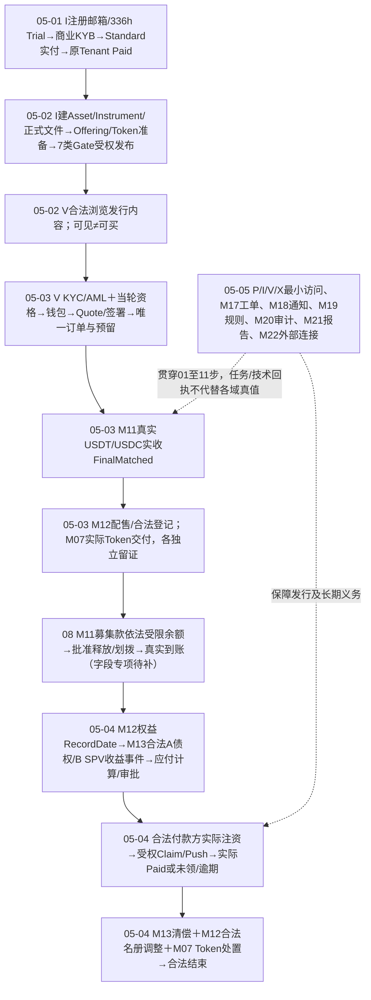

# RWA SaaS｜Step05五场景总体一致性收口及Step06冻结前审核（Draft v0.1）

> **2026-10-25｜审核文档Draft / Static Review Only / Step06 Not Frozen。** 本文对现有五场景**29项已明确批准的产品规则**进行跨模块与四端11步交叉核对，并整理尚需完成的字段级、法域、资金、Signer、技术接口与真正验收证据；它**不新增Approved决策、不批准字段技术方案、不关闭DEC-028 X-01～X-13、不冻结V1.0，不合并PR #6、不启动UI/研发或真实金融生产**。

## 2026-10-26 较新产品工作方向：DEC-036（审计原结论/13门不变）

[DEC-036 Step06-R04=A](../../decisions/DEC-036-step06-r04-a-technology-saas-product-first-and-regulated-activity-production-gate-approved.md)已明确本项目优先完成**全球可配置ToB技术SaaS的通用PRD**，Issuer自行对其具体发行资产负责法律合规，P SaaS对自身实际受监管活动/安全/数据职责保留独立审查；单个法域×Instrument不再是通用产品设计、字段/权限/API审核的前置条件。此前“先选法域，再填字段”的次序已由较新DEC改变；下文历史审计的11步差异、14组字段包和**X-01～X-13仍13/13 Open**全部保留，法律问题转为具体Issuer/平台RG真实生产启用门，不得理解为风险关闭或许可豁免。

现行执行次序：[Step06技术SaaS优先执行计划Draft](../00-governance/RWA-SaaS-Step-06-Technology-SaaS-First-Execution-Plan-Draft-v0.1.md)。Step04 146/146、Step05 29条产品规则仍Approved，193首次版本146/22/20/5及V1未Frozen不变。

## 一、一页产品负责人审核结论（只据文档）

| 维度 | 本次静态核查结论 | 准确的状态说明 |
|---|---|---|
| Step04 V1正式功能ID | **146/146逐ID已按DEC-018～027批准** | DEC-017首次版本归属仍V1 146 / V2 22 / V3 20 / TBD 5，不等于已开发 |
| Step05场景规则 | **五场景29条产品规则已分别批准：7＋4＋6＋6＋6** | 属**产品行为级Approved**，不是全部字段/API/schema/实施已冻结 |
| P/I/V/X四端和11步主链 | **能够找到相应功能与唯一领域Owner，未见需推翻22模块的结构性空档** | 结论继承DEC-028“静态覆盖有条件认可”，不是可运行API和法域审查PASS |
| 模块之间资金/权益/Token | 商业费M01、认购钱M11、收益钱M13、登记权益M12、链Token M07分离 | 正确的**业务权威原则已批准**，具体真实执行/法域生效/差错恢复待字段技术审 |
| 字段级交接 | **不具备完整研发冻结包** | Step05-01的65条字段是候选Draft；Step05-02～05领域数据/权限/状态/API尚无逐项正式签收 |
| Step04十三项审计门 | **X-01～X-13全部Open**，9 High／3 Medium／1 Low | 多项有已批准产品行为承接，但合法生产/技术/验收证据未完成 |
| Step06冻结及代码/生产 | **未获授权** | 此报告只能供用户审核与安排下一轮专项决策 |

**核心结论**：业务闭环层面已经串通，但**现在还不适合宣告“V1开发PRD完全Ready”或“V1.0 Frozen”**。下一步须专项补齐法律/资金/钱包Signer等实务门和字段/API、跨端权限与异常可执行契约。不要让用户逐行审核上百个字段，而应**先批准规则/责任分层，再由研发与合法专业人员填具体接口/字段供验收**。

## 二、五场景业务主链（批准范围准确标记）

**注意**：步骤08的募集资金受权释放/划拨虽在Step04的**M11-F012/F013**已批准，不应误认它已经被Step05-03/04的“投资者支付”“收益发放”全部替代。其资金方、受限余额及实付划拨仍需字段/合法执行专项。以上流程只表示依赖，具体真实法域可能调整法律签署、Token部署和法定登记/Mint顺序。

## 三、五场景逐项审核结果（共29项R，非31）

| 场景 | 链路／主要体验 | 当前规则状态 | P/I/V/X职责与边界 | 唯一真值模块 | 本场景已批准关键Guard | 尚未解决的开发与合法执行项 |
|---|---|---|---|---|---|---|
| **05-01** | 企业注册→336h Trial→商业KYB→Standard合同/付款→原Tenant升级 | DEC-029/030｜7项Approved | P商业审/恢复；I买方账户/草稿；V无真实认购；X商业KYB/付款 | M01/M02/M03/M19/M20/M22 | 付费双状态；Trial只模拟；Paid也须逐Offering合法Gate | 65条字段候选仍Draft；商业价格/税票/付款SDK、精确schema/接口/安全测试 |
| **05-02** | 创建Asset/Instrument→文件与法律证据→Offering/Token准备→合法发布→V披露 | DEC-031｜4项Approved | I编制及受权发布；P不代金融审批；V仅法域有权披露；X律师/评估/Signer | M04/M05/M06/M07/M08/M09/M12 | 发布可见与可认购分离；合同/Token地址和历史报价版本保护 | 首发法域/Instrument、法律文件地址绑定、强制募集方式、P01～P07字段、销售窗/定向授权API |
| **05-03** | 投资者资格及钱包→Quote/签署→订单预留→实收匹配→配售→名册/Token | DEC-032｜6项Approved | V本人认购；I合规/财务/配售；P最小技术支持；X合法资金/登记/Signer | M09/M10/M11/M12/M07/M08 | Order≠Paid≠Allocation≠LegalRegister≠TokenFinality；Unknown必须按原意图调查 | 法定持款与清退、Signer/钱包、链终局确认/幂等/容量并发、身份/合法权益生效条件 |
| **05-04** | 法定权益RecordDate→A债权/B SPV经济事件→应付计算→真实注资→Claim/Push→到期退出 | DEC-033｜6项Approved | I有权财务/公司行动；V本人领取/查询；P受限支持；X有权付款/登记/Signer | M13/M12/M07/M08/M04/M17 | Estimated≠Payable≠Funded≠Paid；Burn不意味着已合法清偿 | 合同及税款计算、合法RecordDate快照、真实支付主体、Claim合约、Unclaimed/逾期及法律退出验收 |
| **05-05** | 商业后台权限与安全→M17原意图任务→M18通知→M19规则→M20审计/M21只读报表→M22服务 | DEC-034｜6项Approved | P SaaS商业/运维；I真实业务审批；V合法数据查看；X法域合法执行与回执 | M01/M03/M17～M22，引用原业务域 | 业务事实唯一；高敏权限限时；工单Done/消息Sent不等于金融或法律完成 | M18邮件SDK vs M22接口归属、RBAC/ABAC、Webhook/监控/SLA、真实Provider、退租法律交接 |

**现行五份产品级权威文件**：

- [Step05-01 产品级Approved](RWA-SaaS-Step-05-01-Onboarding-Trial-KYB-Subscription-Product-PRD-Approved-v0.3.md)
- [Step05-02 产品级Approved](RWA-SaaS-Step-05-02-Issuer-Offering-Investor-Visibility-Product-PRD-Approved-v0.2.md)
- [Step05-03 产品级Approved](RWA-SaaS-Step-05-03-Investor-Subscription-Legal-Holdings-Product-PRD-Approved-v0.2.md)
- [Step05-04 产品级Approved](RWA-SaaS-Step-05-04-Post-Issuance-Yield-Maturity-Exit-Product-PRD-Approved-v0.2.md)
- [Step05-05 产品级Approved](RWA-SaaS-Step-05-05-Platform-Operations-Global-Controls-Product-PRD-Approved-v0.2.md)

## 四、11步逐一对账（Step04关联功能ID可能跨步复用，不可求和成146）

| 主流程 | 核对内容 | 由哪些Step05场景承接 | 领域权威及主要Guard | 现阶段尚不能交付生产的门 |
|---|---|---|---|---|
| **01** | 商业开户、试用、KYB、Standard与原Tenant Paid | 05-01＋05-05 | M01独立商业状态与Trial/Paid职责 | 字段细化/商业Provider/付款Unknown |
| **02** | Issuer组织、人员角色、独立投资者门户 | 05-01＋05-02＋05-05 | M02/M20授权，M08门户与Issuer机构身份独立 | 机构/租户/代理对象权限矩阵 |
| **03** | Asset/Instrument，法律/评估/有效文书 | 05-02＋05-05 | M04权益与M06文书版本，不把上传/签署回执当法定生效 | X-04合法文书与地址、签署及适用法域 |
| **04** | Project/Offering、销售方式、Token准备与发布 | 05-02＋05-05 | M05 P01～07必要Gate；受权人员明确发布；M07链事实独立 | X-02如强制集中募集则版号另审、生产Signer |
| **05** | 投资者账户、KYC/AML、Offering专属资格与钱包 | 05-02＋05-03＋05-05 | M09适格独立于钱包；M08入口与Token接收人受控 | X-07/X-08钱包/跨Tenant复用法域与安全 |
| **06** | Quote/合法签署/唯一认购订单、稳定币支付 | 05-03＋05-05 | M10 Quote、M06签署、M12预留、M11真钱FinalMatched独立 | X-03/X-06资金架构、金额精度、幂等/Finality |
| **07** | 合法配售/登记/Token Mint和最终持仓 | 05-03＋05-05 | M12合法Allocation与名册，M07 Mint链Finality，M08消费结果 | X-01/X-05具体法域名册有效时点 |
| **08** | 募集资金合法释放与受权实际划拨 | 05-03提供前序真款事实；05-05提供审批/审计；需专项字段深化 | M11-F012/F013独立资金释放/划拨业务权威已获Step04批准 | 跨场景字段层重点缺口：受限余额/释放依据/真实划拨Signer、部分出款/Unknown与到账核验，未形成独立Step05字段闭环 |
| **09** | 发行后权益快照、合法收益事件、审批及真实注资 | 05-04＋05-05 | M12真实名册供M13快照；A/B收益合法条件不同 | X-09税费/权益计算与真实注资证据 |
| **10** | Claim/Push/其他合法外部实际支付、未领取 | 05-04＋05-05 | M13真实注资/实付/Unclaimed分开，M08本人显示 | X-03/X-06/X-09合约/Signer/支付最终性与异常 |
| **11** | 到期/逾期/清偿与名册/Token合法退出交接 | 05-04＋05-05 | M13实际清偿、M12名册变化、M07 Token处置各独立 | X-09/X-10法定清偿和Tenant退出义务 |

**正向对账**：01→02→03→04→05→06→07→08→09→10→11各步有Step04已批准V1功能承担。**逆向对账**：146个正式ID由[原Step04全量追踪](RWA-SaaS-Step-04-146-Functions-Four-Lanes-11-Steps-Cross-Audit-Draft-v0.1.md)附录A关联泳道/步骤，**本轮未重做代码/数据库/API层146项逐字段验收**；当前只做五场景静态文档交叉审核，没有运行测试。

## 五、领域唯一事实与P/I/V/X交互一致性

| 真实事实 | 写入/核验唯一权威 | I/P/V/X读取或执行关系 | 错误转换（必须阻断） |
|---|---|---|---|
| 商业Tenant及订阅/商用付款 | **M01**；P通过M03受控 | I SaaS买方自助；P商业KYB/恢复；X真实商业收款；V无权读商用款 | 注册→真款权限；商业支付Unknown→Paid；Tenant退租→删除合法债务 |
| Asset/Instrument、Offerings发布 | **M04/M05/M06**和Issuer合法权利主体 | I创建审批与有权发布；P仅商业支持；V按受权披露；X真正专业法律签署 | Instrument审核→自动公开；Token部署→自动可认购 |
| Investor身份/当轮资格 | **M09**与适格X核验 | V/代理提交；I合规判断；P最小摘要 | KYC Verified→任意Offering Eligible；钱包连接→法律持有人 |
| Quote/签署/订单 | **M06/M10** | V本人签署、I受权审核，P只技术调查 | OrderCreated→已实付、已配售 |
| 认购实收/退款/募集款释放 | **M11**＋合法真实资金方X | I受权财务，V查本人，P不得持款，M22仅监听 | Tx广播/Provider200→FinalMatched；ApprovedRefund→实际已退 |
| 法定容量/Allocation/名册 | **M12**及依法有权Issuer/Registrar | I合法配售和权利确认，V查本人持仓，X依法登记 | 实收→自动股权；Mint成功→法定名册已经有效 |
| Token部署/Mint/Transfer/Burn | **M07**＋有权X Signer及真实链证据 | I准备与合约授权，V钱包视图，P仅技术健康 | TxHash→Finality；Burn→债务清偿 |
| 合法收益/RecordDate/实付/Unclaimed | **M13**引用M12名册与实际合法付款X | I财务/合法主体审批出款，V看真实收益，P不代出款 | 预估→应付、批准→已注资、ClaimSubmitted→Paid |
| 任务/消息/规则/审计/报表/Provider | **M17/M18/M19/M20/M21/M22**各拥有协作事实 | P受限运营，I本业务，V合法消息，X接口提供者 | 工单Done、通知Sent、报表字段或Provider ACK→原金融法律事实成立 |

## 六、字段级与技术决策缺口汇总（供后续分批落实；不是字段审批）

**本表F-01～F-14是本报告局部审计追踪编号，不是新增正式193功能ID或字段已Approved证据。**

| 追踪号 | 工作包 | 必须完善的对象/接口（英文为命名候选） | 已有批准进度 | 未来交付/签收必须具备的具体内容 | 关联唯一模块及X审计门 |
|---|---|---|---|---|---|
| **F-01** | SaaS企业与商业订阅 | Account、IssuerCustomer、Tenant、TrialWindow、CommercialKYBCase、StandardContract、CommercialPayment、EntitlementActivation | 05-01有65项字段候选（名称/类型/必填仍Draft） | 继续技术字段表：合法身份、唯一键、UTC时点、授权、付款证据/原意图、幂等；不得改变336h+720h规则 | M01/M02/M03/M19/M20；X-08/X-10/X-13 |
| **F-02** | 真实发行主体及合同工具 | LegalIssuer/AssetRevision/InstrumentVersion/Obligation/DocumentVersion/LegalSignature/ContractAddressLink | 只有跨端业务权威/版本引用，未完成工程级字典 | 定义Issuer≠SaaS买方≠SPV≠实际资产持有方；法律文件及地址合法绑定的版本/状态/生效证据 | M04/M06/M07；X-01/X-04/X-13 |
| **F-03** | Project/Offering及披露 | Project/OfferingVersion/DistributionAudience/SubscriptionWindow/PublicationGate/PublishedSnapshot | 四项已批准产品规则，精确schema/状态/API未批准 | P01～07适用/不适用/Blocked原因、审批与明确发布、定向访问控制、条款重大变更旧Quote链接 | M05/M19；X-02/X-04/X-13 |
| **F-04** | 投资者KYC与机构代表 | InvestorIdentity/LegalRepresentative/KYBCase/AMLReview/EligibilityDecisionVersion | 产品语义已批准，精确字段与跨Tenant法域规则未定 | 证件/代理权敏感访问、持续制裁/撤销、Offering资格时效、Tenant隔离和合法数据复用 | M09/M20/M22；X-08/X-13 |
| **F-05** | 钱包/Token控制与Signer | PayWallet/TokenReceiver/WalletControlEvidence/SignerAuthorization/MintIntent/ChainFinality | 产品双事实已批准，外部+嵌入式实现未定 | 钱包合法控制权、恢复、Gas与Signer批准矩阵，链/Token精度、供应商安全及Sandbox/生产隔离 | M07/M08/M22；X-05/X-07 |
| **F-06** | Quote、签署、Order与额度 | QuoteSnapshot/SignatureEvidence/Order/Reservation/SeriesCapacity/Allocation | 唯一真值与守卫已批准，工程并发细节仍Draft | 对象主键、法定单位/金额精度、有效期、原子预留/冻结/释放及过期迟到流程、受权重签 | M06/M10/M12；X-02/X-06/X-13 |
| **F-07** | 投资者实际付款/退款 | PaymentInstruction/RealTxLog/FinalityEvidence/MatchedFunds/RefundIntent/ActualRefund | 合法收款与FinalMatched产品语义已批准 | 具体网络与收款方/法定持管、币合约白名单、两笔真转账与Webhook去重、退款授权/目的地址/链重组 | M11/M22/X资金主体；X-01/X-03/X-06 |
| **F-08** | 募集款释放与法定划拨（易漏） | FundReleaseEligibility/RestrictedBalance/SettlementTransferIntent/ActualTransferEvidence | Step04 M11-F012/F013已有Approved功能，但五场景详细字段尚未专门收口 | 明确募集款受限/可释放条件及分批划拨金额、发起批准人与合法Signer、真实出款/到账与部分/Unknown | M11/X合法持款；X-01/X-03/X-13 |
| **F-09** | 法律登记及投资者法定权益 | LegalHolder/RegistrarAuthority/RegisterRequest/EffectiveEvidence/Dispute/Correction | 合法自管或适格外部登记者原则已批准 | 逐Instrument法定生效时刻、名册/Token状态独立、换钱包/权利人授权和回滚/争议追踪 | M12/M07；X-01/X-05/X-13 |
| **F-10** | 存续、RecordDate及经济权利 | SurvivalDuty/RecordDateSnapshot/DebtCoupon/SPVDividendDecision/CalculationVersion | A/B不同产品规则Approved，合同/税款/日期等仍Draft | 真实合同/决议与分红条件、计息和金额舍入、税费、审查与快照更正版本 | M04/M12/M13；X-09/X-13 |
| **F-11** | 收益批次、注资及Claim/Push | DistributionBatch/PrefundingEvidence/ClaimIntent/PaymentFinality/UnclaimedBalance | 业务应付/注资/实付分层批准，合约/执行未定 | 足额性与合法子批次规则、付款方/Signer、安全与审计、Claim去重/Push结果、未领款合法期限 | M13/M22/X付款方；X-03/X-06/X-09 |
| **F-12** | 到期、本金、公司行动与合法退出 | MaturityDuty/PartialDischarge/LegalTermination/RegisterAdjustment/BurnFinality | 清偿/名册/Burn独立Approved | 债权逾期和B SPV退出分别合法决议、真实对价、权利生效/终止时刻与Token锁定/合法Burn | M13/M12/M07；X-05/X-09/X-10 |
| **F-13** | 任务、权限、通知及外部事件 | RoleGrant/AccessPurpose/WorkflowTask/DomainIntent/NoticeReceipt/LegalDeliveryEvidence/ProviderEvent | Step05-05六项业务行为Approved，具体权限码/API/邮件SDK责任Draft | 最小服务端授权、原意图恢复、法定消息/投递区分、M18-F004/F005邮件连接归属与M22健康/凭证关系 | M02/M03/M17～M22；X-06/X-08/X-10/X-11 |
| **F-14** | 跨域E2E与实施验收 | TestEvidence/GoldenPath/FailurePath/AuthorityMatrix/ReportAsOf/APIContract | 当前所有产品测试Not Executed，尚无可引用E2E/Sandbox结果 | V1 146 ID×4泳道×11步→对象字段/状态/权限/API/异常/回执→自动/人工签收证据；不按文档行数冒充测试 | 产品/架构/QA/法律/安全；X-12/X-13 |

### 最低领域字段PRD交付格式（建议，待后续签收）

每个业务对象必须分别写明：**业务含义与法定权威→唯一资源/版本ID→合法创建者与读写范围→数据来源与参考证据→必填/可空/精度/时区→状态枚举与迁移Trigger/Guard/Unknown→错误码/重复消息/幂等/补偿→跨端展示与通知→数据保留/合法删除→UAT/Sandbox验收证据**。

**尤其区分**：M13收益Payment并非M11投资者认购Payment，也非M01商业订阅Payment；M07 TokenBalance不是M12 LegalHolderRegister；M18通知Delivered不是M06法律文书生效。字段可以复用技术基础组件，但**必须保持领域事实不可互相强制改写**。

## 七、13项审计风险对照的实际结论

详见[**X-01～X-13风险逐项对照、建议Owner/证据与Open状态（Draft）**](../00-governance/RWA-SaaS-Step-06-X01-X13-Audit-Gate-Crosswalk-Draft-v0.1.md)。

| 分类 | 数量 | 本轮真实结果 |
|---|---:|---|
| High | 9 | 已关联Step05业务规则与建议的法律/字段/技术Owner；**9项均未关闭** |
| Medium | 3 | KYC数据、Tenant退出、邮件适配责任等已有产品Guard，**仍需真实合同/技术决定，未关闭** |
| Low | 1 | 文档历史状态已有当前权威入口，原Approved文件保持，**未完成正式交接签收，未关闭** |
| **全部Open** | **13** | **13/13继续Open，DEC-028静态有条件认可不变** |

对X-02必须单独提醒：现DEC-017批准V1合法适用的持续认购/基础配售。若首发实际法域依法强制集中募集，需在V1冻结之前正式评审M05-F011、M10-F009、M12-F009/F010这四项目前V2版本归属。**本轮未改变任何193项版号**。

## 八、Step06冻结前建议先后顺序（Draft／未批准安排）

1. **G1｜首发法域和Instrument条件性Gate**：明确拟首发Asset/债权A或SPV股权B的适用法域、发行方、合法募资方式；必要确认X-02，未经另行DEC不改版本。
2. **G2｜资金/登记/钱包/Signer责任门**：合法持款与返款、募集资金释放、名册生效、真实Token地址/签署绑定、钱包与Claim/Push合约安全/法域能否生产。
3. **G3｜五场景的字段/API/权限状态收口**：优先05-01既有65候选，接续05-02～05的F-02～F-13；**重点补完11步08募集资金释放/实际划拨的独立字段与对账**，分领域审核而非让用户手工逐行批上百字段。
4. **G4｜跨端11步和146正式ID双向追踪**：对应每个字段/角色/接口/测试，确保没有V2能力冒充V1；把X-11邮件接口归属明确、X-12历史读者入口冻结前核对。
5. **G5｜可测安全、Sandbox和UAT结果**：形成Golden/Unknown/复核/退款/法律名册/Token/Claim/停服交接与隐私安全真实测试材料；目前均Not Executed。
6. **G6｜用户分别正式审核X-01～X-13每项状态、V1最终范围和Step06 Frozen**。只有满足专业事实、决策证据且用户明确同意，才可以关闭对应门或将V1产品冻结；**本报告不替代授权**。

### 建议产品负责人下一轮只处理的少数关键问题（**均未自动批准**）

- **Q01（优先）**：首发的Instrument/法域如何安排法律确认，以便判断V1持续认购可适用、真实资金持管/Registrar角色？
- **Q02（优先）**：是否将“11步08募集款合法释放/实际划拨”作为单独字段PRD专项，而不与投资者认购款或收益Claim合并？
- **Q03（优先）**：是否同意字段/接口收口由“业务对象/状态与权限矩阵→安全与工程评审→产品只审新增关键决策门”三段进行，而不让用户逐项审批所有字段？
- **Q04（随后）**：是否明确X-11以M18基础邮件功能为产品主责、M22只负责已批准的共用技术凭证/健康能力，具体SDK/接口再审核（当前仅建议，**不批准替代DEC**）？

**本轮禁止产生的误判**：五份Step05产品级文档均已Approved ≠ 字段/schema/API Approved；四端业务覆盖静态成立 ≠ 实际技术跑通；13项风险都有对照 ≠ 已关闭；试用/Standard已定 ≠ 商业定价与法域已定；真实资金/登记/Token/Claim的界面设计 ≠ 获准生产操作。

**最终状态：本Step05总体审核与Step06冻结前建议仅Draft，R01～R06以各已批准场景DEC为准；X-01～X-13全部Open，V1.0整体未Frozen。Frozen/历史DEC/SCOPE和DEC-017 193版本归属原文不改，PR #6 Draft/Open/Unmerged，无UI、代码/合约研发或真实金融生产。**
