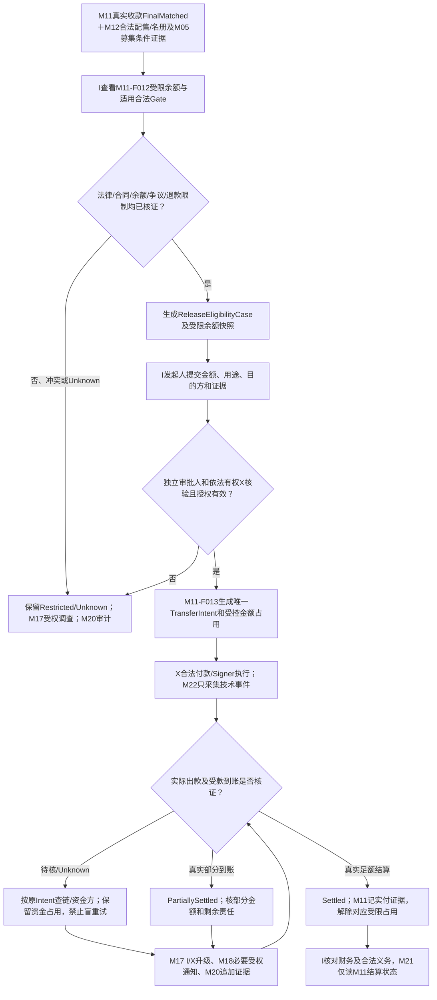

# RWA SaaS｜Step06-02 M11募集款合法释放与实际划拨：专项字段、P/I/V/X状态与异常PRD（Draft v0.1）

> **2026-10-26｜全篇专项字段／权限／接口／法域/真实资金方案Draft；所有测试Not Executed**。依据[DEC-035 R02专项方向Approved](../../decisions/DEC-035-step06-r01-r03-pre-freeze-workstream-method-approved.md)；此前[DEC-023与S04-05](RWA-SaaS-Step-04-S04-05-Issuer-Funds-Lifecycle-Approved-v0.1.md)已批准**M11-F012募集资金受限／可释放余额**与**M11-F013受权划拨及真实到账核验**的产品功能。本稿**不重新批准这些功能、不新增正式ID、不决定合法资金方或Signer**，仅供Step06跨端和字段专项审核。

## 2026-10-26 R04接续｜通用SaaS发行资金工具，不预先固定法域（Draft）

依据[DEC-036](../../decisions/DEC-036-step06-r04-a-technology-saas-product-first-and-regulated-activity-production-gate-approved.md)，本M11专项不以选择J0国家/I0债权样本为前置条件。发行方客户自行决定其具体募资合法性、受限条件及有权资金服务方；平台提供**可配置受限资金业务对象、Issuer授权申请/审批、X真实资金执行、外部最终性证据与异常调查**，而非默认替其募资或控制募集款。下一步按[Step06技术SaaS优先执行计划](../00-governance/RWA-SaaS-Step-06-Technology-SaaS-First-Execution-Plan-Draft-v0.1.md)与[领域矩阵](RWA-SaaS-Step-06-03-Field-State-Permission-API-Review-Matrix-Draft-v0.1.md)优先完善通用字段和P/I/V/X权限。

新增候选产品字段（**Draft非Schema**）：`IssuerMoneyPolicyRef`、`LegalFundHolderRef`、`ReleaseRestrictionRuleRef`、`IssuerApproverAuthorityRef`、`ExternalPayoutExecutorRef`、`ProofOfActualDebitCreditRef`、`ProductionExecutionGate`、`RegulatedActivityAssessmentRef`。Issuer配置/声明**不等于资金依法可以释放的证明**。缺合法实际出款人/Signer、原Intent/批准/规则/受限证据时，真实出款**禁止执行**；SaaS可独立完成工作流配置、模拟和受权查询。若平台实际控制持款、订单执行或Signer，须另审平台自身监管与安全生产门（RG）。

保留上游DEC-023、Step05 Guard：FinalMatched≠Eligible≠Approved≠Settled；M11认购款与M13收益款及M01 SaaS商业账严格分离；Unknown只能查原Intent。原文法域/资金方专项Gate仍保留作为**特定Issuer真实启用/平台行为RG证据门**，不阻断通用字段PRD。

## 1. 为什么必须单独成章

11步端到端业务的**第08步**发生在认购真钱核验、配售/名册等合法前置条件之后、发行后收益分配之前。这一步是**募集资金依合法条件释放、受权向合法接收方实际划拨和真实到账确认**；不得与以下三种事实混淆：

| 原资金或权益事实 | 权威主责 | 与第08步的关系 |
|---|---|---|
| SaaS Standard商业订阅费 | **M01** / X商业收款方 | 与发行募集款完全分账，P平台商业运营不成为发行资金持管人 |
| 投资者认购实收及退款 | **M11-F001～F011** / X合法持款者 | **FinalMatched证明合法真实收款匹配**，不自动证明募集款可释放；退款批准也不等于已实际退钱 |
| 募集款受限、可释放与受权划拨 | **M11-F012/F013** / X真实付款方 | **本专项唯一业务主题**；Eligible不等于Approved，Approved不等于Settled |
| 配售/法定持有人及Token交付 | **M12法定权益、M07链事实** | 作为适用法律条件的输入，不允许由链余额或界面“已发行”单独决定释放 |
| 发行后收益/本息出款与Claim/Push | **M13** / X真实付款方 | 不能将募集款转出视为投资者收益已注资/已支付 |

本稿接续[Step05五场景审核](RWA-SaaS-Step-05-Five-Scenarios-Consistency-and-Step-06-Pre-Freeze-Audit-Draft-v0.1.md)F-08以及[Step05-03产品级PRD](RWA-SaaS-Step-05-03-Investor-Subscription-Legal-Holdings-Product-PRD-Approved-v0.2.md)、[DEC-028风险对照](../00-governance/RWA-SaaS-Step-06-X01-X13-Audit-Gate-Crosswalk-Draft-v0.1.md)。原业务Guard已Approved；下面的英文标识、表格字段和接口均是**候选，不是最终工程契约**。

## 2. 四端责任与严格业务授权（候选矩阵）

| 操作/事实 | P SaaS平台 | I Issuer受权人员 | V投资者 | X依法有权外部/Issuer执行主体 |
|---|---|---|---|---|
| 受限/可释放余额查询 | 仅经授权故障证据摘要，不读他人资金原始敏感账户 | 本Issuer资金/合规受权查询 | 仅本人依法允许的订单/付款状态，不默认展示募集方全量资金 | 提供合同约定的真实资金/持管对账证据 |
| 释放资格申请/核查 | 不代金融决定或修改资金余额 | 财务可发起、合规/必要法定角色复核受限条件；职责分离 | 不发起发行募集款释放 | 依法出具限制解除/资金持管可释放的权威依据 |
| 划拨申请、批准及收款方核验 | **没有默认批准权、操作私钥或出款权** | 授权发起人与独立批准人审核用途、金额、接收方、余额与期限 | 不修改账户/Signer | 独立判断合法持管、目的账户、签名及出款权限 |
| 真实付款、失败和Unknown调查 | 仅M17任务/M22连接与M20留证，不能代出款 | 财务核对原TransferIntent、升级或依法申请修正 | 依法可查询本人资金进度，不将转款等同分红 | 根据法定授权执行，返回真实tx/银行或支付结算证据 |
| 对账与关闭 | 不得以Webhook200/工单Done把M11标Settled | I本业务责任人核对资金源和受款真实证据、异常余额 | 仅本人受权视图 | X提供最终性/入账/退回或司法冻结等外部真实事实 |

**任何Issuer Tenant管理员身份都不自动等于合法出款批准人；任何P后台管理员身份都不自动等于资金控制、合约Signer或托管资质。** 资金持管X可以在依法允许时为Issuer自身，但不能由软件默认推断。

## 3. 逻辑数据对象与候选字段分组（字段Draft，非Schema）

| 对象（候选） | 需要记录的最小业务字段/证据线索（**名称与类型均待专项批准**） | 唯一业务真值与受限条件 |
|---|---|---|
| **FundPool / SourceMoneyLedgerRef** | TenantID、LegalIssuerID、OfferingID/SeriesID、InstrumentVersion、MoneyType、Asset/Token/Chain、LedgerSourceRef、CustodyOrHolderAuthority、EvidenceAsOf | M11引用合法资金X；不得用M21报表余额、M07钱包余额覆盖权威账 |
| **ConfirmedSubscriptionFunds** | OrderID、M11 PaymentIntent、FinalMatchedAmount、Currency/Precision、FinalityEvidence、LegalValueDate、UnmatchedOrLateAmounts | FinalMatched只代表真实已匹配；部分实收/晚到及法定退款的不同真款需分开 |
| **RestrictedBalanceSnapshot** | SnapshotID/Version、AsOf、RestrictedReasonRefs、RefundObligations、PendingDisputes、Encumbrances、AlreadyCommittedRelease、AvailableAfterRestrictions、UnknownSources | M11-F012；具体法定受限类型/算术公式须J0×I0合法意见与资金方对账后定 |
| **ReleaseRuleVersion** | InstrumentVersion、OfferingTermsVersion、SubscriptionModel、RequiredLegalMilestones、SourceOfAuthority、Expiry/RecheckTrigger | M05/M06/M12提供上游合法条件；不能把“全部募资成功”写成任何法域默认必要条件 |
| **ReleaseEligibilityCase** | CaseID、FundPoolRef、RequestedPortion、Currency、EffectiveRuleVersion、ComputedAsOf、GuardResult、BlockReason、EvidenceRefs、ResponsibleReviewer | M11-F012；**Eligible仅表示通过已批准条件校验**，不代表批准或实付 |
| **ReleaseApproval** | ApprovalID、CaseID、ProposerID、IndependentApprover(s)、AuthorityProof、Purpose、AmountCap、ValidityPeriod、DecisionTime、AuditRef | I依法授权审批与X法定批准链；同一人自批、过期、撤销须阻断 |
| **SettlementTransferIntent** | IntentID、ReleaseApprovalRef、Issuer/PayeeLegalEntity、BeneficiaryAccountOrWalletRef、Asset/Network、Amount/Precision、PaymentPurpose、QuoteOrFeeVersion、IdempotencyRef、Expiry | M11-F013；**原Intent不可变更接收人/币种/链后继续使用**，改动应依法重新授权 |
| **ExecutionAttempt / ExternalEvidence** | AttemptID、IntentID、ProviderOrChainRef、TxHash/TransferRef、RequestTime、ExternalStatus、FinalityOrBankSettlementEvidence、SignerAuthorityRef、UnknownReason | X真实执行；M22技术回执不等于M11业务最终真值；具体Signer/确认阈值待技术+法域审 |
| **SettlementReconciliation** | IntentID、ActualDebited、ActualCredited、FeeDifference、PartialTransfers、ReversedOrReturned、StatusAsOf、OriginalEvidenceRefs、ApprovedCorrection | M11-F013；需分别观察真实出款和收款方入账，合法完成点按资金工具/法域确认 |
| **ReleaseException / AuditTrail** | DomainIntent、RelatedEvidence、Dispute/FreezeID、CurrentOwner、CaseAge、ActionHistory、CorrectionReason、M17Task/M20Audit/M18NoticeRefs | Unknown不冲销、不盲重试，不静默改动法定或真实余额 |

**精度说明**：金额不得先转浮点用于计算；币种/Token decimals、法定记账单位、时区与资产最终性需后续数据与法域审核。本稿不指定Decimal位数、账本表结构、系统错误码或具体链确认数。

### 初步余额逻辑（非获准结算公式）

`待法域核验的可释放候选余额` 必须以可核实的合法受持款源、截至同一AsOf的FinalMatched实收及必要退款/预留、适用募集或其他法定限制、已占用/已划拨额等为输入，并逐项标注**来源、精度、可用时间与不确定性**。某数据源缺失或冲突应标Blocked/Unknown，**不能采用“观察到钱包余额 = 可释放金额”的捷径**。具体计算公式和法律释放条件留L04与资金责任方核验。

## 4. 三套不能混淆的产品状态（候选标签，不是enum）

| 状态机 | 语义（独立状态） | 严格禁止的错误推断 |
|---|---|---|
| 释放资格 | `Restricted` / `EvidencePending` / `Eligible` / `Blocked` / `Unknown` | Eligible ≠ Issuer Approved、≠合法收款方已同意、≠资金已转出 |
| 审批授权 | `NotRequested` / `Requested` / `NeedsInfo` / `ApprovedScoped` / `Rejected` / `Revoked` / `Expired` | ApprovedScoped ≠ TransferSubmitted；审批必须绑定金额、接收方、用途和有效期 |
| 执行与对账 | `NotSubmitted` / `Submitted` / `PendingFinality` / `Unknown` / `PartiallySettled` / `Settled` / `FailedVerified` / `ReturnedOrDisputed` | TxHash、ProviderAccepted或技术重试成功 ≠ 法定真实Settled |

三者必须按`ReleaseCaseID → ApprovalID → TransferIntentID → ExecutionAttemptID → ReconciliationEvidence`受权关联；同一募集池可合法存在多次**不同**释放申请，但要有并发额度/余额锁定和相互引用的受限记录。产品状态`Unknown`须保留原Intent并走调查，不通过再点击重复出款。

## 5. P/I/V/X 第08步跨端主流程（产品语义承接已批准原则，技术Draft）

**法定依赖的顺序可因J0×I0变化**：特别是是否须全部募集成功、先登记还是先释放、款项使用用途限制，均需适格法律意见和发行合同验证。本图不批准固定的法律时序或真实钱包资金流。

## 6. 特殊与失败场景 E08-01～E08-14（测试未运行）

| ID | 原因/观察 | 必须保护的产品行为（候选异常规格） |
|---|---|---|
| E08-01 | 收款已FinalMatched但发行条件/合法释放条件未达成 | 资金仍Restricted，不因订单Paid或Token Mint自动Eligible |
| E08-02 | 同一资金池含退款待处理、冻结、争议或Late/Unmatched款 | 分开账面余额和有效可释放候选余额，争议/证据缺失触发Blocked |
| E08-03 | 法域强制集中募集或Offering合同版本变更 | 重新检查ReleaseRuleVersion；如触及V2范围先走X-02，不静默释放 |
| E08-04 | 发起人与批准人为同一无合法独立授权者、越权或批准到期 | 服务器侧守卫阻断，记录原申请，不能以管理员身份绕过 |
| E08-05 | 放款批准后收款方地址、资产/网络、金额或用途被替换 | 不沿用旧Approval/签名；法定有权人重新核验或新建Intent |
| E08-06 | 用户重复点击、API超时、Provider无应答 | 查询原TransferIntent/付款方结果并保持Unknown，不重复真实出款 |
| E08-07 | 同一Webhook重放两次，或两笔真实不同合法划拨 | 同一外部事件不得重复结算；不同合法TransferIntent不得误合并 |
| E08-08 | 链重组、异常Gas或第三方回执成功但收款方未入账 | 保留Submitted/Unknown和外部回执差异，不标Settled |
| E08-09 | 真实资金只划出或只到账部分金额 | PartiallySettled并精确计算差额、保留剩余受限/未履约，禁止直接归零 |
| E08-10 | 付款实际成功但本地写入失败，之后恢复 | 以原资金方证明+原Intent对账补记，不能产生新出款 |
| E08-11 | Tenant欠费、误暂停或退租时存在合法已承诺划拨 | 保持资金法定义务与受权核查/移交，不得用商业Subscription状态冲销真钱 |
| E08-12 | 收款账户/钱包不合法、制裁/黑名单更新或Signer被撤权 | 暂停执行，升级合规安全责任人；既有真钱状态和证据不删除 |
| E08-13 | 实际退回、无法支付或收到监管/法院资金冻结指令 | 独立留存外部证明，停止新出款并依法处理，不归类为单纯FailedRetryable |
| E08-14 | P平台客服以运维名义尝试读取钱包密钥/操作出款 | 拒绝、审计并按安全事件升级，平台不取得客户资金执行权 |

## 7. 逻辑接口及事件契约（**非实际API路径/HTTP/schema批准**）

| 业务操作（候选） | 请求需要的前置依据 | 可读的结果/错误类别（候选） | 不变量 |
|---|---|---|---|
| `ReadRestrictedFunds` | Issuer/Tenant/Offering合法读取权、FundPoolRef、AsOf | 金额来源及受限/Unknown详情、过期/无权/数据延时 | M11为释放主责，M21只读 |
| `EvaluateReleaseEligibility` | Instrument/Offering版本、合同/合法解除限制证明、M11/M12真值 | Eligible/Restricted/Blocked/Unknown＋证据缺项 | 不自动执行付款 |
| `RequestRelease` | 发起人合法角色、金额币种、目的/接收方、ReleaseCase证据 | Requested/NeedsInfo/Rejected；非法重复/额度冲突 | 受控占用与幂等 |
| `ApproveRelease` | 独立受权审批人、审批有效期/金额上限/法律责任 | ApprovedScoped/Rejected/Expired/Revoked | 审批不等于已划拨 |
| `SubmitTransferIntent` | 受权最终释放证明、合法Signer/X、目的钱包/银行校验 | Submitted/Unknown/Blocked＋原Intent引用 | 单一Intent禁止盲重发 |
| `ReconcileTransfer` | 外部付款与受款证据、合法最终性/时间/币种 | PartiallySettled/Settled/Unknown/ReturnedOrDisputed | 真实结算不由Provider200决定 |
| `EscalateException` | DomainIntent、原始证据/权限、差异原因 | M17受权任务/M18必要通知/M20审计引用 | 工单Closed不写M11真钱真值 |

## 8. 本专项未决Gate与后续签收条件

| 门 | 未决事项 | 关联风险 | 必须谁来确认（仅建议职责，不是正式指派） |
|---|---|---|---|
| **FR-G1 法域** | 募资/托管/退款/释放的法定条件、主体、资金归属 | X-01/X-02/X-03 | 首发J0×I0法务、Issuer真实义务主体、合法资金方 |
| **FR-G2 金额与权限** | 真实受限账本、法定计算与分批可释放、审批授权/额度锁 | X-03/X-06/X-13 | I资金负责人＋架构/安全＋实际持款方 |
| **FR-G3 执行与Signer** | 银行/合约/支付实现、网络币种、签名方、密钥管理 | X-03/X-07 | 合法资金/Signer主体＋技术安全负责人 |
| **FR-G4 外部核验** | Tx最终性、真实出入款和差额、部分/未知、对账规范 | X-06/X-13 | X真实结算方＋M11负责人＋QA |
| **FR-G5 交接与持续义务** | Tenant退租/冻结/争议时最小资金访问与合法责任移交 | X-10/X-13 | Issuer合法责任人、SaaS法务运营及安全 |

**Draft最低验收包建议**：资金池/订单/发行条件/Instrument版本和限制的来源；每一个钱的独立唯一Intent；金额精度与最终性、签署/审批分离、P/I/V/X授权；至少E08-01～14异常的后续Sandbox证据；具体法域法律依据；与[Step06-03全局审查矩阵](RWA-SaaS-Step-06-03-Field-State-Permission-API-Review-Matrix-Draft-v0.1.md)双向关联。**当前均没有API契约批准或真实测试通过。**

**状态**：方向R02 Approved，本文字段/状态/权限/API与合法执行方案全篇Draft；DEC-028 X-01～X-13仍13/13 Open；193项版本和M11现有ID均不变；V1.0未Frozen，PR #6 Draft/Open/Unmerged，禁止UI/研发/真实资金和链上生产。
