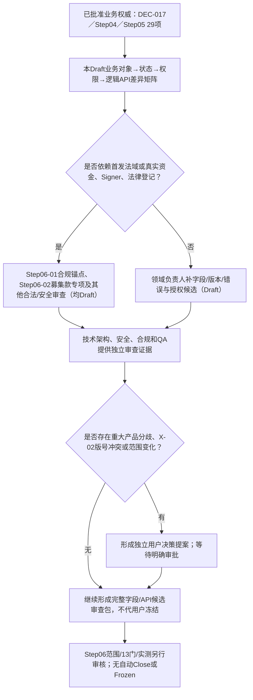

# RWA SaaS｜Step06-03 五场景统一对象、状态、权限与API审核矩阵（Draft v0.1）

> **2026-10-26｜Draft／审查框架，不是工程Schema、接口或权限码规格，不代表开发可直接实施**。[DEC-035 Step06-R03](../../decisions/DEC-035-step06-r01-r03-pre-freeze-workstream-method-approved.md)批准**“先形成业务对象/状态/权限矩阵 → 法域和技术/安全专项审核 → 产品负责人只审核新出现的关键分歧”**的工作方法。上游Step04 146/146正式V1功能和Step05五场景29条产品规则Approved维持；本文的具体字段候选、状态enum、接口、安全、法域、Signer、法律责任及测试均Draft/Not Executed；X-01～X-13继续Open。

## 1. 已批准与未批准的层次

| 层次 | 现行权威 | 状态 | 本轮可做与不可做 |
|---|---|---|---|
| 功能身份和版本 | [DEC-017](../../decisions/DEC-017-step03-r01-06-approved-193-release-assignments.md)／193统一主表 | 193项首次版号Approved：**V1 146、V2 22、V3 20、TBD 5** | 只做映射，不增删/重排正式ID |
| V1业务行为 | DEC-018～027、146项Step04追踪台账 | 146/146功能级Approved | 继承唯一领域事实与Guard，不改变法定责任 |
| 五场景跨端产品语义 | DEC-029～034与相应Approved PRD | **29条产品规则 Approved：7+4+6+6+6** | 读用产品行为，不能升格字段/API自动已批 |
| Step06审查方法 | [DEC-035](../../decisions/DEC-035-step06-r01-r03-pre-freeze-workstream-method-approved.md) | R01～R03方法Approved | 可以产出专项Draft、整理关键审批分歧 |
| 字段/状态/权限/技术API、法域/资金/Signer/安全 | 本矩阵及专项文档 | **Draft/Unknown** | 不授权真实出款、部署或把测试标PASS |
| 全量Step06冻结及DEC-028风险 | [X-01～13对照](../00-governance/RWA-SaaS-Step-06-X01-X13-Audit-Gate-Crosswalk-Draft-v0.1.md) | **13/13 Open，V1未Frozen** | 仅做证据追踪；关闭需独立用户批准 |

## 2. 分层完成原则（Approved仅指方法）

1. **第A层：产品对象/状态/权限静态对账（当前起草Draft）**。先按五场景、11步、P/I/V/X、唯一权威、与146正式ID/29规则关联；区分业务真值和派生视图。报告**缺失证据和待决问题**，不假造精确字段或通过率。
2. **第B层：领域数据/接口候选契约（Draft）**。逐对象补候选身份、版本、来源、目的、精度、时区、权限、生命周期、变更/撤销及异常；每个逻辑接口要求Owner/输入/证据/错误/幂等/可观测结果；不提前固定HTTP路径、enum或数据库表。
3. **第C层：独立专项审核（待法域/技术/安全评审）**。法域×Instrument先审合法发行/资金/登记/清偿门；安全和技术审单一Intent、账/链最终性、钱包与Signer、隔离和恢复；QA之后才可提供实测证据。所有专业Owner先标**建议角色/未任命**。
4. **第D层：用户重大分歧审批（以后独立DEC）**。仅当涉及产品责任变化、合法募集模式、V1功能版号、真实持款/Token/Signer主体、关键法律结论或影响用户产品选择时形成2～4个高价值问题；**不让用户逐行批字段**。
5. **最终Step06冻结必须另提正式审批**，不以A/B/C/D层文档完成度自动触发。

## 3. 五场景统一产品对象×状态×四端权限×逻辑接口总表（均为候选）

**以下“写/看”仅是逻辑职责，不是已批准RBAC策略或可执行权限；合法投资者代表与P高敏访问还须核验。逻辑接口只是行为名，不能直接编码。**

| 场景/11步 | 核心对象与唯一权威 | 业务状态不可混用的关键语义 | P/I/V/X候选权限边界 | 逻辑操作/证据接口（Draft） | 需独立审核的风险 |
|---|---|---|---|---|---|
| 05-01 / 01 | SaaS买方、CommercialKYB、Trial/Standard、Tenant｜**M01** | AccountVerified≠KYBApproved≠Paid/Active；原Tenant升权，336h+720h规则不改 | P有权商业审/支持；I申请/管理自账户；V不获得真发行权；X商业KYB/付款凭据 | VerifyAccount / ReviewCommercialKYB / ActivatePaidSameTenant / QueryOriginalCommercialPayment | X-10/X-13；05-01现有65条候选字段仍Draft |
| 05-01/05-05 / 02 | IssuerTenant、UserRole、ProxyAuthorization｜**M02/M20** | RoleGranted≠法定Signer、合法代表或越Tenant可读 | P仅合法最小支持；I授权本Issuer；V本人/代理；X合法身份/代理证据 | RequestGrant / RevokeGrant / AccessDecision / AuditAccess | X-08/X-13 |
| 05-02 / 03 | LegalIssuer、AssetRevision、InstrumentVersion、LegalDocuments｜**M04/M06** | 已上传文件≠法定生效；Issuer≠SaaS Tenant ≠ SPV | I创建/法定签署；P不代金融批准；V受权披露；X真实律师/评估/签署 | CreateInstrumentVersion / AttachEvidence / ConfirmLegalDocumentEffect | X-01/X-04 |
| 05-02 / 04 | Project/Offering、Audience、Gate、PublishedSnapshot｜**M05/M19** | PublishVisible≠OfferingEligible/可买；发布须明确授权 | I发行审核与发布；P商业后台不发布证券；V合法可见；X法定披露核验 | EvaluateP01ToP07 / AuthorizePublication / GetAudienceView | X-02/X-04/X-13 |
| 05-02/03 / 04/07 | TokenContract/SignerIntent/ChainEvidence｜**M07 + 有权X** | TxSubmitted≠Finality；TokenBalance≠LegalRegister | I依法准备；P仅连接健康；V查询个人钱包；X真实Signer | RequestMint / VerifyChainFinality / ReconcileTokenAndRegister | X-04/X-05/X-07 |
| 05-03 / 05 | Investor/LegalRepresentative/KYC/OfferingEligibility｜**M09** | KYB/KYC通过≠任何OfferingEligible；钱包≠持有人 | V受权提交；I合规判定；P仅最小访问；X KYC/AML结果 | ReviewKYC / EvaluateCurrentEligibility / RecheckAuthorization | X-08/X-13 |
| 05-03 / 05 | WalletBind/PayWallet/ReceiverWallet｜**M08/M07/X** | PaymentSource≠TokenReceiver；Connect≠ControlProof | V本人控制；I符合规则下核验；P不能看密钥；X合法钱包/Signer | VerifyWalletControl / BindTokenReceiver / ReadWalletState | X-05/X-07 |
| 05-03 / 06 | Quote/Signature/Order/Reservation｜**M10/M06/M12** | OrderCreated≠Paid、Allocated；预留须可原子控制 | V本人报价签署；I受权认购规则；P无权签；X法定电签证据 | QuoteSnapshot / ValidateSignature / ReserveCapacity | X-02/X-04/X-06 |
| 05-03 / 06/07 | PaymentIntent/FinalMatched/RefundIntent｜**M11/X资金方** | TxHash/Observed≠FinalMatched；RefundApproved≠Paid | V查询本人；I真实收款审核/退款申请；P不默认持款；X真实付款执行 | IssuePaymentInstruction / ReconcilePayment / AuthorizeRefund / VerifyActualRefund | X-01/X-03/X-06 |
| 05-03 / 07 | Allocation/LegalHolderRegister｜**M12 + 合法登记人X** | Paid≠Allocated；Mint≠合法名册已生效 | I依法配售登记；V查本人；P技术支持不改权利；X适格登记者 | AllocateCapacity / ConfirmEffectiveRegister / DisputeCorrection | X-01/X-05 |
| **05-03/05-05 / 08** | **RestrictedBalance/ReleaseEligibility/Approval/TransferIntent/SettlementEvidence｜M11-F012/F013** | **Eligible≠Approved≠ActualDebited≠Settled；Unknown查原Intent** | **I合法财务发起+独立批准；P不代出款；V仅合法个人视图；X实际合法付款/到账证据** | **ReadRestrictedFunds / EvaluateRelease / ApproveRelease / SubmitOriginalTransfer / ReconcileSettlement** | **X-01/X-02/X-03/X-06/X-07/X-10/X-13；专项[Step06-02](RWA-SaaS-Step-06-02-M11-Funds-Release-Settlement-Field-Cross-Lane-PRD-Draft-v0.1.md)** |
| 05-04 / 09 | RecordDateSnapshot/InstrumentObligation/DistributionDecision｜**M12/M04/M13** | Token余额≠记录日法定权益；A债权≠B SPV自动有息/回购 | I有权公司行动与财务；V本人权益；P不创造分红义务；X法定意见 | FreezeRecordDate / VerifyLegalDistributionDecision / CalculatePayable | X-09/X-13 |
| 05-04 / 10 | YieldBatch/Prefunding/Claim/Push/Unclaimed｜**M13 + X合法付款方** | Estimated≠Payable≠Funded≠Paid；ClaimSubmitted≠到账 | I合法付款审批；V本人受权领取；P只读支持；X真实支付/签名 | AuthorizeDistribution / ConfirmPrefunding / ExecuteClaimOrPush / ReconcilePaid | X-03/X-06/X-09 |
| 05-04 / 11 | Maturity/MandatoryReturn/LegalTermination/RegisterChange/Burn｜**M13/M12/M07分别** | Burn≠本金法律清偿；名册变化≠链已处理 | I有权存续/清偿，V持有人查询；P不代义务；X法律/资金/Signer事实 | ConfirmActualDischarge / UpdateLegalRegister / ReconcileBurn | X-05/X-09/X-10 |
| 05-05 / 01～11 | WorkflowTask/Notice/RuleVersion/Audit/Report/Provider｜**M17～M22** | TaskDone≠真款完成；NotificationRead≠法定送达；Provider200≠合法业务Final | P最小运维/安全；I业务Owner；V合法通知与本人资料；X外部证据/合法送达 | EscalateDomainIntent / DeliverNotice / RecordProof / Audit / ReadAsOfReport / CheckProvider | X-06/X-08/X-10/X-11/X-12/X-13 |

## 4. 产品字段契约最小模板（每组填写但绝不自动批准）

| 审核维度 | 必须填写的内容 | 为什么要明确 |
|---|---|---|
| 对象身份与法定权威 | Domain、ObjectID、Tenant/Issuer/Investor、OriginalIntent、权威来源及跨系统引用 | 防止M01/M11/M13三套资金、M07/M12两套权益真值混写 |
| 类型、精度、版本与时间 | CandidateName、DataType/Scale（待专家定）、Nullable、UTC时点与法律生效时点、Instrument/Document/Offering版本 | 防止错误金额、旧报价覆盖、LegalEffectiveAt被链时间替代 |
| 数据权限与保留 | ServerSideAuthScope、业务目的、本人/代理、合法保留与撤回、P高敏临时授权 | 跨Tenant、法域隐私、过期授权禁止继续读取 |
| 状态迁移 | 独立StateDomain、CurrentState、Trigger、Guard、Evidence、Unknown/Disputed及撤销或法律不可逆 | 任务Done、按钮点击、Provider ACK不得伪造主业务完成 |
| API/事件接口 | LogicalOperation、Owner、InputRef、ExpectedEvidence、Idempotency/VersionGuard、ErrorCategory、Replay/Timeout、CorrelationRef | 外部重试、链重组、两笔真钱/一个重复Webhook正确区分 |
| 异常与测试 | E-case ID、预期拦截、原Intent恢复、审计、P/I/V/X可见度、未来UAT/Sandbox证据 | 目前全部未执行，不能把静态文档当成功测试 |
| 专业/用户决策 | J0×I0法域意见、真实持款/Signer、是否改变V1功能、用户批准DEC编号 | 防止把技术实现选项提升为监管/版号授权 |

**推荐的状态机交付方式**：为每个领域独立列 `SourceStatus → Trigger → Guard → TargetStatus → ReadVisibility → ActionActor → ExceptionRecovery → EvidenceOwner`；跨域汇总仅派生状态，不额外拥有资金、法定权益或Token真值。

## 5. P/I/V/X跨域权限概念矩阵（Draft）

| 行为 | P | I | V | X |
|---|---|---|---|---|
| SaaS商业KYB、Tenant Trial/Standard | 合法受权操作 | 本买方账户管理 | 不得操作 | 商业KYB/订阅支付外部证据 |
| Issuer资产/Offering/法律文件 | 只限获准技术协助 | 本Issuer合法人员创建/审批/发布 | 当前受权披露 | 适格评估/律师/签署证明 |
| 投资者KYC和付款/法定权益 | 最小必要摘要，临时高敏另批 | 本Issuer合规/资金/法定登记责任人 | 本人或有效代理查询/提交 | 有权KYC、持款、登记者、Signer |
| 募集款释放/划拨 | **禁止默认真实资金执行** | 财务发起＋独立授权与合法结算查询 | 不得操作募集池 | 依法受权付款或真正Signer |
| 收益、到期/退出 | 不代收/付/清偿 | 本Issuer有权公司/财务行动 | 本人收益与权利查询 | 合法资金付款/名册/Signer证据 |
| 平台规则/事件/通知/审计 | 合法业务目的最小访问 | 本机构工作流/证据读取 | 本人通知/访问 | 按合法职责回执，不授多Tenant漫游权限 |

所有敏感权限最终仍须按**Tenant、Issuer、本人/代理、角色、用途、有效期、批准与审计证据**服务端核验，具体RBAC/ABAC码、服务商和合同留独立审核。

## 6. F-01～F-14原Step05审计工作包的下一步落地方式

以下F编号**只引用[Step05总体审计Draft](RWA-SaaS-Step-05-Five-Scenarios-Consistency-and-Step-06-Pre-Freeze-Audit-Draft-v0.1.md)的本地追踪工作包**，不是193正式功能ID。

| 工作包 | 先补的产品/字段对账材料 | 专项法域/技术复核 | 用户仅在什么情况下需要决策 |
|---|---|---|---|
| F-01 | 05-01现有65字段候选与336h/720h、原Tenant/商业付款独立 | 身份/商业付款、权限/实现 | 改商业产品行为或价格/权益政策 |
| F-02/F-03 | 法律Issuer/Instrument、Offering发布与文书/地址版本 | **Step06-01 J0×I0**、披露与签署 | 首发锚点、募集方式、合同/权利主体变化 |
| F-04/F-05 | 投资者/代理、跨Issuer资格、钱包与Token接收 | 隐私合规＋钱包/Signer安全 | 真实托管/Signer责任或法域方案 |
| F-06/F-07 | Quote、预留、真实付款、退款和Finality | 并发、资金身份/合法收款、链最终性 | 资金控制、发行最低功能差异 |
| **F-08** | **M11-F012/F013独立ReleaseCase/TransferIntent/E08异常** | **Step06-02 + J0×I0实际持款与Signer专项** | **合法资金责任与释放方案发生实质产品选择时** |
| F-09 | 合法名册/生效/争议 vs Token | 登记合法效力、独立双账对账 | 法定登记主体/受益人映射 |
| F-10/F-11/F-12 | RecordDate、A/B收益、注资/Claim、清偿/退出 | 税/法域、合法付款、法定债务消灭 | 发行后必须采用的合法分配模式 |
| F-13 | M17～M22工作流/通知/隐私/外部凭证 | M18邮件与M22公共能力边界；安全接口 | 如果扩大功能范围或改变既有批准责任 |
| F-14 | 146ID×11步×四端追踪与验收用例 | 真实Sandbox/E2E与专业签收证据 | 是否满足整体V1冻结门（后续独立决定） |

## 7. 审核先后依赖与禁止自动状态升级

## 8. 今后的关键决策入口（目前只是准备，不是问题已批准）

1. **首发验证锚点**：用户选择候选J0主法域与I0 Instrument类别、谁提供有资格的法律审查；如果J0尚未确定，可先批准调研候选而非生产落地。
2. **募集款合法控制链**：实际发行和募集方式确定后，谁拥有真正的受限资金、审批、真实出款和到账判定权；**当前不预选合约/外部支付商/Signer**。
3. **条件性重大差异**：若必须集中募集，单独讨论当前V2四项；若法域或资金控制必须改变已批准产品业务规则，也要另行用户决策。
4. **邮箱与基础外部能力归属**：X-11的M18邮件/M22共同凭证与健康可在专项架构评审后提出**产品职责差异**，但不自动新增功能ID或默许技术实现。

**最后边界**：本矩阵是可审查的工作底稿，不是字段、技术、权限、法律结论、合约和资金执行的批准；13项X仍全部Open，V1未Frozen；四份Frozen、历史DEC/SCOPE、193版号未改，PR #6 Draft/Open/Unmerged；不启动UI/研发/真实生产。
