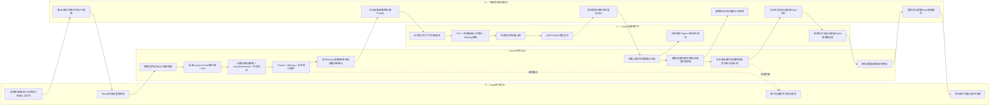
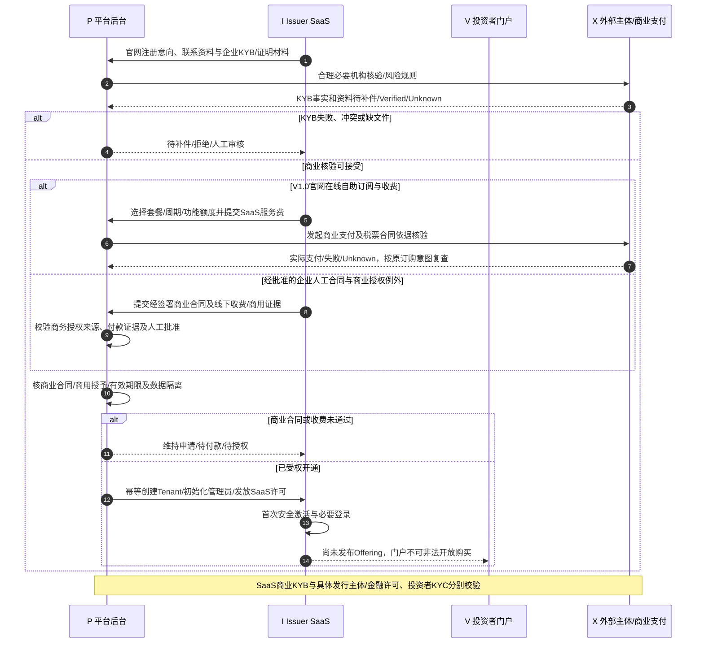
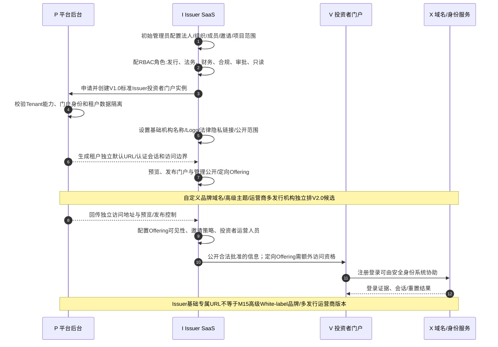
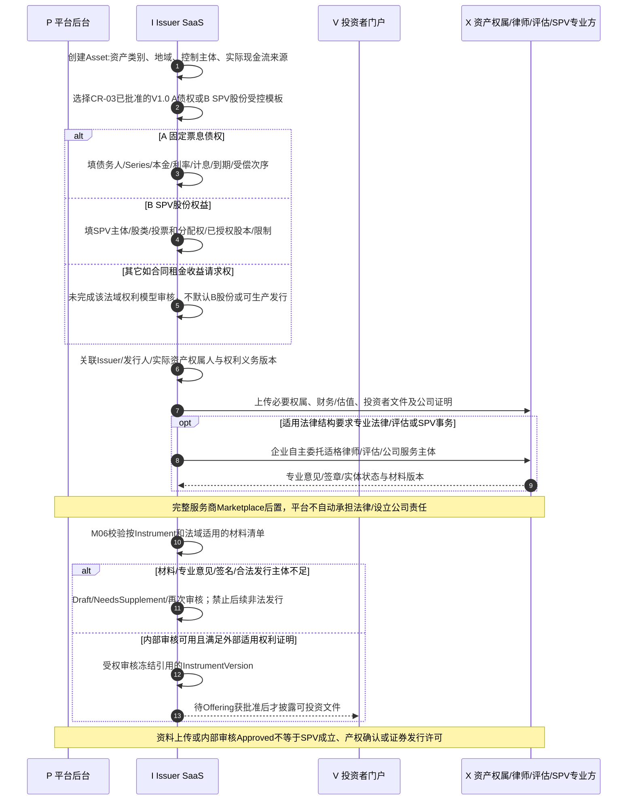
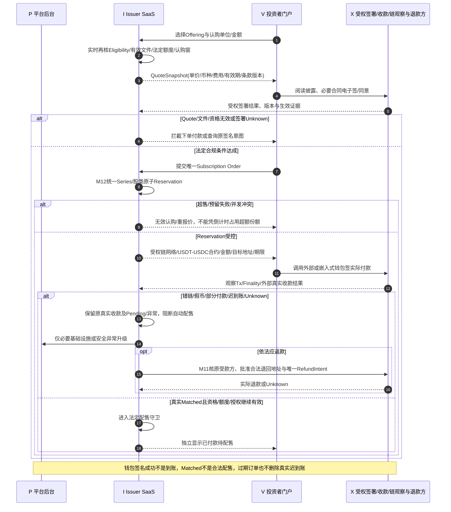
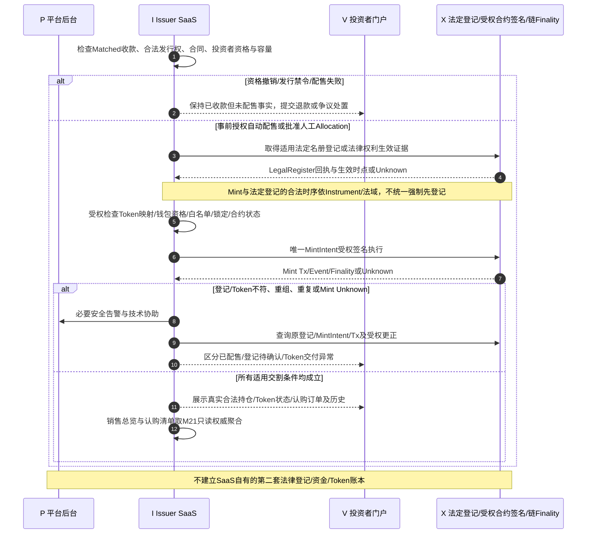
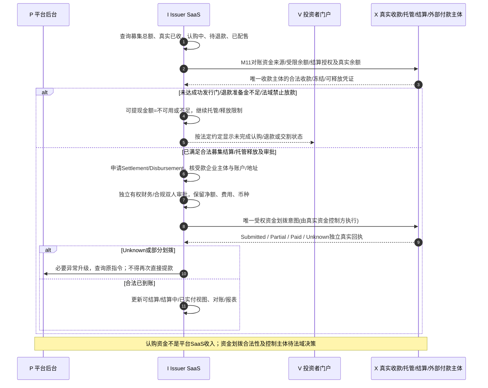
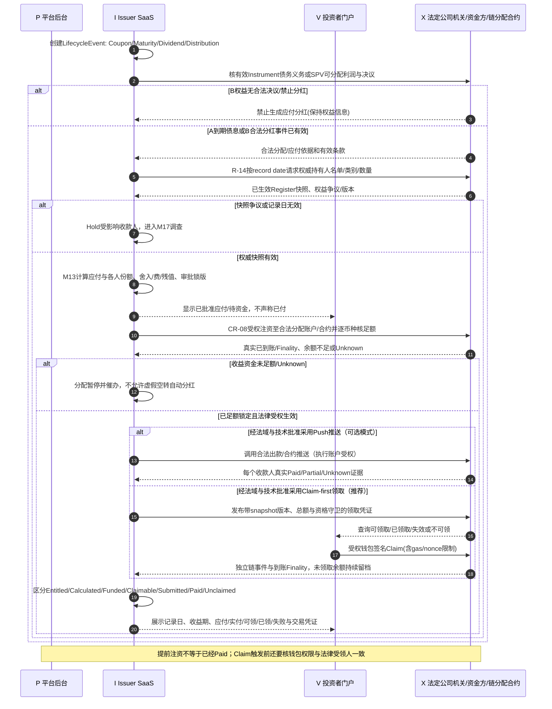
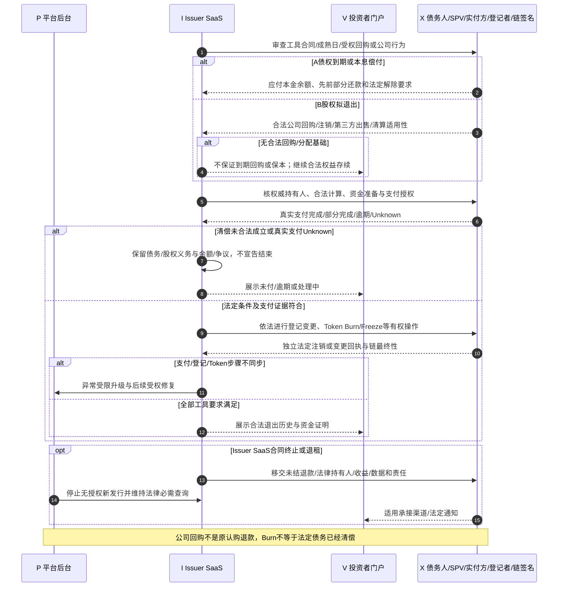

# RWA SaaS｜Step 02 四泳道完整客户业务流程 v0.3（CR-01～10 产品方向已批准；流程草案待审）

> **Draft / Awaiting Flow Approval（2026-10-23）**。本版由 [v0.2 审图草案](RWA-SaaS-Step-02-Four-Lane-Core-Flow-Expanded-v0.2-Draft.md)依据正式 [DEC-013：CR-01～10 全部 A Approved](../../decisions/DEC-013-cr01-10-v1-complete-loop-and-release-directions-approved.md)更新，形成 **1张L0四端总图+10张L1四端分段图**。**已获批准的是 CR-01～10 的产品业务方向，不是本文件全部细节点/技术接口/法域资金机构，也不是 V1.0 最终可开发清单。** 审核通过后仍需 Step 03 原187项功能双向核验和新增功能审批、字段级PRD与最终冻结。
>
> **前置权威**：[DEC-012 版本治理原则](../../decisions/DEC-012-release-versioning-replaces-priority-as-delivery-commitment.md)；[Batch 01～06 产品最低深度 Approved](../Document-Status-Index.md)；[Frozen WF-01～18](RWA-SaaS-Core-Business-Workflows-and-State-Machines-v0.1.md)；[187项版本归属 Draft](../03-product-prd/RWA-SaaS-Version-Plan-V1.0-V2.0-V3.0-187-Function-Migration-Draft-v0.1.md)。
>
> **固定四泳道**：P＝SaaS 平台商业/技术运营；I＝Issuer 企业 SaaS；V＝每家 Issuer 独立投资者门户；X＝分立的外部有权主体（合法 KYC/KYB、律师/评估/SPV、资金收付与托管、法定持有人登记、合约签名与链执行、法律送达）。**X 是合并展示的多类角色，不授权任一主体越权代行全部金融/法律行为**。
>
> **关键用词**：图中“CR Approved A”表示产品目标已经产品负责人批准，非具体服务商/技术实现已定。“V1.0首发必需业务闭环”需达到受权资金、权益、Token真正合法可靠执行的条件；当前法域/生产主体、钱包MPC或其它嵌入式方案、合约Factory技术拓扑、收益Claim与Push、法定分配时点继续 TBD。A参考债权有本息和到期义务，B SPV股份只在合法决议/可分配资金及权利条款满足时分红/回购。

## 01｜L0 四端完整客户旅程（总图）



**总图口径**：一个发行项目可有多个 Offering，募集资金结算和收益付款不是单笔串行完成后才允许下一个 Offering；收益多次循环到期。这里主图只表示依赖关系，并不意味着购买 SaaS 后自动获得任何金融经营/发行合法性。


## 02｜L1-A 企业申请、KYB、合同/在线订阅与 SaaS 授权（Batch 01）



**CR-01 Approved A**：V1.0 商业目标同时包含官网自助订阅收费和人工合同例外，须明确实际商业支付服务商/合同/账单/续费与失败退款状态；与投资者USDT/USDC认购款完全分账。原 M01-F008 历史 P2 只保留审计，不再代表本轮批准的交付方向。


## 03｜L1-B 团队权限与机构独立投资者门户（Batch 01/04、M15边界）



**CR-02 Approved A**：V1.0 标准独立Issuer Portal URL、Logo/信息、门户开关、公开/定向 Offering 访问和安全隔离是首版业务方向；M15-F004 原历史分类仍保持原文，独立自定义域名和高级 White-label 可按 V2.0 候选逐项核验。Issuer Tenant 管理员不自动取得真实发行、资金或合约签名权。


## 04｜L1-C Asset、Instrument、法律结构与适格服务协作（Batch 02）



**CR-03/04 Approved A**：有限的 A/B 受控发行字段向导纳入 V1.0 产品方向；M06-F007专业多机构工作台 P1 后置可以保持，最低上传、补件、受权专业意见引用已由 P0 覆盖。发行实体与持有的权利需独立判断，房屋SPV股票、合同租金请求权、债权不是一个“收益型”法定类别。


## 05｜L1-D Offering发行条款、Token合约工厂与正式发布（Batch 03/05）

```mermaid
sequenceDiagram
 autonumber
 participant P as P 平台后台
 participant I as I Issuer SaaS
 participant V as V 投资者门户
 participant X as X 法定批准/合约安全/签名及链
 I->>I: 创建Project与Offering轮次;引用已审Asset/Instrument版本
 I->>I: 配法定发行容量、数量/单价/最小认购/募集目标/币种/时间窗
 I->>I: 配KYC/Eligibility、配售、退款、资金额度与披露版本
 I->>I: 选择A债息/到期或B合法可选分配规则及退出条件
 I->>I: 选择受控合约方案/链/Token精度/权利单位映射/禁转Guard
 alt V1.0 选择CR-05受控Contract Factory并经批准
  I->>I: 由模板与批准参数生成部署意图/合约校验计划
 else 需要受权外部已部署合约/特定非合约认购
  I->>I: 引用已批准合同/交付方案并核现有地址和部署证据
 end
 I->>X: 分离法律审核、风险、合约参数与真实签名审批
 alt 文件/发行资格/Token映射/权限不合格
  X-->>I: 审核失败/补件/禁止发布
 else 合法且合约版本已批准
  X->>X: 受权执行部署或确认合约已有地址，查询Unknown原交易
  X-->>I: 已部署地址、artifact hash、Tx最终性与角色权限证据
  I->>I: Pre-Launch Checklist：法律条件+付款/退款+配售+合约限制
  alt 必要前置条件仍缺失
   I-->>V: 仅必要受权预览，不允许新认购
  else 发布审核通过
   I-->>V: 发布可见Offering与合规材料、认购开始时点
  end
 end
 Note over P,X: 发行Token合约/链上认购合约/收益分配合约是可组合选择，不必固定三份，每单不是重新部署合约
```

**CR-05 Approved A｜重要边界**：V1.0目标支持Contract Factory的模板参数、差异校验、受权部署与结果查询；在满足合法授权的前提下可做到“点击发行→系统自动编排合约部署”，但不能预设 SaaS 自持 Mint/Burn 私钥。部署和 Mint 要分开：部署通常发生在有效发布或首次交付前，Mint按合法 Allocation/登记时序发生；链上认购和收益分配是否需要独立合约是技术/法域决策，不默认三合约必需。


## 06｜L1-E 投资者登录、EOA/嵌入式钱包、KYC与Eligible（Batch 04）

```mermaid
sequenceDiagram
 autonumber
 participant P as P 平台后台
 participant I as I Issuer SaaS
 participant V as V 投资者门户
 participant X as X 身份/钱包/AML受权服务
 V->>V: 浏览公开许可Offering或获邀请查看定向Offering
 V->>X: 手机/邮箱/其它批准账户方式注册并进行安全登录
 X-->>V: 合法身份会话(不等于金融资格)
 alt 用户选择外部钱包
  V->>X: 连接EOA或合法支持的钱包，签控制权证明
 else CR-06批准的V1.0嵌入式钱包路径（具体架构待审）
  V->>X: 受控创建/恢复钱包，设置密钥恢复与签署权限
 end
 X-->>V: 独立钱包地址/链/控制权证据
 V->>X: 提交自然人或机构KYC/KYB与AML必要材料
 X-->>I: 身份Verified/Rejected/Expired/Unknown及法定范围内证明
 alt 身份不可用或政策禁止
  I-->>V: 补件/冻结或明确拒绝；不能因此销掉旧合法权益
 else KYC有效
  I->>I: 依当前Offering/法域/投资者类别执行Eligibility
  alt 不合资格或钱包未获批准
   I-->>V: 受控拒绝/人工审核或换合格接收地址
  else 合格
   I-->>V: 展示可投资Offering与合法风险/权利文件
  end
 end
 Note over P,X: 账户ID、合法持有人、付款来源钱包、Token接收钱包需分开映射;嵌入式MPC不是独立法定身份
```

**CR-06 Approved A**：V1.0 需可用外部钱包连接与至少一种安全、依法可行的嵌入式钱包；是否MPC/智能账户或其他方案仍由技术/法域 Gate 单独审查，必须详细定义创建/恢复/被盗/签名/Gas/用户与法律持有人绑定。钱包会话不能替代KYC。


## 07｜L1-F Quote、Subscription、预留、USDT/USDC付款与退款（Batch 04）




## 08｜L1-G Allocation、法律登记、Mint、持仓与交易记录（Batch 04/05）




## 09｜L1-H 募集资金结算与Issuer合法资金提取（CR-07 Approved A）



**CR-07 Approved A｜高重要度实现缺口**：V1.0 必须具有募集款真实收款、受限/可结算、合法划拨申请、出款和到账核验的端到端视图；原 M11 与 M21 需在 Step 03 对应到该流程，缺少的独立能力另提正式ID。必须先确定是真正由Issuer可直接从自持钱包提取，还是第三方托管/独立收款主体受控划拨；没有法律确认之前不假定“SaaS平台余额可提现”。


## 10｜L1-I 收益事件、合法可分配额、注资、自动推送/Claim（CR-08 Approved A）



**CR-08 Approved A｜高重要度实现缺口**：V1.0 至少支持一种合法可实际履约的收益分配方式，优先研究 Claim-first；并完整管理合法权益快照、应付、注资、资金确认、受权执行、实付、未领取及异常。原 M13-F004/005/006 的历史 P1 原则已具备部分业务底线，但未定义Escrow/Distribution Contract、Push/Claim、Gas、Unclaimed、重算与资金退回。**这可能是新功能，而不只是修改原描述。** 原批准的 B 股权必须先有合法分红决议；真实“房租收益权”若非SPV股权，应另设适格合同权利审核门。


## 11｜L1-J 到期本金、回购/赎回、法定登记变更与Token退出（CR-09 Approved A）




## 12｜贯穿全业务的异常、人工恢复和通知（复用 BR-01～18）
| 错误/异常域 | 必须停下的动作 | 真正负责查证与恢复的主体 |
|---|---|---|
| 企业订阅已扣款但Tenant未Active | 不重复开通或二次扣款；查询原商业支付/ProvisioningIntent | P商业运营 + X商业支付服务 |
| 自定义域名DNS/TLS失败、门户权限串租户 | 不发布新门户/定向Offering；记录访客/域名安全证据 | P租户安全 + I管理员 + X域名服务 |
| 文件/法定发行主体/SPV/Instrument权利不足 | 不因模板默认值而通过法定发行审查 | I有权法务 + X专业/法律主体 |
| 合约部署/Mint签名权限失效或链Unknown | 不重新发不可逆交易；查原链、nonce、合约地址及已发生事件 | I审批 + X受权链签名执行；P限技术支持 |
| KYC通过但Offering Eligibility失败/撤销 | 不允许认购/交割，不删除真实历史权益 | I合规 + X身份/制裁信息提供方 |
| Quote/签名Unknown、在途订单/额度冲突 | 不自动接收非法交易、不得多次配售 | I发行/法务 + X签名；M12唯一额度权威 |
| 稳定币付款错误/重复/迟到/退款Unknown | 禁止直接认定到账/配售、查询原付款/RefundIntent | I财务 + X真实收款及退款责任方 |
| 登记Unknown但Mint已生效或链重组 | 不显示“所有权益已完成”，合法权益/Token分别查证 | X法定登记者 + X链执行 + I发行 |
| 募集资金未满足释放条件或提现Unknown | 不把总募资显示为可提；禁止盲重划拨 | X受权资金控制/托管 + I财务审批 |
| 收益快照有争议、房租收入未可分配 | 不因合约计算得到金额便默认可付 | X公司/债务法律主体 + M12权威登记 |
| 收益资金未注资、Claim未领取/调用失败 | 不能把应付/分配计划标Paid；留Unclaimed账与受权提醒 | I存续财务 + X受权资金/链服务 |
| 到期/回购/Burn不同步、Issuer退租未结义务 | 不删除法定权益或阻断依法应提供的兑付查询 | I法律主体/承接人 + P受限数据交接 |

跨模块：M17建审批/异常工单不改写M07/M11/M12/M13的真实事实；M18站内已送达 ≠ 法定通知完成；M20保证隔离、授权、审计/原始回执/数据保留，M21所有资金/持有人报表从权威只读映射。所有正向及恢复路径都须保留幂等/原意图ID、source及合法授权链。


## 13｜CR-01～10 正式产品方向与四泳道交叉引用（全部 Approved A）

| 正式批准 | V1.0 已批准业务方向（不等于具体ID冻结） | L1对应图 | 保留的技术/法域实施门 |
|---|---|---|---|
| CR-01 | 企业在线申请/KYB/自助商业订阅与人工合同例外 | L1-A | SaaS收费服务商、税票合同、退款及独立商业授权 |
| CR-02 | Issuer标准独立URL/Logo/门户状态与Offering受权展示，高级白标后置 | L1-B | Tenant隔离、公开/定向/法定披露、自定义域名版本单独决定 |
| CR-03 | A固定票息债权/B SPV股权受控字段模板与向导 | L1-C/D | 真实Instrument合法性、资产权利与法定许可 |
| CR-04 | 企业自找适格律师/评估/SPV服务并提供法律文件，Marketplace后置 | L1-C | 外部法律文件效力、SPV设立资格及评估独立 |
| CR-05 | 合约Factory配置→参数校验→授权审批→合法签名部署→链上核验 | L1-D/G | 智能合约审计、链标准、真实生产Signer和重试 |
| CR-06 | 外部钱包+一种嵌入式钱包的首购入口 | L1-E/F/G | 钱包类型/MPC、账户恢复、Gas、KYC和法律持有人绑定 |
| CR-07 | Issuer募集资金释放/受限/可结算/划拨申请/真实到账 | L1-F/G/H | 真实收款或托管方、法定释放条件、反洗钱/退款准备金 |
| CR-08 | 真实权益快照/应付/注资/足额核验/一种合法自动分配 | L1-I | Claim-first仅技术推荐、Push替代、Gas/未领与法律偿债事实 |
| CR-09 | A到期本息与B合法条件性退出、法定登记/Token处置 | L1-I/J | 法定债务解除、SPV决议、受权Burn/Freeze |
| CR-10 | 原187双向映射、拟 V1.0/2.0/3.0及候选新ID先审后定 | 本文全图 | 版本计划和最终V1功能清单Draft、字段级PRD未冻结 |

**注意**：以前 Batch 01～06 推荐的原P0/P1/P2非默认阶段结论作为历史审批事实保存；新 DEC-013 的业务交付目标覆盖与之不同的**产品方向**，但不修改老文件原文字、不自动批准每个Mxx-Fxxx的新版本归属。

## 14｜严格分开的真实业务权威与状态（v0.3审图控制）

| 独立权威事实 | 负责对象 | 不得凭什么提前认定完成 |
|---|---|---|
| SaaS商业收费/权限 | 真实商业收款主体、P/M01与Tenant | 已点击订阅≠付费；已付SaaS费用≠机构合法可发行 |
| Instrument法律权利 | Issuer/合法发行人、M04/M06与外部法定实体 | 选择A/B模板≠合法债权/SPV股权已经成立 |
| Offering及销售合法性 | Issuer受权方、M05/M19 | 表单填满/合约部署成功≠合法可销售 |
| 投资者KYC/Offering准入 | M09、受权身份/AML服务与Issuer合规 | KYC Verified≠这个Offering可认购 |
| 认购合同和额度预留 | M10/M12/适用签名服务 | 按钮成功≠合法签约、额度分配、认购成交 |
| 稳定币真实收款/退款 | M11 + 有权收款/退款主体与链Finality | txHash/webhook/支付请求成功≠Matched/Refund Paid |
| 合法Allocation与法定权益名册 | M12 + 适格法定登记者 | 款到或Token Mint≠股权法定登记完成 |
| Token部署/Mint/链状态 | M07/M22 + 受权签名与最终性 | Submitted/Unknown≠链上最终确认或权益生效 |
| 发行机构募集资金结算 | M11/M21 + 真正法定可释放收款/托管方 | 已募资总额≠可提现；审批≠出款到账 |
| 发行后收益/本息 | M13/M12 + 公司决议/资金方/链分配执行 | Calculated/Approved/Funded/Claimable≠Paid |
| 合法回购/终止 | M13/M07/M12+有权债务人/公司/登记者/链方 | Burn成功≠合法债务清偿/公司权益注销 |
| 安全审计与消息 | M17/M18/M20/M21 | 通知Sent/Read≠法律有效送达；报表不能制造真实账 |

### 全局异常中断要求
在每个状态转换守卫中必须保留：Unauthorized / Invalid / Pending / Unknown / Failed / Partial / Retry-After-Query / Manual-Review 的适当路径，按实际领域分别展示。**不盲目重付、不二次Mint、不重复退款/收益Claim、不重复企业资金划拨、不在有效公司批准前自动分红。**

**SaaS商业资金与投资者募集款、发行人业务收益资金分别有真实收款/支付权威。** 平台运营软件权限 ≠ 任何一方生产签名、托管、法定登记或股权/债务所有权。

## 15｜版本门、待完成工作与审批状态

1. **完成**：DEC-012 版本治理方法 Approved；DEC-013 / CR-01～10 全部A Approved，要求首发V1.0完整覆盖有权企业开通、门户、合法发行、投资者交易、真实结算、适用分配与依法退出。
2. **已形成但未批准**：Step 02 **v0.3 四泳道 L0＋10张 L1**，含商业自助订阅与人工例外、标准门户、A/B受控模板、专业意见引用、Contract Factory、双钱包入口、真实资金对账/配售、募集款结算、收益注资/Claim与退出全路径。**当前仅是 Draft，尚未经用户单独审核通过全图节点/分支**。
3. **后续 Step 03**：以本图的业务对象、交接和异常为一侧、原187项ID为另一侧建立逐节点双向追踪矩阵；发现的CAND-01～08逐项判断“已有ID扩深、跨模块公共能力、另立新ID”，由产品负责人批准后才修改功能分母与目标版本。原187项当前建议暂拟V1.0 140、V2.0 22、V3.0 25，**全数仍 Draft**。
4. **产品冻结前**：完成分端/权限功能清单、字段级产品PRD（精度/时间/枚举/规则/权限/状态/异常/通知/验收）、具体首发Instrument/法域/资金与链上真实责任确定，以及以用户明确授权形式单独批准V1.0功能冻结。
5. **工程外部执行**：智能合约代码与审计、钱包技术/密钥、真实商业收费、资金托管/结算/外部分配、法律登记与监管许可均没有被本图批准为生产技术方案；无软件已完成、外部金融执行已成功或验收PASS承诺。
6. **仓库治理**：本版新建、v0.1/v0.2历史草案保留，Batch01～06 Approved业务原则和四份 Frozen 不覆写，187项原ID/历史分级不修改。[PR #6](https://github.com/mirrorshang/rwa-saas-platform/pull/6)必须Draft/Open/Unmerged，**不进入UI/开发**。

**当前：CR-01～10 Approved A；Step 02 v0.3 四端详细流程 Draft / 待产品负责人审图；187逐项目标版本及真正V1.0交付清单 Draft；真实实施法域/技术/执行 Gate TBD。**