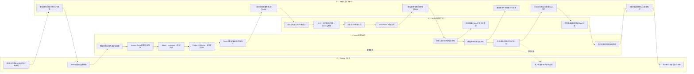
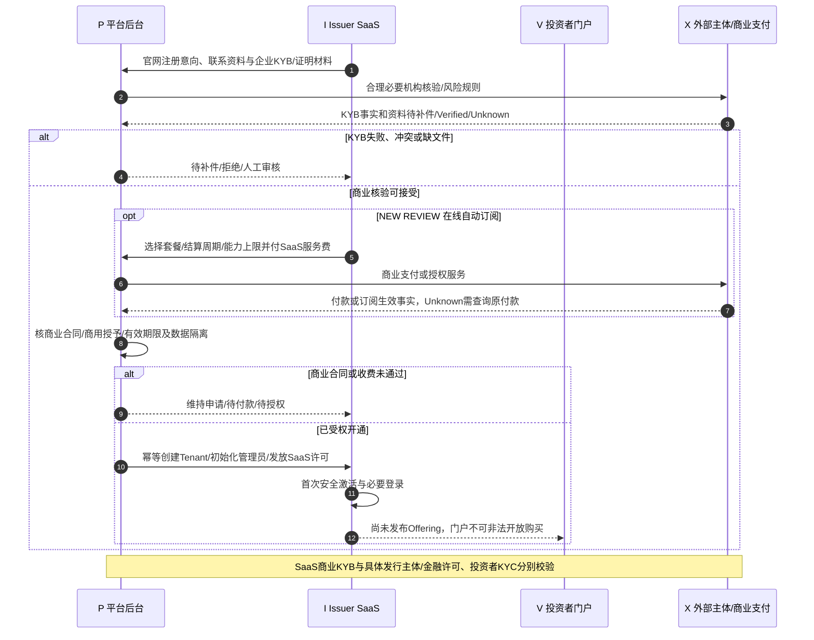
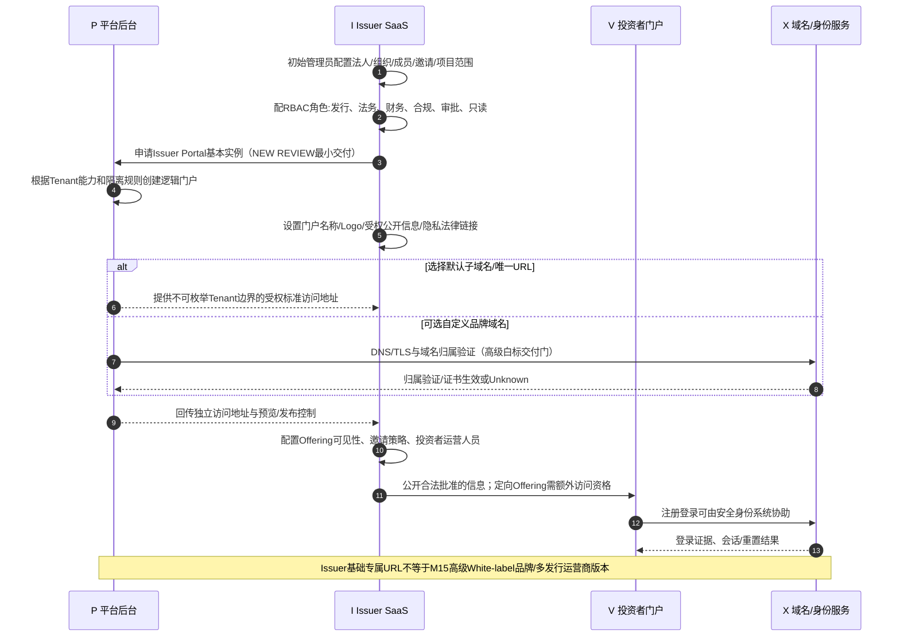
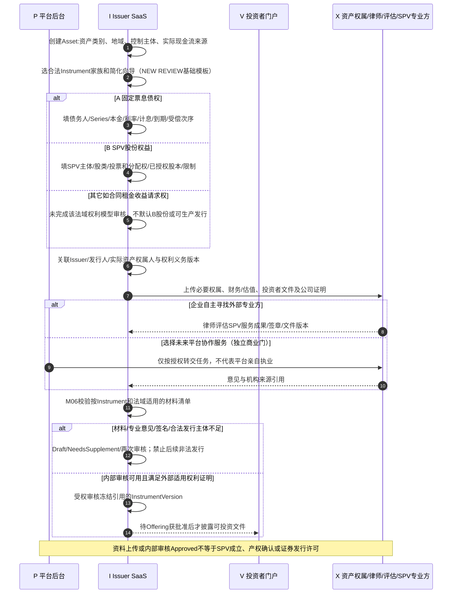
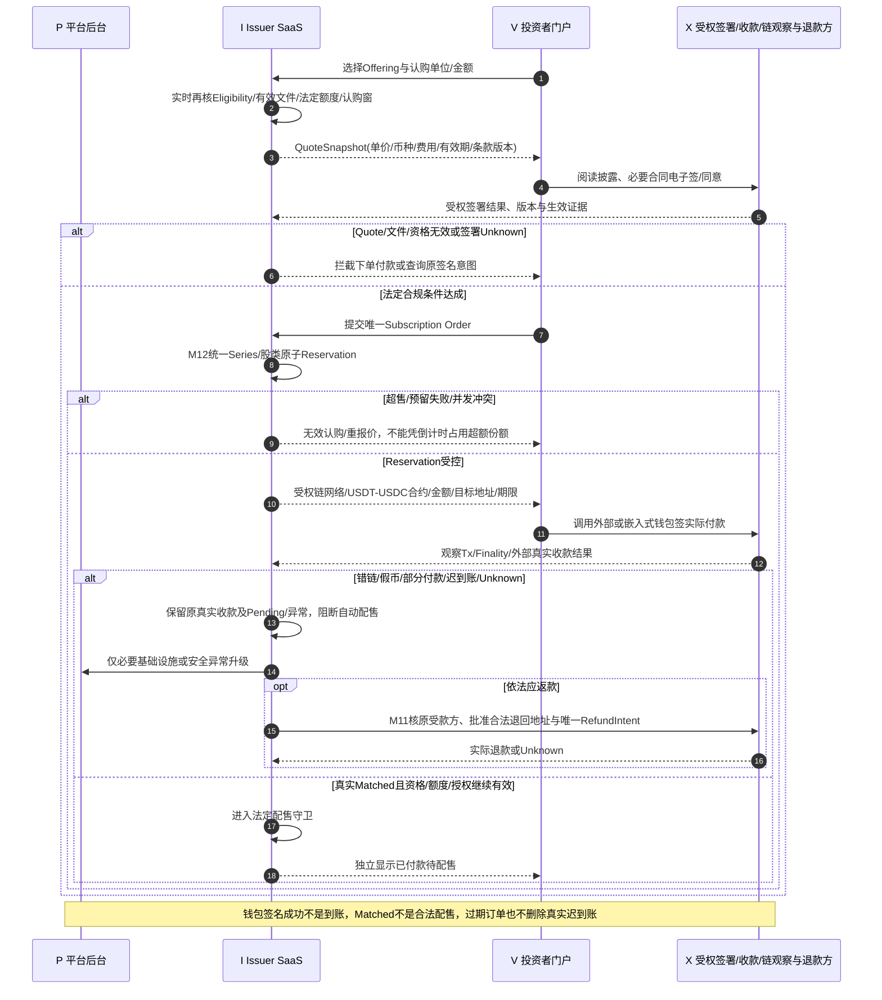
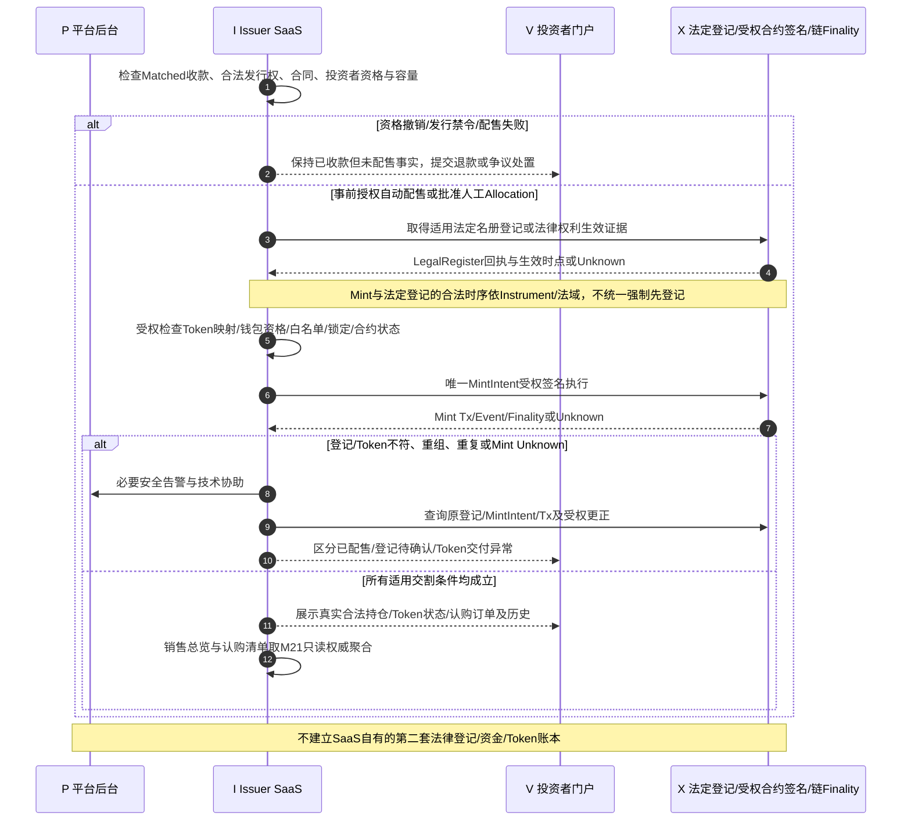
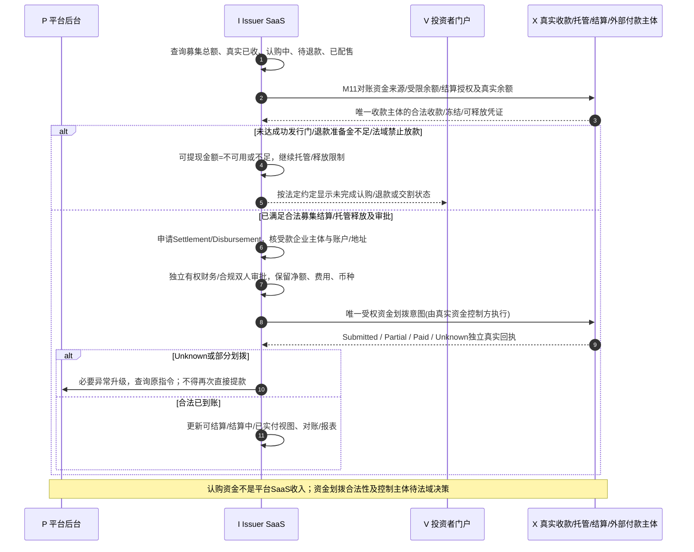
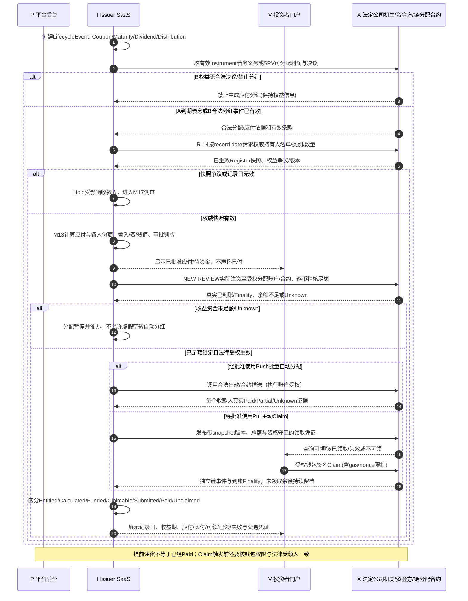
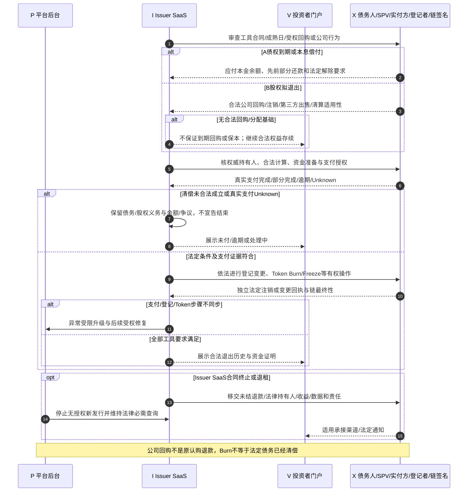

# RWA SaaS｜Step 02 四端业务全生命周期重构 v0.2（产品审图草案）

> **Draft / For Review，2026-10-23。** 以产品负责人描述的 **11 步企业购买 SaaS → 创建资产 → 自动化发行 → 投资者认购 → 募集资金结算 → 收益注资及分配 → 清偿/退出** 为用户旅程原型；在原 Step 02 v0.1 基础上提出扩展。此文**不是**原 187 功能 ID 变更、不是 SCOPE-152～205 Approved 的修改、不更改四份 Frozen、不是合约技术方案/合法发行意见、不批准商业收费/托管/资金提取/自动 Mint 或软件开发。
>
> **权威输入**：[原 Step 02 四端泳道 v0.1](RWA-SaaS-Step-02-Four-Lane-End-to-End-Workflow-Draft-v0.1.md)；[Frozen WF-01～18](RWA-SaaS-Core-Business-Workflows-and-State-Machines-v0.1.md)；[六批需求和批准进度](../Document-Status-Index.md)；[187项原ID与优先级](../03-product-prd/RWA-SaaS-Module-Function-Inventory-and-V1-Scope-Matrix-v0.1.md)。
>
> **固定四端/泳道**：P＝SaaS 平台后台/运营（商业租户/安全/支持），I＝Issuer 发行企业 SaaS（企业管理员、发行/法务/财务/合规人员），V＝**该 Issuer 自己的**投资者门户（非 SaaS 自营聚合市场），X＝一组**各自合法授权**的外部实际执行者（KYC、律师/评估、SPV/登记、资金服务、合约受权签名/区块链、送达）；一个 X 并不意味着一家可兼任所有法定权威。所有图中“自动执行”仅是**受控编排候选**，必须满足授权、资格、真实资金、合法签名、法律权利及 Finality 独立 Gate。
>
> **流程状态**：本版所有新提出的门户配置、MPC 嵌入式钱包、合约工厂、资金结算/提现、收益资金注入/Claim/自动推送均标记 **NEW REVIEW / 交付门待决**；不得默默升级原 P1/P2/待定功能。A = 参考固定票息到期本金债权；B = 参考 SPV 股份权益。纯合同租金收益请求权与 B SPV 股权不是同一产品，若选择必须另行验证合法 Instrument 模型。

## 01｜L0 四端完整客户旅程（总图）



**总图口径**：一个发行项目可有多个 Offering，募集资金结算和收益付款不是单笔串行完成后才允许下一个 Offering；收益多次循环到期。这里主图只表示依赖关系，并不意味着购买 SaaS 后自动获得任何金融经营/发行合法性。

## 02｜L1-A 企业申请、KYB、合同/在线订阅与 SaaS 授权（Batch 01）



**NEW REVIEW**：M01-F008 在线订阅/自动收费原 P2，现建议作为**商业目标待裁定**；V1 可合法保留商务合同/人工开通。购买失败但支付实际成功必须保留支付事实、处理退款，Tenant Unknown 不得创建第二个。

## 03｜L1-B 团队权限与机构独立投资者门户（Batch 01/04、M15边界）



**NEW REVIEW**：最小 Issuer 门户的系统生成 URL、开关、受权资产展示、通用品牌信息建议进入 Issuer V1；自定义域名、主题/全组件品牌、运营商跨多 Issuer 作为 M15/M16 独立商业里程碑，不能偷换原 M15-F004 待定分类。注意Tenant管理员不是法定发行/签名/提现审批人的替代者。

## 04｜L1-C Asset、Instrument、法律结构与适格服务协作（Batch 02）



**NEW REVIEW**：M04-F008 基础模板原 P1 后置，现建议有限的 A/B 字段向导作为低门槛发行首期必需候选；M06-F007专业多机构工作台 P1 后置可以保持，最低上传、补件、受权专业意见引用已由 P0 覆盖。发行实体与持有的权利需独立判断，房屋SPV股票、合同租金请求权、债权不是一个“收益型”法定类别。

## 05｜L1-D Offering发行条款、Token合约工厂与正式发布（Batch 03/05）

```mermaid
sequenceDiagram
 autonumber
 participant P as P 平台后台
 participant I as I Issuer SaaS
 participant V as V 投资者门户
 participant X as X 法定批准/合约安全/签名及链
 I->>I: 创建Project与Offering轮次;引用已审Asset/Instrument版本
 I->>I: 配法定发行容量、数量/单价/最小认购/募集目标/币种/时间窗
 I->>I: 配KYC/Eligibility、配售、退款、资金额度与披露版本
 I->>I: 选择A债息/到期或B合法可选分配规则及退出条件
 I->>I: 选择受控合约方案/链/Token精度/权利单位映射/禁转Guard
 alt 合法部署方案采用Factory（NEW REVIEW）
  I->>I: 由模板与批准参数生成部署意图/合约校验计划
 else 需要受权外部已部署合约/特定非合约认购
  I->>I: 引用已批准合同/交付方案并核现有地址和部署证据
 end
 I->>X: 分离法律审核、风险、合约参数与真实签名审批
 alt 文件/发行资格/Token映射/权限不合格
  X-->>I: 审核失败/补件/禁止发布
 else 合法且合约版本已批准
  X->>X: 受权执行部署或确认合约已有地址，查询Unknown原交易
  X-->>I: 已部署地址、artifact hash、Tx最终性与角色权限证据
  I->>I: Pre-Launch Checklist：法律条件+付款/退款+配售+合约限制
  alt 必要前置条件仍缺失
   I-->>V: 仅必要受权预览，不允许新认购
  else 发布审核通过
   I-->>V: 发布可见Offering与合规材料、认购开始时点
  end
 end
 Note over P,X: 发行Token合约/链上认购合约/收益分配合约是可组合选择，不必固定三份，每单不是重新部署合约
```

**重要边界**：在满足合法授权的前提下可做到“点击发行→系统自动编排合约部署”，但不能预设 SaaS 自持 Mint/Burn 私钥。部署和 Mint 要分开：部署通常发生在有效发布或首次交付前，Mint按合法 Allocation/登记时序发生；链上认购和收益分配是否需要独立合约是技术/法域决策，不默认三合约必需。

## 06｜L1-E 投资者登录、EOA/嵌入式钱包、KYC与Eligible（Batch 04）

```mermaid
sequenceDiagram
 autonumber
 participant P as P 平台后台
 participant I as I Issuer SaaS
 participant V as V 投资者门户
 participant X as X 身份/钱包/AML受权服务
 V->>V: 浏览公开许可Offering或获邀请查看定向Offering
 V->>X: 手机/邮箱/其它批准账户方式注册并进行安全登录
 X-->>V: 合法身份会话(不等于金融资格)
 alt 用户选择外部钱包
  V->>X: 连接EOA或合法支持的钱包，签控制权证明
 else NEW REVIEW 嵌入式MPC/其它钱包
  V->>X: 受控创建/恢复钱包，设置密钥恢复与签署权限
 end
 X-->>V: 独立钱包地址/链/控制权证据
 V->>X: 提交自然人或机构KYC/KYB与AML必要材料
 X-->>I: 身份Verified/Rejected/Expired/Unknown及法定范围内证明
 alt 身份不可用或政策禁止
  I-->>V: 补件/冻结或明确拒绝；不能因此销掉旧合法权益
 else KYC有效
  I->>I: 依当前Offering/法域/投资者类别执行Eligibility
  alt 不合资格或钱包未获批准
   I-->>V: 受控拒绝/人工审核或换合格接收地址
  else 合格
   I-->>V: 展示可投资Offering与合法风险/权利文件
  end
 end
 Note over P,X: 账户ID、合法持有人、付款来源钱包、Token接收钱包需分开映射;嵌入式MPC不是独立法定身份
```

**NEW REVIEW**：M08账户和M07接收钱包已经批准最低能力，但一键创建嵌入式钱包、密钥恢复、Gas、签名托管风险未在六批中明确，需按合约/钱包服务实际能力独立批准。钱包登录可选，并不替代身份审核。

## 07｜L1-F Quote、Subscription、预留、USDT/USDC付款与退款（Batch 04）



undefined

## 08｜L1-G Allocation、法律登记、Mint、持仓与交易记录（Batch 04/05）



undefined

## 09｜L1-H 募集资金结算与Issuer合法资金提取（NEW REVIEW）



**HIGH-IMPACT NEW REVIEW**：原 M11 支付/对账和 M21 销售报表未完整覆盖可提资金、托管释放/结算、企业收款账户、出款审批与到账核验。必须先确定是真正由Issuer可直接从自持钱包提取，还是第三方托管/独立收款主体受控划拨；没有法律确认之前不假定“SaaS平台余额可提现”。

## 10｜L1-I 收益事件、合法可分配额、注资、自动推送/Claim（NEW REVIEW）



**HIGH-IMPACT NEW REVIEW**：现有 M13-F004/005/006 P1 条件性最低深度只覆盖计算/审批/外部支付对账的原则；没有正式确定 Escrow/Distribution Contract、收益注资、Push/Claim 双模式、Claim Gas、到期未领、重算与资金退回。**这可能是新功能，而不只是修改原描述。** 原批准的 B 股权必须先有合法分红决议；真实“房租收益权”若非SPV股权，应另设适格合同权利审核门。

## 11｜L1-J 到期本金、回购/赎回、法定登记变更与Token退出（Batch05/06）



undefined

## 12｜贯穿业务全程的异常及通知分支（复用原 BR-01～18）
| 错误/异常域 | 必须停下的动作 | 真正负责查证与恢复的主体 |
|---|---|---|
| 企业订阅已扣款但Tenant未Active | 不重复开通或二次扣款；查询原商业支付/ProvisioningIntent | P商业运营 + X商业支付服务 |
| 自定义域名DNS/TLS失败、门户权限串租户 | 不发布新门户/定向Offering；记录访客/域名安全证据 | P租户安全 + I管理员 + X域名服务 |
| 文件/法定发行主体/SPV/Instrument权利不足 | 不因模板默认值而通过法定发行审查 | I有权法务 + X专业/法律主体 |
| 合约部署/Mint签名权限失效或链Unknown | 不重新发不可逆交易；查原链、nonce、合约地址及已发生事件 | I审批 + X受权链签名执行；P限技术支持 |
| KYC通过但Offering Eligibility失败/撤销 | 不允许认购/交割，不删除真实历史权益 | I合规 + X身份/制裁信息提供方 |
| Quote/签名Unknown、在途订单/额度冲突 | 不自动接收非法交易、不得多次配售 | I发行/法务 + X签名；M12唯一额度权威 |
| 稳定币付款错误/重复/迟到/退款Unknown | 禁止直接认定到账/配售、查询原付款/RefundIntent | I财务 + X真实收款及退款责任方 |
| 登记Unknown但Mint已生效或链重组 | 不显示“所有权益已完成”，合法权益/Token分别查证 | X法定登记者 + X链执行 + I发行 |
| 募集资金未满足释放条件或提现Unknown | 不把总募资显示为可提；禁止盲重划拨 | X受权资金控制/托管 + I财务审批 |
| 收益快照有争议、房租收入未可分配 | 不因合约计算得到金额便默认可付 | X公司/债务法律主体 + M12权威登记 |
| 收益资金未注资、Claim未领取/调用失败 | 不能把应付/分配计划标Paid；留Unclaimed账与受权提醒 | I存续财务 + X受权资金/链服务 |
| 到期/回购/Burn不同步、Issuer退租未结义务 | 不删除法定权益或阻断依法应提供的兑付查询 | I法律主体/承接人 + P受限数据交接 |

跨模块：M17建审批/异常工单不改写M07/M11/M12/M13的真实事实；M18站内已送达 ≠ 法定通知完成；M20保证隔离、授权、审计/原始回执/数据保留，M21所有资金/持有人报表从权威只读映射。所有正向及恢复路径都须保留幂等/原意图ID、source及合法授权链。

## 13｜Batch 01～06 已批准原则的逐批影响评估（**新意见均 Draft，不是已批准 SCOPE**）
| 批次/原范围 | 原 Approved 审查后保持不变的关键底线 | 此次用户核心旅程暴露的差距或交付级别建议 | 改动性质 |
|---|---|---|---|
| **01 M01/M02/M03** 22项 | 申请/主体、商业合同/授权、Tenant、RBAC、职责分离、暂停退租 | **M01-F008 P2 在线自助订阅/收费**若用户要求首期闭环，则需正式提案改交付阶段；基本门户初始化涉及M01/M02/M08，但“品牌白标”是M15待定 | **明确待裁定**，不是原原则失效 |
| **02 M04/M06** 17项 | Asset≠Instrument、债权A/权益B分类、文件版控、适格专业判断 | **M04-F008 P1 金融工具模板**建议首期提供A/B受控向导；M06-F007 P1外部任务协作可后置，但线下文件/意见引用必须；SPV成立不是平台自动化 | **需裁定模板最低实现深度** |
| **03 M05/M19** 19项 | Project 1:N Offering、真实发行额度、认购模式、版本化资格/价格/授权 | 增发行配置“用户向导”：经济收益类型≠法律权利类型；条件性租金分红规则、合同模板/合约方案、发布前检查、法定发行权，详细产品路径不足 | **完善操作深度，保留核心规则** |
| **04 M08～M12** 50项 | 门户非自营Marketplace、KYC与Offering适格分离、Quote/认购/真实支付、配售和登记独立 | 增嵌入式MPC/合适智能账户的创建/恢复/签名、门户资产列表/个人中心/持仓与Wallet UX；基本投资者独立URL需从M15高级White-label剥离 | **可能需补新功能+审批** |
| **05 M07/M22** 19项 | 有权部署签名、合约参数审查、Mint独立权威、Finality/Token限制与M12登记对账 | 将合约模板工厂/受权自动部署、支持何种Sale/Distribution合约与升级边界变成明确可选执行策略；不默认每个产品都部署3份合约 | **明确自动化最低交付深度；保留签名边界** |
| **06 M13/M17/M18/M20/M21** 37项 | A本息、B合法分红、权益record date/应付与实付分离、保留证据和异常处理 | 最重要：**发行方募集款可用/冻结/结算/提取（M11+M21）**、收益资金注入/批次/Distribution Contract/Push与Claim、Gas与未领取余额、投资者收益历史；不能只凭“外部支付已对账”替代实际全流程 | **高优先交付缺口，需正式新增/分级/边界审核** |

**评审纪律**：本表不得擅自修改原 187 项 P0 125 / P1 21 / P2 21 / V2 6 / 待定14 的统计；建议通过新的 SCOPE-206+ 或 CR-xx 候选提交产品负责人，只有获批准后才能修订 Batch 01～06 的新版本实施深度或变更独立功能 ID。只批准详细泳道图并不意味着批准这张表里的所有新能力进入 V1。

## 14｜新一轮待审核产品决策门（建议 CR-01～10，非正式 SCOPE）
| 提案 | 产品建议 | 必须确认的边界 |
|---|---|---|
| CR-01 | 是否 Issuer V1 首期必须支持在线自助订阅/信用卡或稳定币付 SaaS 费 | M01-F008原P2；是否允许人工商务授权 |
| CR-02 | Issuer V1 每家机构默认可生成独立URL、最小Logo/门户信息；高级定制白标独立产品线 | M15-F004待定；基础门户与运营商白标不能混为一谈 |
| CR-03 | A债权/B股份参考样本有限字段向导/安全默认模板成为V1基础效率能力 | M04-F008原P1非默认;不等于律师意见或SPV自动设立 |
| CR-04 | 专业服务初期只提供资料清单/外部成果引用，复杂工作台与服务商市场后置 | M06-F007 P1、M06-F008 P2保留原后置 |
| CR-05 | 受控合约Factory方案可配置，审批完由适格签名者自动部署；合约拓扑可按工具裁剪 | 不预设认购合约、收益合约独立存在或SaaS保管生产私钥 |
| CR-06 | 投资者外部钱包与嵌入式钱包为并行首期入口或分期上线 | 私钥恢复/安全、Gas赞助及钱包法定持有人映射 |
| CR-07 | 募集资金的合法释放、可提/待结算/已划拨、授权出款及到账核验是否Issuer V1必交 | M11/M21原覆盖不完整，外部托管与SaaS不控资 |
| CR-08 | 收益资金先注资后分配，统一事件+快照+应付+实际支付状态;首期采用Push还是Claim或双支持 | M13 P1真实深度、M07/M22合约角色及合法支付主体 |
| CR-09 | A债权到期/本金及B有条件公司回购/注销，是否首期必需具体Token Burn/Freeze | M07-F009原P1条件性，不能默认B有到期保本 |
| CR-10 | 重新核对V1最低交付清单时如何追加少量新ID或原ID扩深；先产品审批后映射187 | 绝不预先把187改为188+或修改Frozen正文 |

## 15｜后续追踪与质量说明
- 用户原**11步**已经展开为1张 L0、10张 L1，共11张可编辑Mermaid图，L1序列图始终保留P/I/V/X四泳道与法定守卫、异常/Unknown及责任说明。
- 本版 **Step 02 v0.2 是新提案**；原 [v0.1](RWA-SaaS-Step-02-Four-Lane-End-to-End-Workflow-Draft-v0.1.md)作为历史草案保留；所有 Batch 01～06 决策仍 Approved，四份 Frozen 正文保持不变。
- **NFR/真实发行条件**：多租户隔离、服务端权限、金额Token精度、UTC/权威记录日、重复事件幂等、外部资金/登记/链原始证据、法域限制、隐私与合同责任/有权收付、必要法定通知必须覆盖。
- **不制造错误承诺**：Issuer SaaS只是发行运营工具；商用开通≠发行许可，Token有链上余额≠法定投资者名册有效，认购支付≠公司募集款可提，基金/租金收入≠可合法分红，Calculated≠Funded≠Paid，Burn≠实际本金清偿。
- 187原功能及优先级不因审图而改变；164张Batch 01～06原业务验收卡均 Not Executed，A/B 187项仍 Not Tested。PR #6 必须 Draft/Open/Unmerged。
