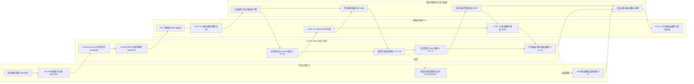
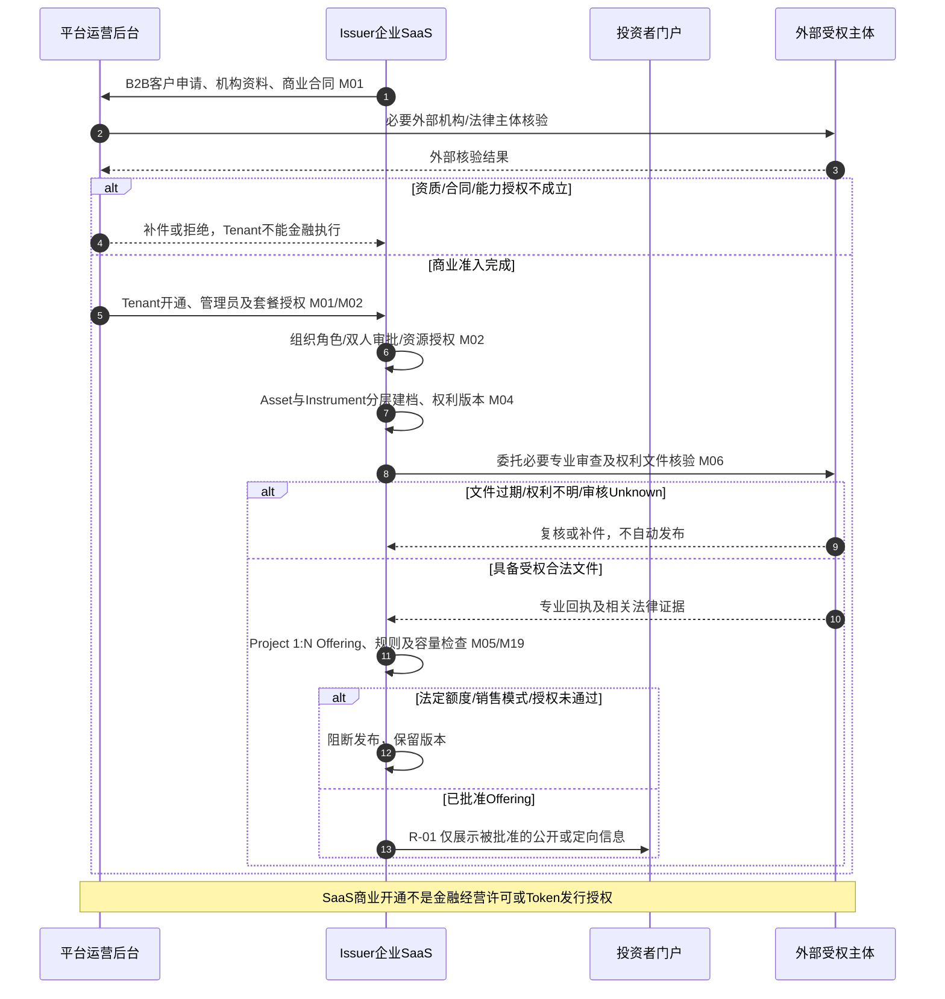
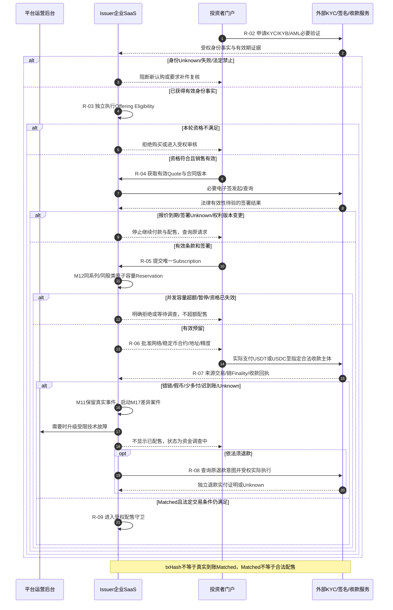
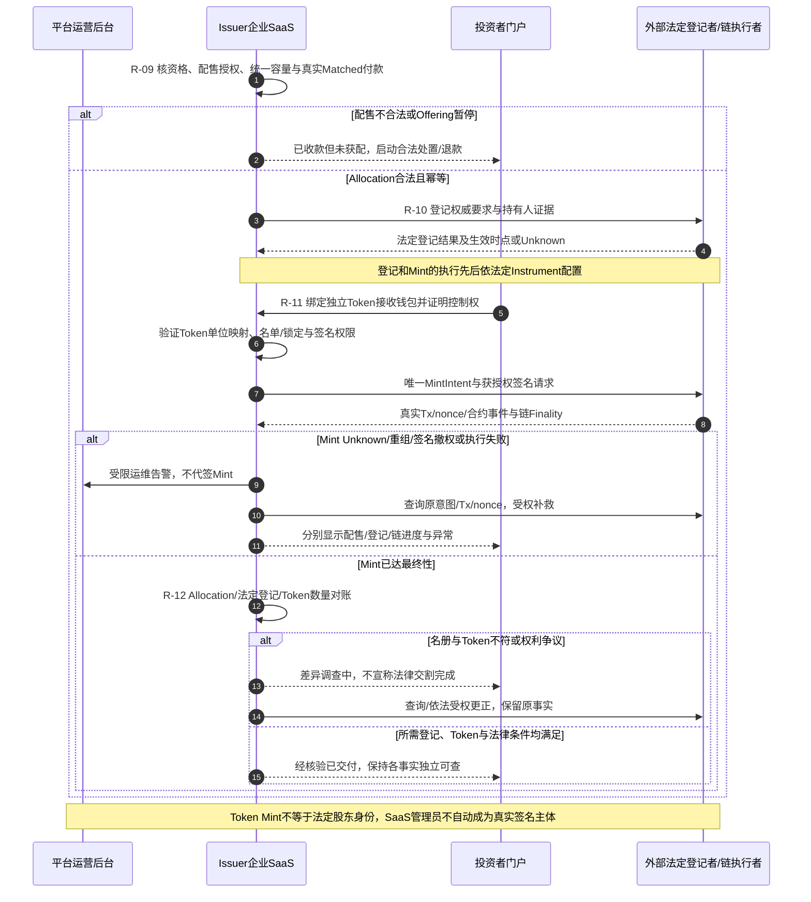
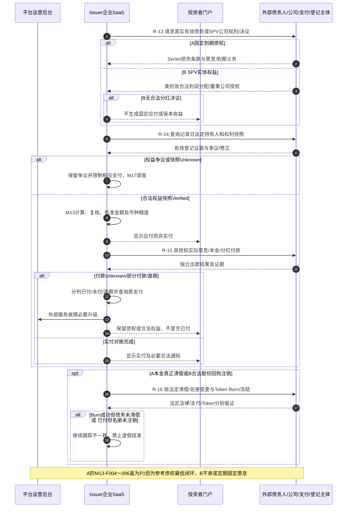
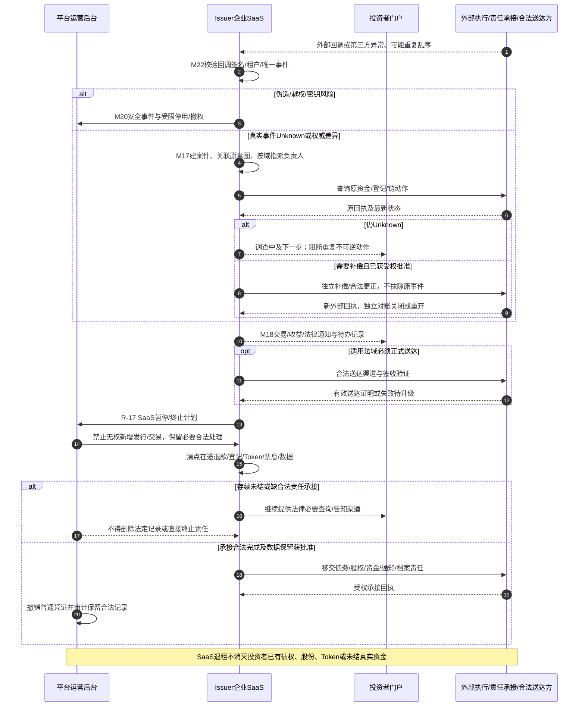

# RWA SaaS｜Step 02：四端端到端业务流程及异常分支 v0.1

> **Step03.5 历史文件提示（2026-10-23）：Historical / Superseded as CURRENT READING ENTRY；原文内容及其历史批准证据继续保留。** Step02 v0.3 已按 DEC-014 获准作为现行11步核心流程。旧 v0.1 仅供追溯早期五段时序及异常素材，不再作为当前业务阶段或待决状态。 当前请以[文档权威目录](../00-governance/RWA-SaaS-Current-Document-Authority-and-Supersession-Index-v0.1.md)和[对应现行材料](../04-business-workflows/RWA-SaaS-Step-02-Four-Lane-Core-Flow-Approved-CR-v0.3-Draft.md)为准。**本提示仅更新导航生效关系，不撤销任何历史正式决策，不冻结详细PRD，也不改变原正文。**

> **Draft / 待产品负责人审核（2026-10-23）**。GitHub Mermaid 可编辑业务流程；不是 Frozen 第 04 份状态机正文、技术时序/API、实际金融业务许可、UI/UX 设计或测试已执行。

> 基线：[WF-01～WF-18 Frozen](RWA-SaaS-Core-Business-Workflows-and-State-Machines-v0.1.md)｜[六批 SCOPE Approved 状态索引](../Document-Status-Index.md)｜[Step 01 R-01～17 与 BR-01～18](../03-product-prd/RWA-SaaS-Step-01-Batch-04-06-Business-Rules-Closure-v0.1.md)｜[原 187 项功能](../03-product-prd/RWA-SaaS-Module-Function-Inventory-and-V1-Scope-Matrix-v0.1.md)。

**四泳道固定**：平台运营后台（P）、Issuer SaaS 企业工作台（I）、发行机构投资者门户（V）、依法受权的外部服务及法定权威（X）。X 是不同执行主体的集合，不能表示单个服务商可合法代理所有行为。主图仅描绘基线设计；合法登记与Token Mint 的顺序依批准的 Instrument 具体情况，不能由图自动决定。

## 1．L0｜四端整体业务主链路

## 2．L1-A｜客户购买SaaS至发行发布（WF-01～05）

## 3．L1-B｜投资者资格、报价与真实资金（WF-06～10/12）

## 4．L1-C｜法定登记、链上Token与交割异常（WF-10～12）

## 5．L1-D｜A债权本息/B股权分红及权利终结（WF-13）

## 6．L1-E｜异常、通知、暂停退租及法律责任接力（WF-15/18）

## 7．强制异常断点与图内入口（18项均是 Not Executed 业务设计）
| 异常 | 必须显示的分支 | 最小守卫/主责任 |
|---|---|---|
| BR-01、BR-12 | KYC有效但本轮资格不符/支付后资格撤销 | M09阻断新配售，M11保留真实钱，Issuer合规决定合法处置 |
| BR-02、BR-14 | 并发额度预留/同Series多个Offering股本冲突 | M12原子容量，付款Pending不可盲目释放 |
| BR-03、BR-04 | 假USDC/错误链、Tx无终局、迟到账、少/多付、退款Unknown | M11核原链/收款与外部退款证据，禁止盲重付 |
| BR-05 | 已收款但Offer暂停/配售失败 | M12不伪造Allocation，Issuer/合法资金方处理 |
| BR-06、BR-07 | 登记Unknown但已Mint/链重组与重复Mint | M12与M07独立留痕，原意图/nonce查询及受权恢复 |
| BR-08、BR-16 | 债券票息/本金或分红已核算但外部付款Unknown/部分付款 | M13分别追踪应付、已付、未付；M17升级，不再付第二笔 |
| BR-09 | SPV无合法分红却显示固定利息/回购当退款 | M13按真实公司授权，M11退款不同于M13合法退出 |
| BR-10、BR-18 | Tenant终止但有退款、票息、登记或法定通知 | M01/M20限制新交易，承接实体持续履约、留存和受权查询 |
| BR-11 | 电子签Unknown、Quote有效但法律合同未生效 | M06/M10按适用合法签署守卫阻断付款/配售并查原回执 |
| BR-13 | 付款来源钱包、Token接收钱包、法定持有人不同 | M07/M11/M12分别核验，不能向错误原地址自动退款 |
| BR-15 | 记录日后合法名册追溯更正或权利争议 | M12权威名册、M13新快照版本、M17受权纠错 |
| BR-17 | 合约暂停、冻结或实际签名权撤销 | M07受限，已有M12合法权利不消失，通知Issuer核验 |

## 8．临时流程节点与权威边界

| R编号 | 主业务 | 主责模块 | 对应WF | 必须独立核验 |
|---|---|---|---|---|
| R-01～03 | 门户访问、KYC、Offering资格 | M05/M08/M09/M19 | WF-05～07 | 身份Verified不等于本轮Eligibility |
| R-04～05 | Quote/签署/唯一订单与容量 | M06/M10/M12 | WF-08 | 订单不等于付款、容量预留不等于已配售 |
| R-06～08 | 指定稳定币支付/真实对账/退款 | M11/M22/M17 | WF-09/12 | txHash和回调不等于Matched，退款批准不等于实际出款 |
| R-09～10 | 配售/法定登记 | M12/M22 | WF-10～11 | 合法授权、法定名册及登记生效单独核验 |
| R-11～12 | Mint/接收钱包/链Finality/交割一致性 | M07/M12/M22 | WF-11 | Token不等于法律登记或已合法持有 |
| R-13～16 | 票息/本金、B合法分红、权益快照与注销 | M13/M07/M12/M17 | WF-13/18 | 应付、实付、名册更正、Burn互相独立 |
| R-17 | 暂停/退租/义务和数据移交 | M01/M03/M13/M20 | WF-15 | SaaS商业终止不取消法律权利 |

**范围例外**：WF-14/M14受控二级转让为V2，不进入Issuer V1链路；WF-16/M15 White-label和WF-17/M16 商业Open API/SDK是独立商业里程碑。它们与164项Issuer主线合成187项功能；真正的187项逐条核验是Step 03，当前不得提前说已完成。

**附加守卫**：INV-01 M12统一额度、INV-02 M11/M12的付款与配售独立、INV-03法定登记与Token执行独立；所有真实资金、外部签名/登记按合法授权由对应执行方承担。Unknown须查原意图、幂等和真实回执；M17异常工单不是金融事实权威；M18站内已读不是当然法定送达；M21报表只读不制造另一套账。

## 9．本轮审图待确认点（保持 Draft）

- 主链路和 BR-01～18 的断点是否足以覆盖成功/失败/Unknown/人工接管/恢复/取消/迟到/重复调用、公司合法分红与债务本息、退出后的持续责任？
- BRD-A～F（投资者入口、自动化程度、钱包/身份/支付分离、异常负责者、状态透明、退租责任）仍为 Step 01 参考草案；用户尚未单独批准这些默认选项作为最终图的冻结事项。
- 特定法域真实发行权、电子签法律效力、公司/登记生效顺序、受监管资金路径、链/合约、通知送达和受权签名者依G-01～G-06后续单独审查。图中任何箭头不能视为已通过法律许可或生产执行批准。
- 本版为 L0 总图 + L1 五段细图的首次可编辑草稿。需产品负责人逐节点审核后再决定修订/批准图稿；第04份Frozen原文不修改。
- Batch 01～06 的164项B01～B06验收案例仍 Not Executed；A/B 187个功能仍 Not Tested；不存在实际代码或金融环境验收PASS。后续按原规划 Step 03 187项双向核验→Step 04分端功能清单→Step 05字段级PRD→Step 06全局冻结→统一UI。PR #6保持 Draft/Open/Unmerged。