# RWA SaaS｜四端功能与业务流程总览（开发理解版）

> **文档用途：**面向工程师的全系统快速理解、跨端功能核对和开发交接入口。  
> **范围：**Issuer SaaS（I）、Platform Admin（P）、企业投资者平台（V）、总投资者平台（M）；按要求不包含官网 W。  
> **版本：**V1.0 产品流程总览 Draft v0.1｜2026-11-19  
> **权威性：**本文件是跨端导航图和流程索引，不替代各端详细 PRD、Backend Developer PRD、已批准 DEC 或法律/技术准入文件。发生冲突时，以对应端最新批准产品基线及正式 DEC 为准。

---

## 0. 如何使用本文件

工程师建议按以下顺序阅读：

1. 先看第 1～3 节，理解四端定位、九个阶段和系统主流程。
2. 再看第 4 节，按平台核对功能模块及页面归属。
3. 查看第 5～7 节，理解跨端审核、状态权威、数据归属和禁止越权事项。
4. 最后根据第 8 节文档索引进入各端详细规格和技术契约。

本文件有两个目的：

- **产品完整性核对：**检查企业入驻、资产发行、两种投资者入口、渠道审核、认购和存续运营是否形成闭环。
- **工程协作：**让各端工程师理解前后端交互、谁发起、谁审批、谁生成记录、谁维护权威状态，以及哪些动作不能跨端代办。

### 0.1 产品规格与代码实现状态必须分开

本文件描述的是当前已梳理/确认的产品功能关系，不等于四端都已经完成代码开发或生产接入。

当前可核实的工程交付基线记载：官网及 Issuer SaaS 有独立前端交付；当前该基线不包含独立 V、M 投资者应用及 P 平台后台，也不代表生产后端已完成。Platform Admin P-01～P-18 当前为 UI-Ready 产品规格文档，尚非已开发系统。其他端的实际代码状态须以对应仓库、固定提交和验收记录核实，不能仅凭本流程图判定。

**Mock、静态展示、按钮 Toast、模拟钱包/支付/链上状态，不得视为真实业务结果。**

---

## 1. 四端定位与责任边界

| 平台 | 主要使用者 | 核心定位 | 主要管理对象 | 不负责 |
|---|---|---|---|---|
| **I｜Issuer SaaS（发行企业后台）** | 发行企业 | 企业进行商业准入、资产准备、权益设计、Offering 创建、发行及存续运营的工作台 | 本企业、Asset、Instrument、Project、Offering、钱包引用、投资者关系、认购/资金/Token/收益业务 | 不审核自己是否能进入 M；不管理其他企业；不管理平台全局规则 |
| **P｜Platform Admin（平台总管理后台）** | 平台运营与管理团队 | 管理 SaaS 商业客户、M 渠道展示准入、M 投资者账户必要服务状态及平台运营 | Tenant、商业 KYB、套餐、渠道申请、Listing、M 账户、任务、通知、规则、安全、Provider、平台聚合报表 | 不审批 Issuer 资产发行；不代管企业资金、钱包私钥、订单、法定名册、Token 或收益主账 |
| **V｜企业投资者平台** | 某一发行企业的投资者 | 该企业自己的投资者访问、信息披露、认购和投后查询入口 | 当前 Issuer 获授权展示的资产/Offering，以及该投资者在该企业范围内的业务视图 | 不展示其他 Issuer 资产；不自动进入 M；不承担平台渠道审核 |
| **M｜总投资者平台** | 平台统一投资者 | 汇集多个 Issuer 已获准在 M 展示的 Offering，提供统一发现、账户及投资者体验 | 经 P 审核并成功创建的 Listing、M 投资者账户、跨 Issuer 授权的投资者视图 | 不自行批准 Listing；不取代 Issuer 的发行和存续责任；不建立第二套订单/资金/登记/Token 主账 |

### 1.1 两种投资者入口必须保持独立

| 对比项 | V 企业投资者平台 | M 总投资者平台 |
|---|---|---|
| 服务主体 | 单一 Issuer | 平台及多个获准 Issuer |
| 展示内容 | 该企业获准公开的资产/Offering | P-15 审核通过且自动上架成功的 Listing |
| 入口配置 | Issuer 在 SaaS 配置企业门户 | 平台统一维护 M 市场 |
| 投资者账户 | V/Issuer 业务关系范围 | M 统一投资者账户 |
| 投资者 KYC | 按平台统一 KYC 服务及合法授权规则完成/引用 | 通过平台统一 KYC 服务完成/引用 |
| 账户合并 | 不与 M 自动合并 | 不与 V 自动合并 |
| P 后台管理 | 不建立全局 V 投资者库 | P-18 管理 M 账户必要服务状态 |

同一邮箱、姓名、证件或钱包不构成 M/V 账户自动合并依据。KYC 结果在具备合法依据和必要授权时可以引用，但不自动迁移钱包、订单历史、持仓或企业关系。

---

## 2. 全系统主流程总图

下图仅展示成功主路径。V 与 M 是两条不同的投资者入口：企业可使用 V；是否申请 M 由企业自主决定。P-03 商业 KYB 与 P-15 M 渠道审核是两种不同审核。

```mermaid
flowchart LR
  subgraph I["I｜Issuer SaaS（发行企业后台）"]
    I1["邮箱登录"]
    I2["创建企业 / 填写企业资料"]
    I3["提交商业 KYB"]
    I4["KYB 通过 / 企业服务开通"]
    I5["配置企业钱包 / Standard 订阅"]
    I6["创建 Asset 并填写资料"]
    I7["配置 Instrument / 权益结构"]
    I8["创建 Project / Offering"]
    I9["发行准备与最终确认"]
    I10["正式发行 Asset / Offering"]
    I11["配置 V 企业门户"]
    I12["发布至 V"]
    I13["自愿申请 M 渠道上架"]
    I1 --> I2 --> I3
    I4 --> I5 --> I6 --> I7 --> I8 --> I9 --> I10 --> I11 --> I12 --> I13
  end
  subgraph P["P｜Platform Admin（平台总管理后台）"]
    P1["接收商业 KYB"]
    P2["审核商业 KYB"]
    P3["商业 KYB 通过"]
    P4["接收单个 Offering 的 M 上架申请"]
    P5["审核渠道展示资料 / 地区 / 受众"]
    P6["渠道审核通过"]
    P7["系统自动创建唯一 Listing"]
    P8["自动上架 M，核实成功"]
    P1 --> P2 --> P3
    P4 --> P5 --> P6 --> P7 --> P8
  end
  subgraph V["V｜企业投资者平台"]
    V1["展示该企业专属资产/Offering"]
    V2["投资者注册 / 登录"]
    V3["完成 KYC / 资格检查"]
    V4["连接钱包 / 准备 OP Mainnet USDT"]
    V5["浏览披露信息 / 提交认购"]
    V6["向 Offering 收款合约支付"]
    V7["收款确认 / 配售 / Token 交付"]
    V8["查看持仓 / 收益 / 存续信息"]
    V1 --> V2 --> V3 --> V4 --> V5 --> V6 --> V7 --> V8
  end
  subgraph M["M｜总投资者平台"]
    M1["展示已审核且上架成功的 Listing"]
    M2["投资者注册 / 登录"]
    M3["完成 KYC / 资格检查"]
    M4["连接钱包 / 准备 OP Mainnet USDT"]
    M5["浏览披露信息 / 提交认购"]
    M6["向 Offering 收款合约支付"]
    M7["收款确认 / 配售 / Token 交付"]
    M8["查看跨 Issuer 持仓 / 收益"]
    M1 --> M2 --> M3 --> M4 --> M5 --> M6 --> M7 --> M8
  end
  I3 --> P1
  P3 --> I4
  I12 --> V1
  I13 --> P4
  P8 --> M1
```

### 2.1 流程图阅读说明

- I → P 的第一条跨端流转是商业 KYB：P-03 审核的是 SaaS 客户主体，不是企业资产。
- I 内部资产、权益、Offering 和正式发行由 Issuer 按自身发行 Gate 完成；不需要 P 逐项审批。
- I → V 是企业门户发布路径，不经过 P-15 M 渠道审核。
- I → P → M 是可选渠道路径：企业针对单个已正式发布 Offering 自愿申请；P-15 通过后自动创建唯一 Listing 并上架 M。
- 只有自动上架确认成功，M 才展示 Listing；不能把“审核通过”与“Listing 已可见”混为同一状态。
- V 与 M 后续认购都调用对应权威业务服务；不能由门户前端自行制造付款成功、持仓或收益记录。

---

## 3. 按业务生命周期拆解的跨端流程

### 阶段 A｜企业登录、建企与商业 KYB

| 顺序 | I｜Issuer SaaS | P｜Platform Admin | V｜企业投资者平台 | M｜总投资者平台 |
|---|---|---|---|---|---|
| A1 | 企业邮箱验证码登录；首次成功按规则自动建账号 | — | — | — |
| A2 | 创建企业、填写企业基础资料和关联人员资料 | — | — | — |
| A3 | 完成 KYB 五步资料，提交商业 KYB | 接收申请并建立审核任务 | — | — |
| A4 | 查看申请状态；按要求补件/重新提交 | 审核企业商业主体和材料；形成通过结论 | — | — |
| A5 | 收到通过结果，进入企业工作台和后续可用流程 | 更新商业 KYB 结果及 Tenant/服务准入状态 | — | — |

**关键规则：**

1. 一个账号对应一个企业（MVP），不建设 V1 多企业成员和复杂分权。
2. KYB 补件保留之前资料和审核历史，企业只修改需要补充的内容。
3. P-03 商业 KYB 只判断企业是否可作为 SaaS 商业客户，不审核 Asset、Instrument、Offering 或资产发行。
4. KYB 通过、Standard 订阅有效、钱包验证、法律/Provider Gate 是不同条件，不能互相替代。

### 阶段 B｜Issuer 企业开通与发行准备

| 顺序 | I｜Issuer SaaS | P｜Platform Admin | V | M |
|---|---|---|---|---|
| B1 | 查看企业工作台、当前套餐及待办 | P-01 展示平台运营摘要 | — | — |
| B2 | 配置企业收款钱包；绑定自有钱包需完成签名验证 | P-04/P-05 管理 Tenant 和套餐/服务状态；不掌握企业私钥 | — | — |
| B3 | 按需订阅 Standard（月付/年付） | P-06 处理 SaaS 订阅收费异常；P-09 管理套餐权益定义 | — | — |
| B4 | 创建 Asset，选择开放模板，填写资料、上传证明文件 | 不审核企业资产，不改写资产资料 | — | — |
| B5 | 创建/配置 Instrument，选择股权、债权或收益参与权等适用权益结构，填写条款和容量映射 | 不替企业决定权益条款 | — | — |
| B6 | 创建 Project（发行项目）及 Offering，填写份数、价格、时间、披露和收款钱包 | 不逐项审批 Project/Offering | — | — |
| B7 | 完成发行准备、资料/条款/容量/钱包等 Gate 检查及最终发布预览 | 不提供资产发行许可或替代外部有权主体 | — | — |
| B8 | 满足自身发行准入后正式发行 | 不审批企业发行动作 | — | — |

**关键规则：**

- Asset、Instrument、Project、Offering 是不同业务对象，不得为简化 UI 而合并。
- V1 优先常见基础闭环；复杂资产和复杂权益模型不擅自扩张。
- Free 可以完成资产/权益/发行准备并内部预览；Free 不执行真实部署/Mint/真实募资。Standard 也不自动替代 KYB、法律、钱包、Provider、资金或 Token 的独立 Gate。
- 发行时选择企业收款钱包；投资者支付到 Offering 对应收款合约，确认收款后再推进配售/Mint。不能把支付请求创建视为收款完成。
- 金额统一以 U（USDT）展示；V1 投资者支付网络为 OP Mainnet USDT。其他网络/币种不得由前端自行开放。

### 阶段 C｜企业投资者平台 V 配置、发布与投资

| 顺序 | I｜Issuer SaaS | P｜Platform Admin | V｜企业投资者平台 | M |
|---|---|---|---|---|
| C1 | 配置企业门户内容：Logo、展示名称、平台域名前缀 | 不代企业编辑门户内容 | 接收企业门户配置 | — |
| C2 | 预览门户，确认展示企业已发布且允许展示的 Offering | 不审批 V 的每个 Offering | 展示企业专属网站/资产页面 | — |
| C3 | 按权限维护企业投资者关系和业务状态 | P-18 不管理 V 投资者全局库 | 投资者注册/登录 | — |
| C4 | 通过授权视图查看本企业投资者脱敏 KYC 状态 | 仅处理平台级必要服务协作，不查看不必要的原始身份资料 | 投资者完成第三方 KYC 流程 | — |
| C5 | 查看本企业认购订单、收款、配售/持有人、Token、收益等企业业务记录 | 不成为这些业务的主账或操作员 | 投资者连接钱包/准备 OP Mainnet USDT，浏览披露并提交认购 | — |
| C6 | 依据权威回执查看认购和发行后业务状态 | 只在被授权的聚合或异常范围查看 | 支付至 Offering 收款合约；收款确认后进入配售/Mint/持仓及收益展示 | — |

**关键规则：**

- V 是单一 Issuer 的专属入口；企业门户配置不等于平台总市场上架。
- V 的公开展示、投资者资格和真实认购仍需满足适用法域及业务 Gate。
- 投资者 KYC 由第三方适格服务实际核验；平台维护权威状态，Issuer 仅获得本企业必要脱敏信息。
- V 与 M 账户不自动合并；若合法依据和授权允许，可以引用已有 KYC 结果，但不自动迁移钱包、订单、持仓或 Issuer 关系。

### 阶段 D｜Issuer 自愿申请 M 渠道上架

| 顺序 | I｜Issuer SaaS | P｜Platform Admin | V | M |
|---|---|---|---|---|
| D1 | 选择一个已正式发布的 Offering，主动提交 M 渠道申请（I-67） | 接收申请 | 不受此动作影响 | 尚不可见 |
| D2 | 查看申请状态（I-68） | P-15 审核 Issuer 申请权限、Asset/Instrument/Offering 快照、披露文件、渠道授权、展示地区/受众规则 | 不受此动作影响 | 尚不可见 |
| D3 | 接收审核结果和 Listing 状态 | 审核通过，系统自动创建该申请唯一 Listing | 不受此动作影响 | 等待自动上架结果 |
| D4 | 查看已上架结果 | 自动发布至 M，核实上架成功；P-16 后续管理既有 Listing | 不受此动作影响 | 仅在自动上架确认成功后展示 |

**关键规则：**

1. 一个 Asset 可以关联多个 Offering；每个 Offering 独立申请、审核和创建 Listing。
2. 审核对象是单个已正式发布 Offering 的 M 渠道展示资格，不是企业资产发行许可。
3. P-15 审核通过即触发自动创建唯一 Listing 并上架 M；不设置 P-16 二次人工发布。
4. 自动上架失败或 Unknown 时，保留原审核决定和操作 ID，幂等核验/补偿；禁止重复创建 Listing。
5. 只有确认上架成功，M 才展示。
6. P-16 只管理已创建 Listing。暂停/下架不改变 Issuer Offering 或历史订单、资金、配售、登记、Token、收益事实；下架后重新上架需企业重新申请并通过 P-15。

### 阶段 E｜M 总投资者平台发现、KYC 与投资

| 顺序 | I｜Issuer SaaS | P｜Platform Admin | V | M｜总投资者平台 |
|---|---|---|---|---|---|
| E1 | 继续管理自己的 Offering 和存续业务 | P-15/P-16 确保 Listing 处于有效展示状态 | 独立运行 | 展示审核通过且自动上架成功的 Listing |
| E2 | 查看本企业授权范围内的投资者/订单摘要 | P-18 管理 M 统一账户必要服务状态，不管理 V 账户 | 独立运行 | 投资者注册/登录 M 账户 |
| E3 | 查看本企业投资者脱敏 KYC 状态 | P-18 查看 KYC 摘要和 Provider 同步异常，不得人工覆盖 KYC 结论 | 独立运行 | 投资者完成/引用有效 KYC 结果 |
| E4 | 查看 Offering 相关企业业务状态 | 不决定某 Offering 的个体认购资格 | 独立运行 | 连接钱包/准备 OP Mainnet USDT，浏览 Listing 和披露 |
| E5 | 接收订单/资金/配售/Token/收益领域的权威业务结果 | 仅查看有权限的聚合指标和异常任务 | 独立运行 | 提交认购；服务端检查 KYC、Offering 状态、资格、额度、时间窗和容量 |
| E6 | 依据权威状态更新企业端记录 | P-17 监控渠道聚合表现/投诉异常 | 独立运行 | 按 Offering 收款安排支付至合约；确认收款后推进配售、法定登记引用和 Token 交付 |
| E7 | 企业持续履行发行后管理义务 | 不直接修改资金、配售、登记、Token、收益主账 | 投资者查看该企业持仓/收益 | 投资者查看 M 跨 Issuer 的本人持仓/收益汇总 |

**关键规则：**

- M 的 KYC Passed 不自动代表某个 Offering Eligible/Purchasable；KYC、账户访问状态、Offering 资格是不同状态。
- M 的跨 Issuer 持仓/收益视图聚合原业务领域事实，不建立第二本金融主账。
- 投资者付款、链上最终性、资金匹配、配售、法定登记和 Token 交付必须分别有权威状态；不能仅凭前端“支付成功”直接展示最终持仓。
- P-18 只管理 M 统一投资者账户；账户服务限制不能删除或消灭既有投资者权益。

### 阶段 F｜发行后存续运营与平台管理

| 平台 | 存续期主要功能 | 对其他端的协作 |
|---|---|---|
| I｜Issuer SaaS | 企业投资者关系、认购订单、资金/对账、配售/持有人、Token、收益分配、债权利息与本金、资产/Offering 存续管理、业务报表和操作记录 | 维护本企业业务事实；通过授权接口/事件向 V/M 提供投资者展示数据 |
| P｜Platform Admin | P-07 任务/异常、P-08 通知、P-11 敏感访问、P-12 安全审计、P-13 Provider 健康、P-14 平台报表、P-16 Listing 状态、P-17 渠道监控、P-18 M 账户运营 | 处理平台自身责任范围的任务、渠道和服务异常；不接管 Issuer 资产、资金或收益操作 |
| V｜企业投资者平台 | 本企业投资者查看订单、持仓、收益和披露更新；按企业权限提供后续服务 | 读取该 Issuer 授权数据；不展示其他企业资产 |
| M｜总投资者平台 | 投资者账户、跨 Issuer 资产发现、本人订单/持仓/收益汇总、渠道展示和投资者服务 | 读取成功上架 Listing 与原业务领域授权数据；P 管理渠道与 M 账户必要服务状态 |

**Tenant 暂停/降级/退租保护：**可按套餐/服务规则限制企业新增 SaaS 操作，但不自动下架 M Listing、不删除 M 投资者账户、不终止已有订单/持仓/收益/本金或其他存续义务。存续义务仍由原业务责任主体继续履行。

---

## 4. 各端功能模块总览

本节是模块索引，不替代逐页 PRD。

### 4.1 I｜Issuer SaaS（企业发行后台）

当前 Issuer V1.0 九个一级模块：

| 一级模块 | 主要功能 | 核心业务对象/输出 |
|---|---|---|
| 01 工作台 | 企业状态、待办、业务摘要和模块入口 | Tenant 状态引用、待办、业务摘要 |
| 02 资产与发行 | 资产目录/模板、Asset 创建与管理、Instrument/权益结构、Project、Offering、发行准备、正式发行 | Asset、AssetVersion、Instrument、Project、Offering、发行状态 |
| 03 投资者门户 | 企业门户 Logo/名称/域名前缀配置、地址展示、预览、发布状态 | 企业门户配置、展示内容范围 |
| 04 投资者与认购 | 企业投资者关系、KYC 脱敏状态、认购订单、配售/持有人相关视图 | Investor reference、Order、Allocation/Holder reference |
| 05 资金与结算 | 企业收款钱包、收款/对账、退款与异常、募集款结算 | Wallet reference、Payment、Reconciliation、Settlement |
| 06 Token 管理 | 合约信息、部署流程、Token 操作、链上记录与对账 | Contract、Token operation、Chain transaction reference |
| 07 收益与分配 | 存续管理、租金/收益分配、债权利息、本金偿还、退出 | Distribution batch/line、Repayment、Exit |
| 08 数据与报表 | 企业业务报表、操作记录 | Issuer 业务指标和审计视图 |
| 09 企业管理 | 企业资料/KYB、钱包管理、套餐订阅 | Enterprise、KYB、Wallet、Subscription |

Issuer 产品规则重点：

- MVP 一个账号对应一个企业；V1 不做复杂成员角色与企业分权。
- 邮箱 + 验证码登录；首次邮箱成功验证自动注册并登录。
- 企业 KYB 五步；补件保留原资料和审核历史。
- KYB 后按已批准流程分配/配置企业钱包；发行时选择收款钱包。
- Free 永久免费；Standard 付费（月/年）。Free 可完成资产、权益、发行准备并内部预览；不部署、不 Mint、不开展真实募资。Standard 也须通过独立生产 Gate。
- 资产目录与开放模板按最新 V1.0 产品基线执行；不得从历史 R2 规格自行恢复未开放模板。
- 金额使用 U（USDT）；投资者支付 V1 暂仅 OP Mainnet USDT。
- 正式发行、资金确认、Mint、收益分配和本金偿还必须由后端/Provider/链上权威结果驱动。

### 4.2 P｜Platform Admin（平台总管理后台）

P 端九个一级导航、P-01～P-18 页面组：

| 一级导航 | 页面组 | 功能范围 |
|---|---|---|
| 01 平台工作台 | P-01 | 平台运营当前快照、待办摘要、异常预警 |
| 02 发行机构管理 | P-02～P-06 | SaaS 企业客户、商业 KYB、Tenant、订阅/服务状态、商业收费异常 |
| 03 统一投资渠道管理 | P-15～P-17 | 单 Offering 上架审核、自动创建 Listing、Listing 暂停/下架/恢复、渠道监控/投诉/异常 |
| 04 投资者管理 | P-18 | 仅 M 统一投资者账户、KYC 状态摘要和服务异常 |
| 05 运营中心 | P-07～P-08 | 平台任务/异常、通知模板/投递 |
| 06 平台规则与套餐 | P-09～P-10 | Free/Standard 商业权益、资源配额版本、平台强制规则和 M 渠道地区/受众规则 |
| 07 安全与审计 | P-11～P-12 | 敏感资料访问申请/审批/撤权、安全事件、不可覆盖审计、留存监督 |
| 08 外部服务管理 | P-13 | 已批准 Provider/Adapter 连接、健康、Webhook、凭证安全元数据 |
| 09 数据与报表 | P-14 | 商业经营、统一投资渠道、M 投资者服务、平台运营质量四类授权聚合报表 |

P 端特别规则：

- P-03 只审核 SaaS 商业客户 KYB，不审核 Issuer 资产或发行。
- P-15 审核 M 渠道展示资格，不审核企业发行许可；通过即自动创建唯一 Listing 并上架。
- P-16 只管理已经创建的 Listing，不负责首次人工发布。
- P-18 只管理 M 账户，不建立 V 投资者总库，不手工覆盖第三方 KYC 结论。
- P-14/P-17 不读取 Issuer M21 金融业务报表；只使用授权平台聚合数据。
- P 不复制订单、资金、配售、法定登记、Token、收益/本金主账。

### 4.3 V｜企业投资者平台

V 是单个 Issuer 的专属投资者入口，主要功能链：

1. 访问企业专属门户及该企业已发布的资产/Offering。
2. 投资者注册/登录。
3. 完成或引用合法有效的 KYC 结果。
4. 连接投资者钱包，准备对应网络及 USDT。
5. 浏览资产信息、Offering 条款及风险披露。
6. 提交认购，服务端执行资格、时间窗、额度、容量等校验。
7. 按 Offering 收款安排完成支付。
8. 在权威收款确认、配售/登记和 Token 交付达到对应状态后查看持仓。
9. 查看收益、付息、本金偿还及其他存续信息。

V 不承担平台统一市场的 Listing 审核；企业在 I 配置和发布 V 门户不需要经过 P-15。

### 4.4 M｜总投资者平台

M 是平台统一投资者入口，主要功能链：

1. 展示 P-15 审核通过且自动上架成功的多个 Issuer Listing。
2. 投资者创建/登录 M 账户。
3. 完成第三方 KYC 或引用符合规则的有效结果。
4. 连接钱包，准备 OP Mainnet USDT。
5. 浏览 Listing、Offering 条款及披露文件。
6. 提交认购并通过 KYC、账户、Offering 资格、额度、时间窗、容量等独立检查。
7. 按 Offering 收款安排向合约支付。
8. 资金确认后推进配售、法定登记引用及 Token 交付。
9. 查看 M 范围内本人跨 Issuer 订单、持仓与收益汇总。

M 不得展示未成功上架的 Listing；不得以 M 账户 KYC Passed 自动替代具体 Offering 的 Eligible/Purchasable 判断。

---

## 5. 跨端审核与自动流转清单

| 流转事项 | 发起端 | 处理/审批端 | 返回或后续端 | 通过后的自动动作 | 绝不能误解为 |
|---|---|---|---|---|---|
| SaaS 商业 KYB | I | P-03 | I | 更新商业 KYB/Tenant 相关状态并通知 | 资产发行获批 |
| Standard 订阅/商业收费 | I | 商业订阅服务；P-06 处理平台收费异常 | I | 更新订阅/Entitlement 权威状态 | 真实发行 Gate 自动通过 |
| 企业钱包配置/绑定 | I | 钱包 Provider/签名验证服务 | I | 更新钱包验证状态 | P 获得私钥或签名权 |
| Asset/Instrument/Offering Ready | I | Issuer 自身规则及适格外部 Gate | I | 允许进入发行准备/发布动作 | P 逐项审批 |
| 正式发行 | I | Issuer 授权工作流及实际 Provider/Signer | I、V/M 读取可展示状态 | 根据真实部署/发行回执更新状态 | 仅点击按钮即发行成功 |
| V 门户发布 | I | Issuer 自身发布 Gate | V | 发布该企业获准展示内容 | M Listing 自动创建 |
| M 渠道上架申请 | I-67 | P-15 | I-68 / P | 审核通过触发唯一 Listing 自动创建及上架 | 企业资产发行许可 |
| Listing 暂停/下架/恢复 | P-16 | 平台授权运营流程 | M、I 状态可见 | 更新 M 渠道展示状态 | 关闭 Offering 或删除历史交易 |
| 投资者 KYC | V/M 投资者端 | 第三方 KYC Provider；平台维护结果 | V/M 展示，I 获取脱敏状态 | 更新 KYC 结果/有效期/同步状态 | 自动满足所有 Offering 资格 |
| 投资者认购与支付 | V/M | 订单、资金、链监听等原业务权威 | I/V/M 读取结果 | 确认收款后推进配售/登记/Token | Provider 请求成功等于最终收款 |
| 收益/利息/本金 | I 侧发行后管理 | 原收益/资金/登记领域及有权执行主体 | I/V/M 展示本人/企业授权结果 | 最终支付确认后更新收益/偿还状态 | P 直接批准或支付 |

---

## 6. 数据权威与全局不变量

### 6.1 每类业务事实只有一个权威来源

| 业务事实 | 权威归属 | P/V/M 的角色 |
|---|---|---|
| SaaS 企业/Tenant/订阅 | 平台商业客户与订阅领域 | P 管理必要平台状态；I 查看本企业状态 |
| Asset/Instrument/Project/Offering 及版本 | Issuer 发行领域 | V/M 读取获授权的展示快照；P 只审核 M 渠道申请快照 |
| V/M 门户展示配置 | 对应门户所属产品领域 | P 不代企业编辑 V |
| M Listing 与渠道状态 | M23/平台渠道领域 | P-15～P-17 运营；M 只展示有效 Listing |
| Investor 身份/KYC 权威结果 | 平台统一身份/KYC 服务及第三方 Provider 结果 | P-18 管理 M 账户必要服务状态；I 仅看授权脱敏结果 |
| Order | 原订单领域（M10） | I/V/M 按权限读取；P 仅聚合/异常摘要 |
| Payment/资金匹配/退款 | 原资金领域（M11 等）及链上权威证据 | I 运营本企业业务；V/M 查看本人状态；P 仅受权聚合 |
| Allocation/配售 | 原配售领域（M12 等） | I 管理本企业业务；V/M 查看本人结果 |
| 法定 Holder/Register | 原法定登记/持有人领域 | I 管理本企业发行关系；V/M 展示本人信息；P 不复制 |
| Token/链上操作 | Token/Signer/链上权威领域 | I 受权发起；V/M 展示；P 不执行 |
| 收益/利息/本金 | 原收益与资金执行领域 | I 负责发行后运营；V/M 展示本人结果；P 不形成第二本账 |
| 平台任务/通知/审计 | M17/M18/M20 等平台运营领域 | P 管理平台任务、通知、安全审计 |
| Provider 连接/健康 | M22/外部服务管理领域 | P-13 管理平台批准的连接和安全元数据 |

### 6.2 全局不可破坏规则

1. **单一状态权威：**各端可以有本地展示状态，但不能建立与原业务相冲突的第二权威状态。
2. **审核职责分离：**P-03 商业 KYB ≠ Issuer 发行 Gate ≠ P-15 M 渠道展示审核。
3. **M/V 分离：**账户、钱包、订单历史、持仓和企业关系不自动合并。
4. **渠道自动上架：**P-15 审核通过触发自动创建唯一 Listing；上架确认成功后 M 才展示；P-16 不二次人工发布。
5. **订单与资金分离：**订单创建、支付广播、链上确认、资金匹配、配售、法定登记、Token 交付分别记录。
6. **Unknown 不等于成功或失败：**对原操作核验，禁止盲目重复扣款、支付、Mint、创建 Listing 或发送通知。
7. **缺失不等于 0：**报表数据缺失/未接入/Unknown 应明确显示，不虚构数值。
8. **任务/通知不覆盖业务结果：**关闭任务不代表原业务完成；通知发送成功不等于法律有效送达。
9. **最小权限：**平台管理员身份不自动获得企业敏感资料、私钥、资金或链上执行权。
10. **Tenant 退出保护：**降级、暂停或退租不自动删除 Listing、M 账户、历史交易或既有投资者权利。
11. **版本快照：**Offering、披露、渠道审核等关键对象必须保留申请/确认时的版本引用。
12. **幂等与审计：**重要写操作有唯一操作标识、重复保护和可追溯历史；纠正记录追加，不覆盖原始审计事件。

---

## 7. 开发时的跨端事件/接口理解

本节只定义工程协作语义，不规定具体 API 路径、消息中间件、数据库或部署拓扑；具体接口契约以各端 Backend Developer PRD/OpenAPI 为准。

| 业务事件/命令 | 发起方 → 接收方 | 最低关联信息 | 接收方应产生的结果 |
|---|---|---|---|
| CommercialKYBSubmitted | I → P | tenant_id、kyb_application_id、kyb_version | 建立待审核业务记录/任务 |
| CommercialKYBPassed | P → I | tenant_id、kyb_application_id、decision_id、version | 更新商业准入结果并通知企业 |
| SubscriptionEntitlementChanged | 商业订阅领域 → I/P | tenant_id、subscription_id、plan、status、version | 更新企业服务能力视图 |
| IssuerOfferingPublished | I → V | issuer_id、asset_id、instrument_version、offering_id、disclosure_version | V 读取企业已发布内容 |
| MarketplaceListingRequested | I → P | issuer_id、tenant_id、offering_id、offering_version、disclosure_snapshot、request_id | P-15 创建渠道审核上下文 |
| MarketplaceListingApproved | P-15 → Listing 服务/M | application_id、decision_id、approved_scope、idempotency_key | 自动创建唯一 Listing 并发布 |
| MarketplaceListingActivated | Listing 服务 → I/M/P | listing_id、offering_id、publish_result、version | I-68 显示成功；M 展示；P 记录结果 |
| MarketplaceListingSuspended/Delisted | P-16 → M/I | listing_id、reason_code、operator、decision_id | 更新渠道展示状态，不改 Issuer 发行/交易主账 |
| KYCStatusChanged | KYC Provider → 平台 KYC 服务 → I/V/M | investor_ref、provider_case_id、result_version、status、effective_at | 更新权威 KYC 状态并按授权传播 |
| SubscriptionOrderCreated | V/M → Order 服务 | investor_ref、offering_id、offering_version、quantity、request_key | 创建唯一订单并返回权威状态 |
| PaymentFinalized | 链监听/资金服务 → Order/Allocation 服务 | network、tx_hash、log_index、order_id、amount、finality | 确认收款后推进资金匹配及后续配售流程 |
| Allocation/TokenDeliveryFinalized | 配售/登记/Token 服务 → I/V/M | order_id、allocation_id、register_ref、token_tx_ref、finality | 更新持仓/交付视图 |
| Distribution/RepaymentFinalized | 收益/资金领域 → I/V/M | batch_id、investor_ref、amount、currency、payment_ref、finality | 更新收益/本金支付结果 |

**注意：**以上事件名是便于跨团队沟通的逻辑名称，不代表现有系统已经存在相同事件 Topic、API 或数据表。实现时需由工程师结合现有后端契约和技术架构确定。

---

## 8. 开放决策门与不可假设事项

下列内容尚不能由前端或工程师自行补成生产规则：

| 类别 | 开放事项 | 开发处理原则 |
|---|---|---|
| 法律/地区 | 各法域可发行资产、M 渠道地区与受众的法律依据 | 使用 Not Configured/Disabled 状态；不得自行开放地区 |
| 平台权限 | 实际角色码、字段权限、职责分离、双人审批配置 | 按已确认的最小权限原则设计接入点；角色矩阵另行批准 |
| 隐私与留存 | KYC/KYB、审计、通知、导出数据留存期限和删除规则 | 不硬编码期限；等待正式规则 |
| 商业 | Standard 价格、账期、税费/发票、资源配额数值 | 不虚构价格或配额 |
| Provider | KYC/KYB、邮件、MPC、RPC、支付、Signer、文件扫描等供应商与生产合同 | Adapter 可设计，生产连接须单独批准 |
| 自动上架 | 幂等键、事务边界、失败补偿、事件投递、Unknown 核验机制 | 必须形成服务端技术设计和测试，不得仅靠前端按钮实现 |
| 资金/链 | 托管模式、Signer 授权、合约标准、网络、最终性阈值、退款/收益执行授权 | 不允许 Mock 代表生产权限；OP Mainnet USDT 是投资者支付 V1 范围，不自动决定 Token 部署网络 |
| 统计 | P-14 指标字典、刷新频率、小样本抑制、导出权限/留存 | 未接入指标显示待接入；Unknown 不当 0 |

---

## 9. 各端开发文档索引与阅读顺序

### 9.1 当前仓库可直接引用的核心文档

| 文档 | 路径/链接 | 用途 |
|---|---|---|
| Issuer V1.0 实际产品基线 | [docs/V1.0/V1.0-PRODUCT-BASELINE.md](../V1.0/V1.0-PRODUCT-BASELINE.md) | Issuer 九模块当前前端实际能力、路由、Mock 限制与未完成项 |
| Issuer Backend Developer PRD | [docs/V1.0/V1.0-BACKEND-DEVELOPER-PRD.md](../V1.0/V1.0-BACKEND-DEVELOPER-PRD.md) | 后端实体、状态机、接口、外部 Adapter、安全及开发顺序 |
| Issuer OpenAPI 草案 | [docs/V1.0/openapi.yaml](../V1.0/openapi.yaml) | 已定义的接口和 Schema 契约 |
| Issuer 版本追溯矩阵 | [docs/V1.0/V1.0-FEATURE-TRACEABILITY-MATRIX.csv](../V1.0/V1.0-FEATURE-TRACEABILITY-MATRIX.csv) | 功能版本归属和历史追溯 |
| Platform Admin README | [PLATFORM-ADMIN/README.md](README.md) | P 端导航、规格索引、审核状态 |
| Platform Admin 总体架构 | [总体架构与九导航](PLATFORM-ADMIN-OVERALL-ARCHITECTURE-AND-NAVIGATION-DRAFT-v0.1.md) | P 端定位、九导航及跨端责任 |
| Platform Admin 一致性审计 | [P-01～P-18 最终一致性审计](PLATFORM-ADMIN-CROSS-MODULE-CONSISTENCY-AUDIT-DRAFT-v0.1.md) | P 端全模块和跨端边界 |
| Platform Admin 逐页 PRD | [Platform Admin 文档目录](.) | P-01～P-18 及 I-67/I-68 的字段、交互、状态、异常和验收 |

### 9.2 投资者端文档

V 与 M 的逐页页面规格、接口和代码验收应以对应投资者端项目的**当前有效基线/仓库**为准。本文件只提供跨端功能关系，不替代 V/M 自身 PRD，也不将旧 R2 历史草案视为当前代码事实。

工程师接入 V/M 时必须确认：
- 当前有效仓库、分支和固定基准提交；
- M23/M24 已批准功能与各自页面/接口实际实现状态；
- V 门户与 M 市场的登录、KYC、钱包、订单和持仓边界；
- 与 Issuer/Platform 共用服务的 API、事件和数据权限契约。

### 9.3 推荐开发阅读顺序

1. 本文：先理解全系统。
2. Issuer V1.0 实际产品基线：理解 I 端已交付前端和明确缺口。
3. Issuer Backend Developer PRD + OpenAPI：理解 I 端后端数据与接口权威。
4. Platform Admin README + 总体架构 + P-01～P-18 逐页 PRD：理解平台运营后台。
5. V/M 当前有效产品文档与代码基线：理解两类投资者入口。
6. 本文第 5～8 节：联调时逐条核对跨端事件、审核、权限、状态和开放决策门。

---

## 10. 端到端验收场景清单（成功主路径）

以下是产品流程覆盖清单，不表示这些用例已经通过代码/生产测试。

| 场景 | 起点 | 成功终点 | 必须核验的跨端结果 |
|---|---|---|---|
| E2E-01 企业商业准入 | I 邮箱登录、建企、提交 KYB | P 审核通过，I 企业服务状态更新 | KYB 版本、Tenant 关联、通知、审核历史一致 |
| E2E-02 Issuer 资产发行 | I 创建 Asset/Instrument/Project/Offering | 正式发行状态由权威执行回执确认 | P 不参与资产逐项审批；版本和钱包快照正确 |
| E2E-03 V 门户发布 | I 配置门户并发布 Offering | V 展示该企业获准内容 | 不经过 P-15；不展示其他 Issuer |
| E2E-04 V 投资者认购 | V 投资者登录、KYC、钱包准备、认购支付 | 权威收款确认并推进配售/登记/Token | 订单、付款、配售、持仓状态一致 |
| E2E-05 M 渠道申请及自动上架 | I 对单个已发布 Offering 提交 I-67 | P-15 通过、自动创建唯一 Listing，M 可见 | I-68 状态、P 审核决定、Listing 唯一性、M 展示一致 |
| E2E-06 M 投资者认购 | M 投资者登录、KYC、钱包准备、认购支付 | 权威收款确认并推进配售/登记/Token | M 账户与 KYC 独立；不重复建立订单/资金/登记主账 |
| E2E-07 发行后收益/本金 | I 创建收益/利息/本金批次并完成权威支付 | I/V/M 显示对应本人/企业范围结果 | 资金最终回执、分配批次、持有人快照和展示金额一致 |
| E2E-08 Tenant 暂停/退租保护 | P 对 Tenant 进行受控服务状态变更 | 企业新增 SaaS 操作受限，既有权益继续存续 | 不自动删除 M Listing、投资者账户、订单、持仓或收益义务 |

---

## 11. 最终产品边界结论

- 四端职责明确：I 负责发行企业业务，P 负责平台商业/渠道/运营，V 负责单 Issuer 投资者入口，M 负责统一投资者入口。
- 企业资产发行不需要 P 逐项审核；企业自愿申请 M 渠道时才进入 P-15 审核。
- P-15 审核通过自动创建唯一 Listing 并上架；上架成功后 M 才展示。
- V 与 M 不自动合并账户、钱包、订单、持仓或投资者关系。
- 订单、资金、配售、法定登记、Token、收益/本金保持原业务领域唯一权威。
- 平台管理权限、业务执行权限、Provider 连接权限和链上 Signer 权限必须分离。
- 本文不新增产品功能、不改变历史 DEC/Frozen/版本归属，不授权生产资金或链上操作。

**本文作为四端开发理解入口；各端详细 PRD、Backend Developer PRD、OpenAPI 和正式 DEC 才是对应实现的具体依据。**
