# RWA 四端业务流程泳道图

本图只画成功主流程。**实线**为当前 Issuer SaaS 内已验收的 Sandbox Mock 操作及其页面结果；**虚线及「待接入」**为 V/M/Platform 的计划业务流，不表示本次已完成跨端联调。企业门户目前只有配置和预览，不能作为独立投资者交易平台。Platform P-15 只审核未来 M 上架申请，不审核企业资产发行；P-16 只管理已自动创建的 Listing。

```mermaid
flowchart LR
  subgraph S[Issuer SaaS（发行企业后台）]
    direction TB
    S1[邮箱入口导航／创建企业]
    S2[提交 KYB；配置钱包与 Mock Standard]
    S3[创建 Asset 与 Instrument；自动关联 Project]
    S4[创建并确认 Offering；七组发行准备检查]
    S5[企业责任确认；Sandbox 任务执行与唯一发布快照]
    S6[按认购窗口标记 Sandbox 认购中]
    S7[内部测试控制区：Mock 投资者／订单／支付／配售／登记／Token 交付]
    S8[订单、持有人、Record Date 快照]
    S9[住宅租金上报／债权月息与本金事件]
    S10[计算、确认批次；逐笔 Mock 支付；收益或本金收据]
    S11[配置并预览企业门户]
    S12[选择已正式发布 Offering；提交 M 上架申请（待接入）]
  end
  subgraph V[企业投资者平台 V]
    direction TB
    V1[公开企业资产／Offering（待接入）]
    V2[投资者注册、KYC、钱包准备（待接入）]
    V3[认购与真实支付（待接入）]
    V4[持仓与收益查看（待接入）]
  end
  subgraph M[总投资者平台 M]
    direction TB
    M1[自动 Listing 后展示 Offering（待接入）]
    M2[投资者注册、KYC（待接入）]
    M3[认购与真实支付（待接入）]
    M4[持仓与收益查看（待接入）]
  end
  subgraph P[Platform Admin（平台总管理后台）]
    direction TB
    P1[审核企业 KYB（待接入）]
    P2[P-15 审核 M 渠道上架申请（待接入）]
    P3[审核通过后自动创建唯一 Listing（待接入）]
    P4[P-16 管理已有 Listing（待接入）]
  end
  S1 --> S2
  S2 -. KYB 资料／审核申请 .-> P1
  P1 -. 通过状态返回 .-> S3
  S2 --> S3 --> S4 --> S5 --> S6 --> S7 --> S8 --> S9 --> S10
  S5 --> S11
  S11 -. 发布资料／门户配置待接入 .-> V1
  V1 -. Offering 展示 .-> V2 --> V3 --> V4
  V3 -. 订单／支付结果回传待接入 .-> S8
  S10 -. 权威收益结果回传待接入 .-> V4
  S5 -. 正式发布后申请待接入 .-> S12
  S12 -. 上架资料／申请 .-> P2
  P2 -. 审核通过 .-> P3
  P3 -. 自动 Listing／上架 .-> M1
  P3 --> P4
  M1 --> M2 --> M3 --> M4
  M3 -. 订单／支付结果回传待接入 .-> S8
  S10 -. 权威收益结果回传待接入 .-> M4
```

## 阅读说明

- 当前可演示的是 Issuer 内部 Sandbox：企业资料、资产、权益、Offering、七组检查、唯一模拟发行、Mock 投资者认购与登记、住宅收益和债权本息。发行任务、Contract、Token、销售状态各自独立；Mock 支付不等于真实收款。
- 企业 KYB 的真实 Platform 审核、V/M 投资者动作、M 渠道申请和 P-15/P-16 全部待接入。图中审核通过路径是计划业务流，不得用当前企业本地 Mock KYB 冒充 Platform 审核。
- 未来权威服务负责订单、资金、名册、Token 和收益主账。Platform Admin 不直接操作企业资金、订单、Token 或收益。V/M 查看收益需等待权威数据回传。
